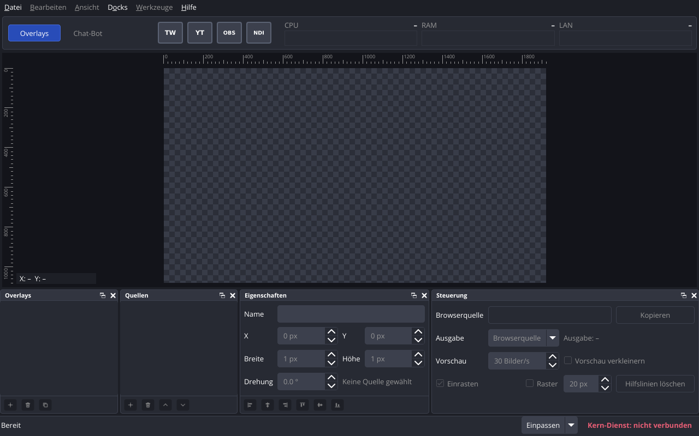
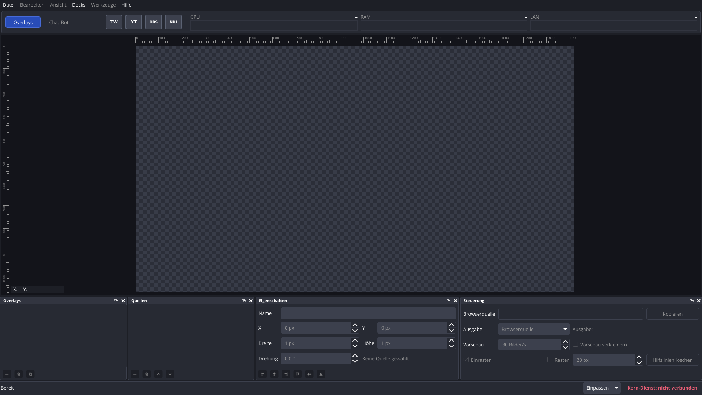
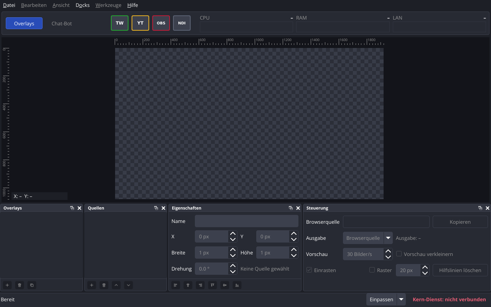

# P06 – Bericht Aussehen wie OBS Studio

Stand: 2026-11-02. Alle Messwerte stammen vom Studio-PC (Debian 13, Kernel 6.12.113+deb13-amd64, Xfce/xfwm4 unter X11, `DISPLAY=:0.0`, `XDG_SESSION_TYPE=x11`, `Xft.dpi: 96`). Kein Xvfb; offscreen nur im Schrifttest, der laut Auftrag ohne Fenster läuft.

Abnahme Punkt 5 (Handtest durch den Nutzer): erledigt am 2026-11-02, alle 3 Schritte in Ordnung, Vergleich mit OBS auf dem Streaming-PC «passt» (Rückmeldung des Nutzers im Chat). Dabei hat der Nutzer die vier Kürzel-Symbole auf dem Studio-PC durch eigene Dateien ersetzt; sie erscheinen einfarbig wie vorgesehen.

## Kurzfassung

| Abnahme | Ergebnis |
|---|---|
| 1. Bau ohne Warnungen mit `-Wall -Wextra`, alle Schalter einzeln abschaltbar | ja: 0 Warnungen im sauberen Neubau, mit jedem Schalter einzeln und mit allen dreien aus; jeder der fünf Teil-Commits einzeln gebaut, je 0 Warnungen |
| 2. `ctest --test-dir build` | 11 von 11 bestanden (neu: `tst_connectionstate`, `tst_windowsize`, `tst_fonts`, `tst_symbols`; `bildschirmfoto` erweitert) |
| 3. Startprüfung `scripts/startpruefung.py --runs 20` | 20/20 sauber in allen drei Fällen |
| 4. Bildschirmfotos im Bericht, Änderungen und Auffälligkeiten aufgelistet | ja: `P06-bilder/fenster-1280x800.png`, `fenster-1920x1080.png`, `zustaende.png`; Vergleich unten |
| 5. Handtest durch den Nutzer | ja: 3 Schritte in Ordnung, Vergleich mit OBS passt (2026-11-02) |

**Es wurde kein Paket installiert.** Für SVG wird weiter `qt6-svg-plugins` 6.8.2-3 genutzt (seit P05 in `scripts/pakete.txt`).

## 1. Design nach OBS «Yami»

Quelle: https://github.com/obsproject/obs-studio, flacher Klon mit `git clone --depth 1 --filter=blob:none --sparse` und `git sparse-checkout set frontend` in den Scratch-Ordner (ausserhalb des Repos). Gelesen: **Commit `65c320b46e1af5c7a555161aea6182cdf7a8c524`** (2026-10-29), derselbe wie der Chat. Dateien: `frontend/data/themes/Yami.obt`, `Yami_Default.ovt` (nur Kopf, keine eigenen Werte: «stub Variant Theme»), `frontend/OBSApp.cpp`, `frontend/OBSApp_Themes.cpp`, Lizenz `COPYING` (GNU GPL Version 2, June 1991).

Aufgelöste Werte: OBS setzt `obsFontScale` und `obsPadding` zur Laufzeit (`frontend/OBSApp_Themes.cpp` Zeile 912 bis 924). Standard:

- `frontend/OBSApp.cpp` **Zeile 420**: `config_set_default_int(userConfig, "Appearance", "FontScale", 10);` → `obsFontScale` = 10.
- `frontend/OBSApp.cpp` Zeile 421: `"Density", 1`; `frontend/OBSApp_Themes.cpp` Zeile 863 bis 878 `getPaddingForDensityId`: für 1 gilt der Anfangswert 4 → `obsPadding` = 4.

Daraus (Rechnung nach den Formeln in `Yami.obt`, Abschnitt `@OBSThemeVars`): `--font_base` 10pt, `--font_small` max(7pt, 8pt) = 8pt, `--padding_base` 2px, `--padding_large` 4px, `--padding_xlarge` 7px, `--padding_wide` 16px, `--padding_menu` 12px, `--padding_menubar` 7px, `--spacing_base` 1,6px, `--spacing_large` 4px, `--spacing_small` 1px, `--input_padding` 4px, `--input_text_padding` 8px, `--input_height_base` 30, `--input_height` 22px, `--input_height_half` 15, `--spinbox_button_height` 14px, `--spinbox_min_width` 55px, `--icon_base` 16px, `--icon_small` 14px.

Umsetzung (alles in `src/app/theme.h/.cpp`, Farben im Struct `Theme`, je mit der Variable aus `Yami.obt` im Kommentar):

| Teil | Übernommen aus `Yami.obt` |
|---|---|
| Fenster, Menüleiste, Menüs | `QWidget`, `QMainWindow`, `QMenuBar::item`, `QMenu::item`, Trennlinien, `QMainWindow::separator` |
| Docks | `OBSDock > QWidget` (→ `QDockWidget > QWidget`), `QDockWidget::title`, Knöpfe im Titel mit `close.svg`/`popout.svg`, `OBSDock QToolBar` (→ `#dockButtons`) |
| Listen | `QListWidget`, `QListView::item` mit Auswahl, Hover, Fokus |
| Eingabefelder, Auswahllisten | `QLineEdit` (auch `:read-only`), `QComboBox` mit `collapse.svg` |
| Zahlenfelder | `QSpinBox`/`QDoubleSpinBox` mit Pfeilknöpfen (Teil 3) |
| Knöpfe | `QPushButton`, `QToolButton` (normal, Hover, gedrückt, gewählt, ausgegraut) |
| Kontrollkästchen | `QCheckBox::indicator` mit den sechs SVG aus `themes/Yami/` |
| Statuszeile | `OBSBasicStatusBar` (→ `QStatusBar`) |
| Bildlaufleisten | `QScrollBar` mit Griff, ohne Pfeile |
| Palette | `--palette_…` (Window, Base, Button, Highlight, Link, Light, Mid, Dark, Text ausgegraut und inaktiv) |
| Leinwand-Umgebung, Lineale, Seite «Chat-Bot» | `--bg_preview` `#13141A` (in OBS `OBSQTDisplay { qproperty-displayBackgroundColor }`) |

Eigene Bereiche ohne Gegenstück in OBS, mit Werten aus Yami gestaltet: Kopfbereich wie ein Dock-Inhalt (`--bg_base`, Rahmen `--border_color`, Radius 4px); Modul-Reiter wie `QTabBar::tab` (Hintergrund `--tab_bg`, gewählt `--primary` mit Rahmen `--primary_light`), aber in 10pt statt `--font_small` (Annahme 1).

Übernommene SVG-Dateien (unverändert, oben ein XML-Kommentar mit Datei, Commit und Lizenz GPL Version 2):

| Datei unter `src/app/symbole/` | Herkunft (`frontend/data/themes/…`) |
|---|---|
| `auswahl-pfeil.svg` | `Dark/collapse.svg` |
| `dock-schliessen.svg`, `dock-loesen.svg` | `Dark/close.svg`, `Dark/popout.svg` |
| `kaestchen-an.svg`, `-an-fokus`, `-an-ausgegraut`, `kaestchen-aus.svg`, `-aus-fokus`, `-aus-ausgegraut` | `Yami/checkbox_checked*.svg`, `Yami/checkbox_unchecked*.svg` |
| `zahlenfeld-hoch.svg`, `zahlenfeld-runter.svg` | `Dark/up.svg`, `Dark/down.svg` |

Diese Bilder stehen im Stylesheet (`image: url(…)`) und werden **nicht** eingefärbt; sie haben die Farben des dunklen OBS-Designs. Für ein helles Design (E-16) braucht es eigene Dateien (OBS hat dafür einen eigenen Ordner, nicht geprüft). Neuer offener Punkt 34.

Abweichungen vom Wert in `Yami.obt`:

| Stelle | Yami | hier | Grund |
|---|---|---|---|
| `--spacing_base` | 1,6px | 2px | Qt-Stylesheets mit ganzen Pixeln geschrieben; wie Qt 1,6px rundet, ist nicht geprüft |
| `QSpinBox { min-width }` | 55px | weggelassen | siehe Teil 3 |
| Rahmen der Verbindungsknöpfe | – | 2px | eigener Knopf, Farbe des Zustands soll gut sichtbar sein |
| «Kern-Dienst: …» | – | `--red1` `#E85E75` / `--green1` `#59D966` | `--red3` als Schrift auf `--bg_base` ist schlecht lesbar (Annahme 2) |
| Schachbrett der Leinwand | – | Werte aus P05 | Auftrag nennt nur Umgebung und Lineale |
| Schriftliste | `'Open Sans', '.AppleSystemUIFont', Helvetica, Arial, 'MS Shell Dlg', sans-serif` | `'Open Sans', Helvetica, Arial, sans-serif` | die zwei Namen gelten nur unter macOS und Windows |

## 2. Schrift Open Sans

| Angabe | Wert |
|---|---|
| Quelle | https://github.com/googlefonts/opensans (offizielles Repo der Schrift bei Google Fonts), flacher Klon, **Commit `bd7e37632246368c60fdcbd374dbf9bad11969b6`** (2023-11-16) |
| Dateien | `fonts/ttf/OpenSans-Regular.ttf`, `fonts/ttf/OpenSans-Bold.ttf` (statisch, keine variable Schrift), `OFL.txt` |
| Version | 3.003 (Namenseintrag 5 der Dateien: «Version 3.003; ttfautohint (v1.8.4)»; `fc-scan`: fontversion 196805 = 0x000300C5, als 16.16-Zahl 3,003) |
| Lizenz | SIL Open Font License 1.1, geprüft an der Quelle: `OFL.txt` im Repo («SIL OPEN FONT LICENSE Version 1.1 - 26 February 2007», Copyright 2020 The Open Sans Project Authors) und Namenseintrag 13/14 der Schriftdateien. Liegt als `src/app/schriften/OFL.txt` neben den Dateien. |
| sha256 | Regular `c53aceea…f8eb59`, Bold `27da758f…10bd1e6`, OFL.txt `01cd5ffb…1c811af7` |
| Familienname | «Open Sans», Stil «Regular» bzw. «Bold» (`fc-scan`) |

Auf dem Studio-PC ist Open Sans nicht installiert (`fc-list | grep -i "open sans"` ohne Ausgabe). `dss-app` lädt beim Start alle `.ttf`/`.otf` aus `src/app/schriften/` mit `QFontDatabase::addApplicationFont` (`src/app/fonts.cpp`, Ordner beim Bau festgelegt wie die Symbole, `DSS_FONT_DIR`) und setzt `QApplication::setFont(QFont("Open Sans", 10))`; das Stylesheet setzt wie Yami `font-size: 10pt; font-family: 'Open Sans', …` für alle Bedienelemente und 8pt fett für die Dock-Titel. Fehlt die Schrift, steht «Schrift «Open Sans» nicht geladen, Qt wählt einen Ersatz» im Protokoll.

Warum Regular und Bold statt der variablen Datei: Fett wird gebraucht (Dock-Titel, Verbindungsknöpfe, Kern-Dienst); ob Qt 6.8.2 bei einer variablen Schrift aus `addApplicationFont` die Stärke «Bold» wählt, ist nicht geprüft. Mit zwei statischen Dateien prüft der Test beide Stile.

Abgeschnittene Beschriftungen: siehe Bildschirmfotos (Teil 5). Mit Open Sans und den Pfeilknöpfen von Yami war bei 1280x800 der Wert «20 px» im Feld «Raster» abgeschnitten; behoben in Teil 3. Danach ist bei 1280x800 und 1920x1080 nichts abgeschnitten (Prüfung mit Augen auf den vergrösserten Ausschnitten, nicht automatisch).

## 3. Pfeile der Zahlenfelder (Punkt 30)

Die Pfeilknöpfe sind nach `Yami.obt` gestaltet: je 22x14 px rechts im Feld, Trennlinie `--bg_base`, Hintergrund ausgegraut `--button_bg_disabled`, Pfeile `up.svg`/`down.svg` aus OBS (Farbe `#fefefe`, also weiss auf `#272A33`). Bild: `P06-bilder/fenster-1280x800.png`, Docks «Eigenschaften» und «Steuerung».

Gefundenes Problem und Lösung: Mit `min-width: 55px` aus Yami setzt Qt eine feste Mindestbreite (Box 67 px), die den `sizeHint` des Feldes übersteuert. Bei 1280x800 bekam das Feld «Raster» nur diese 67 px, davon 22 px Pfeilknöpfe, und «20 px» war abgeschnitten. Gemessen mit vorübergehenden Protokollzeilen (nicht committet): `sizeHint` 90x39, Breite 67. Lösung: `min-width` weggelassen und in `src/app/docks.cpp` jedes Zahlenfeld mit horizontaler Grössenregel `QSizePolicy::Minimum` (nie schmaler als der `sizeHint`); danach Breite 88 px, Wert ganz sichtbar. Die Rechnung von Qt (`QStyleSheetStyle::sizeFromContents`, `CT_SpinBox`) zählt die Breite des Pfeilknopfes zum `sizeHint` dazu; nachgelesen im Quellcode von Qt 6.8.2 (`src/widgets/styles/qstylesheetstyle.cpp`, Zeile 5300 bis 5320). Ein zweiter Versuch (Knöpfe in eigenen Innenabstand verschieben) hat das Eingabefeld zusätzlich verkleinert (Zeile 5845 bis 5870, Knopfbreite wird vom Inhalt abgezogen) und wurde verworfen.

## 4. Verbindungsknöpfe mit vier Zuständen (Punkt 27, 28)

| Zustand | Wert der Eigenschaft `state` | Rahmen | Variable | Tooltip (Beispiel) |
|---|---|---|---|---|
| grau: nicht eingerichtet oder abgeschaltet | `off` | `#5B6273` | `--grey1` | «Twitch: nicht eingerichtet oder abgeschaltet» |
| rot: eingerichtet, aber nicht verbunden | `error` | `#C01C37` | `--red3` | «OBS: eingerichtet, aber nicht verbunden» |
| orange: Verbindungsversuch | `connecting` | `#E5AF24` | `--yellow2` | «YouTube: Verbindungsversuch läuft» |
| grün: verbunden bzw. Ausgabe läuft | `connected` | `#25A231` | `--green3` | «Twitch: verbunden», «NDI: Ausgabe läuft» |

- Zustände und Texte: `src/common/connectionstate.h/.cpp` (nur Qt Core, Test `tst_connectionstate`). Das Fenster ruft `HeaderBar::setConnectionState(Verbindung, Zustand)` bzw. `MainWindow::setConnectionState`; das setzt die Eigenschaft, Tooltip und Namen für Bildschirmleser und poliert den Knopf neu, damit das Stylesheet den neuen Wert sieht. Später ruft das der Kern-Anschluss auf.
- In P06 stehen alle vier Knöpfe auf **grau** (`P06-bilder/fenster-1280x800.png`).
- `dss-app --bildschirmfoto DATEI --zustaende-zeigen`: Twitch grün, YouTube orange, OBS rot, NDI grau (`P06-bilder/zustaende.png`). Ohne `--bildschirmfoto` ist die Option ein falscher Aufruf (Exit-Code 2).
- Grau als Grauton aus Yami: `--grey1` `#5B6273`, der hellste Grauton; er hebt sich vom Knopfhintergrund `--button_bg` (`--grey4` `#3C404D`) ab. Die dunkleren Grautöne wären auf diesem Hintergrund kaum zu sehen (Einschätzung nach dem Bild, nicht gemessen).
- **Symbole einfarbig** (`src/app/symbols.cpp`): Die Datei wird in der Knopfgrösse gezeichnet, dann mit `QPainter::CompositionMode_SourceIn` mit der Textfarbe der Palette gefüllt; die Deckkraft jedes Pixels bleibt wie in der Datei. Für ausgegraute Knöpfe wird ein zweites Bild in der Farbe für ausgegrauten Text abgelegt (`QIcon::Disabled`). Das gilt für alle Symbole aus `loadSymbol` (Verbindungsknöpfe und Knöpfe unter den Listen und in «Eigenschaften»), nicht für die Bilder im Stylesheet (Teil 1).
- Geprüft mit `tst_symbols` (X11-Sitzung): eine selbst erstellte Test-SVG mit Rot, Grün, halbdurchsichtigem Blau und einem Kreis in Orange (nur im Test, in einem temporären Ordner) wird in drei Farben und drei Grössen gefärbt; jedes Pixel mit Deckkraft ab 128 hat die Zielfarbe (±1), die Deckkraft ist gleich wie ungefärbt. Dazu `twitch.svg`, `youtube.svg`, `obs.svg`, `ndi.svg`, `hinzufuegen.svg` normal und ausgegraut mit Farben aus der Palette. Gegenprobe: ohne das Füllen (`fillRect` vorübergehend entfernt) schlagen 8 von 11 Fällen fehl («Farbe bei 0,0: #ff0000 statt #ffffff»).

### Für den Nutzer: eigene Symbole

| Datei | Knopf |
|---|---|
| `twitch.svg` | Twitch |
| `youtube.svg` | YouTube |
| `obs.svg` | OBS |
| `ndi.svg` | NDI |

- Ort: `src/app/symbole/` im Repo (`/home/dominik/DoNs_Streaming_Studio/src/app/symbole/`).
- Format: SVG; die heutigen Dateien haben `viewBox="0 0 64 64"`, angezeigt werden sie in 28x28 Pixeln. Andere quadratische `viewBox` gehen auch (Qt skaliert); nicht quadratische werden mit gleichem Seitenverhältnis kleiner gezeichnet.
- Farbe der Datei ist egal: Jede sichtbare Fläche wird in Textfarbe gezeichnet, durchsichtige Stellen bleiben durchsichtig. Ein Logo mit farbigem Hintergrund wird also zu einer einfarbigen Fläche; geeignet sind einfarbige Umriss- oder Flächensymbole (zum Beispiel die aus `donstv_Studio`, `assets/icons/connections/`).
- Ersetzen: Datei mit **gleichem Namen** ablegen, `dss-app` neu starten. **Kein neuer Bau nötig.**
- Markenhinweis NDI in «Hilfe → Über»: weiter offen (`docs/04-offene-punkte.md`, «Entschieden vor P06»).

## 5. Bildschirmfotos

```
$ python3 tests/bildschirmfoto_pruefen.py build/src/app/dss-app …/bftest      (2026-11-02 18:40, rc 0)
$ cp …/bftest/{bildschirmfoto,zustaende,fenster-1920x1080}.png docs/berichte/P06-bilder/
$ sha256sum docs/berichte/P06-bilder/*.png
40a935a902760cdc07fefc650c793fbe6a1def900030c2f225873ba7d5f88fbc  fenster-1280x800.png
5893d3096a596b3b7b856b8509bd1750c5b879f993cb8d5d97a1f791638af9cb  fenster-1920x1080.png
71a37547fddc2012f924f6b5966c28528022a9d7b824f3929c3cdd98c68d657b  zustaende.png
```

Für 1920x1080 gibt es neu `dss-app --bildschirmfoto DATEI --fenstergroesse 1920x1080` (nur zusammen mit `--bildschirmfoto`, Wert `BREITExHOEHE`, 1 bis 10000, gelesen in `src/common/windowsize.cpp`, Test `tst_windowsize`). Ohne weiteres begrenzt xfwm4 das Fenster auf die Arbeitsfläche: Das erste Bild war 1920x1029 (Leiste unten). Mit `--fenstergroesse` setzt `dss-app` deshalb `Qt::X11BypassWindowManagerHint` (Fenster am Fenstermanager vorbei, nur in diesem Fall).







Vergleich mit `docs/berichte/P05-bilder/fenster-1280x800.png` (Lagen abgelesen aus den Bildern, ±2 px):

| Nr | Stelle | P05 | P06 |
|---|---|---|---|
| 1 | Schrift | DejaVu Sans (Standard von Qt auf dem Studio-PC) | Open Sans 10pt, Dock-Titel 8pt fett; Texte schmaler |
| 2 | Menüleiste | Hintergrund `#1d1f26`, Schrift `#e6e6e6` | `--bg_window` `#1D1F26`, Schrift weiss, ausgegraute Menüs `#969696` |
| 3 | Modul-Reiter | gemeinsamer schwarzer Streifen, gewählt `#4c8dff` | einzelne Reiter wie OBS-Reiter, gewählt `--primary` `#284CB8` mit hellerem Rahmen, nicht gewählt gedämpfte Schrift |
| 4 | Verbindungsknöpfe | alle rot (`#ff7b72`), Radius 6px | alle grau (`#5B6273`), Radius 4px; Symbole weiss statt `#e6e6e6`; beginnen bei x ≈ 290 (gleich) |
| 5 | Leinwand | Umgebung `#13141a`, Lineale `#3c404d` | Umgebung und Lineale `#13141A`; Lineal-Zahlen `#969696`. Die Lineale heben sich nur noch durch Striche und Zahlen ab |
| 6 | Grösse der Leinwand | Leinwand bis y ≈ 543, Lineal 0 bei x ≈ 278 | bis y ≈ 519, Lineal 0 bei x ≈ 300; die Leinwand ist kleiner, weil die Docks höher sind (Nr. 7) |
| 7 | Docks | Oberkante bei y ≈ 556 | Oberkante bei y ≈ 531 (25 px höher): Eingabefelder und Knöpfe nach Yami höher (Innenabstand 4px oben und unten, 2px Aussenabstand), Knopfleiste unter den Listen 32 px |
| 8 | Dock-Titel | `#272a33`, Knöpfe klein und dunkel (Fusion) | `--grey5` `#323540` mit Rahmen und runden oberen Ecken, Knöpfe weiss (`close.svg`, `popout.svg` aus OBS) |
| 9 | Eingabefelder, Auswahl, Knöpfe | dunkel `#1d1f26` mit Rahmen | `--input_bg` `#3C404D`, Radius 4px; ausgegraute Knöpfe `#272A33` |
| 10 | Zahlenfelder | Pfeilfelder ohne sichtbare Pfeile | Pfeile weiss, deutlich sichtbar |
| 11 | Kontrollkästchen | Fusion, angehakt grau gefüllt | Bilder von Yami (Rahmen, Haken), ausgegraut dunkel |
| 12 | Statuszeile | `#272a33`, «Kern-Dienst» `#ff7b72` | `--bg_base` mit Linie oben, «Kern-Dienst» `#E85E75` |
| 13 | Breite der Docks bei 1280 | ≈ 215 / 215 / 352 / 482 | ≈ 217 / 214 / 349 / 488 |

Abgeschnitten oder verrutscht: bei 1280x800 und 1920x1080 keine Beschriftung abgeschnitten, nichts verrutscht. Aufbau, Docks und Beschriftungen sind wie in P05. Auffällig: Nr. 5 (Lineale kaum vom Rand zu unterscheiden, so verlangt) und Nr. 6/7 (Leinwand bei 1280x800 etwa 5 % kleiner).

## Ausgeführte Befehle und Ergebnisse

### Vorbereitung

```
$ git pull                                            → Bereits aktuell (1720ae4)
$ git clone --depth 1 --filter=blob:none --sparse https://github.com/obsproject/obs-studio.git …/scratchpad/obs/src
$ git sparse-checkout set frontend ; git log -1      → 65c320b46e1af5c7a555161aea6182cdf7a8c524 2026-10-29
$ git clone --depth 1 --filter=blob:none --sparse https://github.com/googlefonts/opensans.git …/scratchpad/font/src
$ git sparse-checkout set fonts/ttf ; git log -1     → bd7e37632246368c60fdcbd374dbf9bad11969b6 2023-11-16
$ fc-list | grep -i "open sans"                      → keine Ausgabe
$ xrdb -query | grep -i dpi                          → Xft.dpi: 96
$ LANG=C dpkg-query -W qt6-svg-plugins libqt6svg6 qt6-base-dev
libqt6svg6 6.8.2-3 / qt6-base-dev 6.8.2+dfsg-9+deb13u2 / qt6-svg-plugins 6.8.2-3
$ curl -sSfL -o …/scratchpad/qt/qstylesheetstyle.cpp https://raw.githubusercontent.com/qt/qtbase/v6.8.2/src/widgets/styles/qstylesheetstyle.cpp
```

### Bau (Abnahme 1)

```
$ date '+%F %T %z' → 2026-11-02 18:43:03 +0100
$ rm -rf build && cmake -S . -B build -DCMAKE_BUILD_TYPE=Debug && cmake --build build -j8 > build.log 2>&1 ; echo rc=$?
rc=0
$ grep -c -i -E 'warning|error' build.log         → 0
$ touch src/app/theme.cpp && cmake --build build --verbose 2>&1 | grep -c -- '-Wall -Wextra'   → 1
```

| Schalter (frischer Build-Ordner im Scratch-Ordner) | rc | Warnungen | gebaut |
|---|---|---|---|
| `-DDSS_BUILD_APP=OFF` | 0 | 0 | dss_common, dss-core, dss-cli, tst_version, tst_unixsignals, tst_overlaymodel, tst_canvasview, tst_connectionstate, tst_windowsize, tst_overlaystore |
| `-DDSS_BUILD_TESTS=OFF` | 0 | 0 | dss_common, dss-core, dss-cli, dss-app |
| `-DDSS_BUILD_CLI=OFF` | 0 | 0 | dss_common, dss-core, dss-app, alle Tests einschliesslich tst_fonts, tst_symbols |
| alle drei `OFF` | 0 | 0 | dss_common, dss-core |

`tst_fonts`, `tst_symbols` und `bildschirmfoto` brauchen Qt Gui bzw. `dss-app` und fallen mit `DSS_BUILD_APP=OFF` weg.

Teil-Commits einzeln gebaut (Worktree im Scratch-Ordner, `ctest -E bildschirmfoto`):

| Commit | rc | Warnungen | ctest |
|---|---|---|---|
| Design | 0 | 0 | 5 von 6, `tst_overlaystore` fehlgeschlagen |
| Schrift | 0 | 0 | 6 von 7, dito |
| Zahlenfelder | 0 | 0 | 6 von 7, dito |
| Verbindungsknöpfe | 0 | 0 | 7 von 8, dito |
| Bildschirmfotos und Tests | 0 | 0 | 9 von 10, dito |

Der Fehler in `tst_overlaystore::formatDocExample` tritt nur in einem frischen Checkout auf und schon beim Stand vor P06 (Commit `1720ae4`, gleich geprüft): `media_vorbereiten` erzeugt dort `prototypes/media/` neu, und das neu erzeugte `alpha.webm` hat eine andere Prüfsumme (`cd26e7bf…`) als die Datei im Arbeitsordner (`09445b26…`), auf die das Beispiel in `docs/06-overlay-format.md` verweist. Im Arbeitsordner besteht der Test. Neuer offener Punkt 33.

### Tests (Abnahme 2)

```
$ date '+%F %T %z' ; ctest --test-dir build
2026-11-02 18:52:40 +0100      (nach dem sauberen Neubau; gleiches Ergebnis um 18:40:55)
 1/11 tst_version          Passed
 2/11 tst_unixsignals      Passed
 3/11 tst_overlaymodel     Passed
 4/11 tst_canvasview       Passed
 5/11 tst_connectionstate  Passed
 6/11 tst_windowsize       Passed
 7/11 media_vorbereiten    Passed
 8/11 tst_overlaystore     Passed
 9/11 tst_fonts            Passed
10/11 tst_symbols          Passed
11/11 bildschirmfoto       Passed    4.68 sec
100% tests passed, 0 tests failed out of 11
```

Einzelne Totals: `tst_connectionstate` 7, `tst_windowsize` 23, `tst_symbols` 11, `tst_fonts` 6 (je einschliesslich initTestCase/cleanupTestCase), `tst_canvasview` 21, `tst_overlaymodel` 64, `tst_overlaystore` 18, alle bestanden. Ohne X11 (`env -u DISPLAY ctest -R "bildschirmfoto|tst_symbols"`): beide «Skipped» (Exit-Code 77).

| Test | prüft |
|---|---|
| `tst_fonts` (Plattform offscreen, ohne Fenster) | `loadWindowFonts(src/app/schriften)` liefert genau «Open Sans»; Stile «Regular» und «Bold» vorhanden; `QFontInfo` nennt «Open Sans» normal und fett (kein Ersatz); leerer Ordner gibt Warnung und keine Familie |
| `tst_symbols` (X11) | Einfärbung, siehe Teil 4 |
| `tst_connectionstate` | Namen, Werte von `state` wie im Stylesheet, Texte, 16 verschiedene Texte, Zustände für `--zustaende-zeigen` |
| `tst_windowsize` | 5 gültige, 16 ungültige Angaben |
| `bildschirmfoto` (X11) | 1. Standard: Exit-Code 0, 1280x800, keine Konfiguration geschrieben, 1200 Pixel in Grau `#5B6273`, keine in Grün, Orange, Rot. 2. `--zustaende-zeigen`: 1280x800, Grün 300, Orange 296, Rot 296, Grau 300 Pixel. 3. `--fenstergroesse 1920x1080`: 1920x1080. 4. `--zustaende-zeigen` allein: Exit-Code 2. Die PNG werden mit `zlib` aus der Standardbibliothek gelesen |

### Startprüfung (Abnahme 3)

```
$ python3 scripts/startpruefung.py --runs 20 --out docs/berichte/P06-daten ; echo rc=$?
(Beginn 2026-11-02 18:41:05 +0100; Sitzung vorher geprüft: loginctl Active=yes, light-locker läuft nicht)
rc=0
```

| Fall | sauber | bis Start min / Median / max (ms) | Beenden min / Median / max (ms) |
|---|---|---|---|
| `dss-core`, SIGTERM | 20/20 | 3,7 / 4,9 / 6,3 | 0,7 / 0,8 / 1,4 |
| `dss-core`, SIGINT | 20/20 | 3,6 / 4,7 / 5,6 | 0,7 / 0,9 / 2,6 |
| `dss-app`, SIGTERM | 20/20 | 143,3 / 157,6 / 163,8 | 8,8 / 12,3 / 14,2 |

Alle 60 Starts mit Exit-Code 0, ohne Restprozesse und unerwartete Zeilen; `dss-app` 20 von 20 Mal sichtbar, `fenster.ini` im temporären Ordner geschrieben. Bis zum ersten Zeichnen etwa 158 ms statt 146 ms (P05), also etwa 12 ms mehr (Schriften laden, mehr Stylesheet; Ursache nicht einzeln gemessen). Rohdaten: `docs/berichte/P06-daten/`.

### Nebenwirkung: Fenstereinstellungen des Nutzers neu geschrieben

Beim Messen der Breite des Zahlenfeldes (Teil 3) habe ich einmal `timeout 5 build/src/app/dss-app` **ohne** eigenen `XDG_CONFIG_HOME` gestartet (18:34:39). `dss-app` hat dabei die Anordnung aus `~/.config/dons-streaming-studio/fenster.ini` geladen und beim Beenden durch SIGTERM wieder gespeichert (Datei geändert 18:34:44). Inhalt: dieselbe Anordnung, die beim Start geladen wurde; es gab keine Eingabe dazwischen. Ein Unterschied in Grösse oder Lage ist nicht geprüft (keine Kopie vorher). Zum Zurücksetzen: `rm ~/.config/dons-streaming-studio/fenster.ini`.

## Handtest

Grund (Regel 10): Aussehen und Vergleich mit OBS kann nur der Nutzer prüfen; OBS läuft nicht auf dem Studio-PC. Im Terminal der Xfce-Sitzung, im Ordner des Repos, nach `git pull` und `cmake -S . -B build && cmake --build build -j8`:

1. Auf dem Streaming-PC OBS öffnen (Einstellungen → Darstellung: Design «Yami», Stil «Default», Schriftgrösse und Dichte auf Standard) und auf dem Studio-PC `build/src/app/dss-app` starten. Vergleichen: Farben (Fenster, Docks mit Titelleiste, Eingabefelder, Knöpfe, blaue Auswahl), Schrift und Schriftgrösse, Zahlenfelder mit Pfeilen. Hinweis: Zeigt OBS dort nicht Open Sans, liegt das an der Installation auf dem Streaming-PC (OBS bringt die Schrift nicht mit); prüfen mit `fc-list | grep -i "open sans"` auf dem Streaming-PC.
2. In `dss-app` mit der Maus über die vier Verbindungsknöpfe fahren: Rahmen grau, Tooltip «… : nicht eingerichtet oder abgeschaltet». Dann `docs/berichte/P06-bilder/zustaende.png` öffnen: Rahmen grün, orange, rot, grau gut zu unterscheiden.
3. Fenster mit der Maus auf volle Bildschirmgrösse und dann möglichst klein ziehen: keine Beschriftung und kein Wert in den Zahlenfeldern abgeschnitten.

## Geänderte und neue Dateien

| Datei | Art | Commit (Nummern vor `git pull --rebase` beim Push) |
|---|---|---|
| `src/app/theme.h/.cpp`, `canvaswidget.cpp`, `symbols.h/.cpp` (`symbolDir`), `main.cpp`; `src/app/symbole/auswahl-pfeil.svg`, `dock-*.svg` (2), `kaestchen-*.svg` (6) | geändert / neu | 4cca422 Design |
| `src/app/schriften/OpenSans-Regular.ttf`, `OpenSans-Bold.ttf`, `OFL.txt`, `src/app/fonts.h/.cpp`, `tests/tst_fonts.cpp` neu; `theme.*`, `main.cpp`, `src/app/CMakeLists.txt`, `tests/CMakeLists.txt` geändert | neu / geändert | 2eac10a Schrift |
| `src/app/symbole/zahlenfeld-hoch.svg`, `zahlenfeld-runter.svg` neu; `theme.cpp`, `docks.cpp` geändert | neu / geändert | 611ae30 Zahlenfelder |
| `src/common/connectionstate.h/.cpp`, `tests/tst_connectionstate.cpp` neu; `headerbar.*`, `mainwindow.*`, `symbols.*`, `docks.cpp`, `theme.cpp`, `main.cpp`, `src/common/CMakeLists.txt`, `tests/CMakeLists.txt` geändert | neu / geändert | f42e71b Verbindungsknöpfe |
| `src/common/windowsize.h/.cpp`, `tests/tst_windowsize.cpp`, `tests/tst_symbols.cpp`, `docs/berichte/P06-bilder/` (3), `docs/berichte/P06-daten/` (6) neu; `tests/bildschirmfoto_pruefen.py`, `main.cpp`, `README.md`, `src/common/CMakeLists.txt`, `tests/CMakeLists.txt` geändert | neu / geändert | 560f3d6 Bildschirmfotos und Tests |
| `docs/berichte/P06-bericht.md` neu; `docs/04-offene-punkte.md`, `docs/07-bauplan.md`, `docs/00-uebergabe.md`, `docs/05-quellen.md` geändert | neu / geändert | Bericht-Commit |

Modell (`src/common/overlay*`, `address*`, `tokenstore*`, `canvasview*`), Kern `src/core/` und `src/cli/` (`dss-cli`) sind unverändert. `scripts/` unverändert.

## Nicht erledigt

- Handtest durch den Nutzer (Abnahme 5).
- **[OFFEN]** Punkt 33 (neu): `tst_overlaystore` schlägt in einem frischen Checkout fehl, weil die Testdateien neu erzeugt werden und andere Prüfsummen haben (besteht schon vor P06).
- **[OFFEN]** Punkt 34 (neu): Die Bilder im Stylesheet (Pfeile, Kontrollkästchen, Dock-Knöpfe) sind die Dateien des dunklen OBS-Designs und werden nicht eingefärbt; für E-16 braucht es helle Varianten.
- Nicht geprüft: wie Qt Bruchteile von Pixeln im Stylesheet behandelt (deshalb 2px statt 1,6px).
- Nicht geprüft: Aussehen von Menüs, Auswahlliste offen, Tooltips und Bildlaufleisten (im Bildschirmfoto nicht offen bzw. nicht sichtbar; Listen sind leer).
- Nicht geprüft: Symbole bei Skalierung des Bildschirms (Gerätepixelverhältnis ≠ 1); die Einfärbung zeichnet in der logischen Grösse.
- Nicht Teil des Auftrags: Verbindung zum Kern, echte Zustände, CPU/RAM/LAN, helles Design (E-16), Werte der ausgegrauten Elemente (Punkt 32), Markenhinweis NDI.

## Annahmen

1. **Modul-Reiter** in 10pt (wie die übrige Schrift), Farben wie `QTabBar::tab` in Yami; Yami nimmt für Reiter `--font_small` (8pt). Die Modul-Reiter sind die Hauptnavigation und auf dem Bild des Nutzers so gross wie die übrige Schrift.
2. **Schrift «Kern-Dienst»** in `--red1`/`--green1` statt `--red3`/`--green3` (Lesbarkeit auf `--bg_base`).
3. **Grau der Verbindungsknöpfe** = `--grey1` `#5B6273`.
4. **Open Sans Regular und Bold** als statische Dateien (nicht die variable Datei, nicht weitere Stile).
5. **Schrift- und Symbolordner** werden zur Laufzeit aus dem Quellbaum gelesen (wie P05, Annahme 11): Ein verschobenes Repo braucht einen neuen Bau.
6. **Zahlenfelder** nie schmaler als ihr `sizeHint` (`QSizePolicy::Minimum`); das ist eine Grössenregel, kein Umbau.
7. **`--fenstergroesse`** mit `Qt::X11BypassWindowManagerHint`, nur für Bildschirmfotos.
8. **Zustandstexte** «nicht eingerichtet oder abgeschaltet», «eingerichtet, aber nicht verbunden», «Verbindungsversuch läuft», «verbunden», bei NDI «Ausgabe läuft» (aus der Tabelle in `docs/01-festlegungen.md`).

## Quellen

Abgerufen in dieser Sitzung (2026-11-02):

- OBS Studio, Repo und Commit: https://github.com/obsproject/obs-studio/tree/65c320b46e1af5c7a555161aea6182cdf7a8c524
  - `frontend/data/themes/Yami.obt`, `Yami_Default.ovt`, `Dark/up.svg`, `Dark/down.svg`, `Dark/collapse.svg`, `Dark/close.svg`, `Dark/popout.svg`, `Yami/checkbox_*.svg`
  - `frontend/OBSApp.cpp` Zeile 420 (`FontScale` 10), Zeile 421 (`Density` 1)
  - `frontend/OBSApp_Themes.cpp` Zeile 863 bis 878 (`getPaddingForDensityId`), 912 bis 924 (`obsFontScale`, `obsPadding`)
  - Lizenz: `COPYING` (GNU GPL Version 2)
  - Hinweis im Kopf von `Yami.obt` auf das Theme-System: https://github.com/obsproject/obs-studio/wiki/OBS-Studio-Theme-System (nicht abgerufen)
- Open Sans: https://github.com/googlefonts/opensans, Commit `bd7e37632246368c60fdcbd374dbf9bad11969b6`, Dateien `fonts/ttf/OpenSans-Regular.ttf`, `fonts/ttf/OpenSans-Bold.ttf`, `OFL.txt`
- SIL Open Font License 1.1 (Verweis in den Schriftdateien): http://scripts.sil.org/OFL (nicht abgerufen; Text aus `OFL.txt`)
- Qt 6.8.2, `qstylesheetstyle.cpp`: https://raw.githubusercontent.com/qt/qtbase/v6.8.2/src/widgets/styles/qstylesheetstyle.cpp (Zeile 5300 bis 5320 `CT_SpinBox`, 5845 bis 5870 `SC_SpinBoxEditField`)

Nicht abgerufen (aus dem Wissensstand, im Code als Verweis genannt):

- Qt 6.8, QFontDatabase::addApplicationFont: https://doc.qt.io/qt-6.8/qfontdatabase.html#addApplicationFont
- Qt 6.8, QPainter::CompositionMode: https://doc.qt.io/qt-6.8/qpainter.html#CompositionMode-enum
- Qt 6.8, Style Sheets, Eigenschaften als Selektor und Neuberechnung: https://doc.qt.io/qt-6.8/stylesheet-syntax.html#selector-types
- Qt 6.8, Style Sheets Reference: https://doc.qt.io/qt-6.8/stylesheet-reference.html
- Qt 6.8, Qt::WindowType (`X11BypassWindowManagerHint`): https://doc.qt.io/qt-6.8/qt.html#WindowType-enum
- Qt 6.8, QPalette: https://doc.qt.io/qt-6.8/qpalette.html
- PNG (Third Edition), IHDR und Filter: https://www.w3.org/TR/png-3/#11IHDR, https://www.w3.org/TR/png-3/#9Filters
- CMake 3.31, `SKIP_RETURN_CODE`: https://cmake.org/cmake/help/v3.31/prop_test/SKIP_RETURN_CODE.html
- Debian-Pakete und Systemzustand: Ausgaben von `dpkg-query`, `fc-list`, `fc-scan`, `xrdb`, `loginctl`, `xset` auf diesem Gerät
