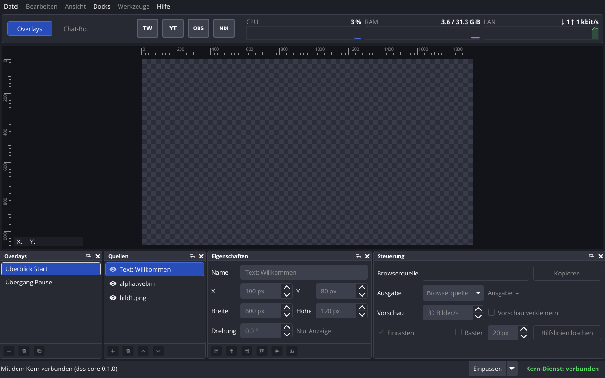
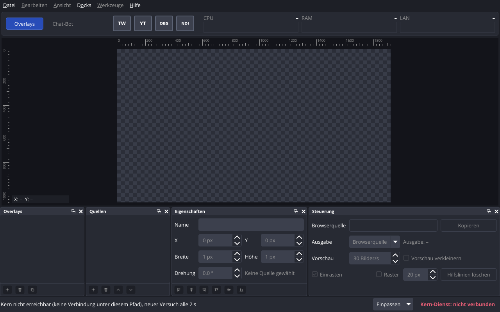

# P07 – Bericht Kern als Dienst, Verbindung Fenster–Kern

Stand: 2026-11-02. Alle Messwerte stammen vom Studio-PC (Debian 13, Kernel 6.12.113+deb13-amd64, Xfce/xfwm4 unter X11, `DISPLAY=:0.0`, systemd 257.13-1~deb13u1, Qt 6.8.2+dfsg-9+deb13u2). Kein Xvfb und kein offscreen: Fenstertests liefen in der aktiven X11-Sitzung (vor jeder Prüfung `loginctl show-session … -p State -p LockedHint` → `State=active`, `LockedHint=no`).

Auftrag: `prompts/P07-kern-dienst.md`. Abnahme Handtest: erledigt am 2026-11-02, alle 5 Schritte in Ordnung (Rückmeldung des Nutzers im Chat; CPU, RAM, LAN mit einer Leistungsanzeige des Systems abgeglichen). Der Nutzer hatte Schritt 1 versehentlich zweimal ausgeführt; dabei entstand wie vorgesehen ein zweites Overlay mit Adresse `handtest-p07-2`, beide wurden beim Aufräumen gelöscht. Schritt 5 lief ohne erneuten Start des Kerns.

## Kurzfassung

| Abnahme | Ergebnis |
|---|---|
| Bau ohne Warnungen mit `-Wall -Wextra`, jeder Schalter einzeln abschaltbar | ja: 0 Warnungen im sauberen Neubau, mit jedem Schalter einzeln und mit allen dreien aus; jeder der 11 P07-Commits einzeln gebaut, je 0 Warnungen |
| `ctest --test-dir build`, auch im frischen Klon | 17 von 17 bestanden im Arbeitsordner und in einem frischen Klon ausserhalb des Repos (neu: `tst_configpaths`, `tst_protocol`, `tst_windowdata`, `tst_systemstats`, `tst_sperre`, `tst_kernverbindung`) |
| Startprüfung `--runs 20` | 20/20 sauber in allen vier Fällen (`core-sigterm`, `core-sigint`, `app-sigterm`, neu `app-kern-sigterm`) |
| Dienstprüfung | bestanden: Start durch das Fenster, 5 × `kill -9` des Kerns (Neustart nach 1,07 bis 1,12 s), Kern läuft nach `kill -9` des Fensters weiter, Kern endet nach normalem Schliessen des letzten Fensters, Einrichten und Entfernen je zweimal |
| Echte Einheit | `dss-core.service` eingerichtet, Zustand `inactive`, `static` (nicht laufend, kein Start bei der Anmeldung) |
| Handtest | ja: 5 Schritte in Ordnung (2026-11-02) |

**Es wurde kein Paket installiert.** Qt Network (`libqt6network6` 6.8.2+dfsg-9+deb13u2) war schon installiert und gehört zu `qt6-base-dev`. Für systemd wird keine Bibliothek gebraucht: Die Meldung an systemd (`sd_notify`) schreibt der Kern selbst auf den Socket aus `NOTIFY_SOCKET` (Protokoll laut sd_notify(3)).

## Teil A – Eigene Symbole

- `src/common/configpaths.*`: `configDir()` (`~/.config/dons-streaming-studio`, über `QStandardPaths::GenericConfigLocation`, folgt `XDG_CONFIG_HOME`), `userSymbolDir()` = `configDir()/symbole`, `findSymbolFile(name, dirs)` (erste vorhandene **Datei**; Namen mit «/» und leere Namen werden abgelehnt).
- `src/app/symbols.*`: `symbolPath()` sucht zuerst im Ordner des Nutzers, dann in `src/app/symbole/`. Gilt für die Verbindungsknöpfe und für die Bilder im Stylesheet (`@symbols@/<datei>` in `theme.cpp`).
- «Hilfe → Über» zeigt «NDI® is a registered trademark of Vizrt NDI AB», wenn der Nutzer ein eigenes `ndi.svg` hat. Wortlaut: https://docs.ndi.video/docs/sdk/licensing.
- Die Dateien des Nutzers (`~/.config/dons-streaming-studio/symbole/twitch.svg`, `youtube.svg`, `obs.svg`, `ndi.svg`, Zeitstempel 19:09) wurden nicht geändert, nicht kopiert und nicht committet. Alle Tests nutzen eigene Ordner (`XDG_CONFIG_HOME` im Build-Ordner bzw. temporäre Ordner).

## Teil B – Punkt 33

Ursache: `formatDocExample` verglich das Beispiel aus `docs/06-overlay-format.md` mit einem Datenordner, in dem die Medien unter ihrer Prüfsumme liegen. In einem frischen Klon erzeugt `media_vorbereiten` `alpha.webm` neu, mit `ffmpeg` und anderer Prüfsumme (gemessen, siehe unten), also fehlte die Datei, auf die das Beispiel verweist.

Lösung: Der Test liest die Verweise `media/<64 Hex>.<Endung>` aus dem Beispiel und legt die Testdateien unter genau diesen Namen in den temporären Datenordner (png → `bild1.png`, webm → `alpha.webm`, ttf → DejaVu Sans). Die Prüfsumme wird nicht verlangt. Begründung: Der Test prüft das Format der Overlay-Datei (Laden, Felder, Speichern), nicht die Prüfsumme der Testmedien; den Namen aus der Prüfsumme prüft `tst_overlaystore` an anderer Stelle (`tests/tst_overlaystore.cpp:295`).

Prüfung im frischen Klon (`git clone` nach `…/scratchpad/klon-b`, 2026-11-02 19:32:12): 12 von 12 bestanden, 0 Warnungen. Dort neu erzeugtes `alpha.webm`: sha256 `2c268e62…`, im Arbeitsordner `09445b26…`. Gegenprobe im selben Klon mit dem alten Test (Stand `4dac87e`): «FAIL! formatDocExample Compared lists have different sizes». Am Ende von P07 noch einmal: frischer Klon `…/scratchpad/klon-p07` (2026-11-02 20:09:27, Stand `1f11b0d`): 17 von 17 bestanden, 0 Warnungen.

## Teil C – Kern als Benutzerdienst

- `scripts/dienst-einrichten.sh` schreibt `~/.config/systemd/user/dss-core.service` (über eine temporäre Datei; unverändert → «unverändert»), führt `systemctl --user daemon-reload` aus und startet die Einheit **nicht**. `--entfernen` hält an und löscht; fehlt die Einheit, meldet es «nicht vorhanden» mit Exit-Code 0. Der Pfad zu `dss-core` wird aus dem Ort des Skripts ermittelt (`build/src/core/dss-core`). Für Prüfungen: `--einheit`, `--datenordner`, `--verbindung`.
- Einheit: `Type=notify`, `Restart=on-failure`, `RestartSec=1s`, `RestartPreventExitStatus=3`, `ExecReload=/bin/kill -HUP $MAINPID`, kein Abschnitt `[Install]` (Zustand `static`, kein Start bei der Anmeldung). Protokoll im Journal (`journalctl --user -u dss-core.service`).
- `dss-core`: neue Optionen `--datenordner PFAD`, `--verbindung PFAD`. Sperre `<Datenordner>/kern.lock` (`QLockFile`, `staleLockTime` 0, damit eine alte Sperre eines laufenden Kerns gültig bleibt). Zweiter Kern → Exit-Code 3 mit «Datenordner ist gesperrt von dss-core (PID …)». SIGHUP lädt den Datenordner neu. Meldet `READY=1`, sobald die Verbindung offen ist, und `STOPPING=1` beim Beenden.
- `dss-cli`: `overlay-liste` und `quelle-liste` gehen immer (laden nur lesend: legen keinen Ordner an, erzeugen keinen Token, ändern keine Rechte). Alle anderen Befehle nehmen die Sperre; läuft der Kern, brechen sie mit Exit-Code 3 ab: «Kern läuft (Datenordner gesperrt …). Zuerst anhalten: systemctl --user stop dss-core.service».
- Fenster: startet `systemctl --user start dss-core.service`, wenn der erste Verbindungsversuch scheitert. Beim normalen Schliessen schickt es `quit_request`; der Kern beendet sich nur, wenn kein anderes Fenster (`program` = `dss-app`) verbunden ist. Stürzt das Fenster ab, läuft der Kern weiter.

## Teil D – Verbindung Fenster–Kern

Vollständig beschrieben in `docs/08-kern-schnittstelle.md` (neu). Kurz: Unix-Socket `$XDG_RUNTIME_DIR/dons-streaming-studio/kern.sock` (Ordner 0700, `QLocalServer::UserAccessOption`), JSON, eine Nachricht pro Zeile, höchstens 16 MiB pro Zeile, Versionsnummer `protocol_version` 1 in `hello`. Nachrichten: `hello`, `get_overlay_list`, `get_overlay`, `quit_request` (Fenster → Kern); `hello`, `overlay_list`, `overlay`, `overlay_changed`, `overlay_removed`, `stats` (jede Sekunde), `connections` (alle vier `off`), `quit_reply`, `error` (Kern → Fenster). Kein Token in einer Nachricht (geprüft in `tst_protocol::overlayHasNoToken` und `tst_kernverbindung::tokenNeverSent`). Mehrere Fenster gleichzeitig erlaubt. Pfade über 107 Byte lehnt der Kern mit klarer Meldung ab (unix(7): `sun_path` 108 Byte).

## Teil E – Leistungswerte

`src/common/systemstats.*`, Quellen proc_stat(5), proc_meminfo(5), proc_pid_net(5):

- CPU: belegt = user + nice + system + irq + softirq + steal; gesamt = belegt + idle + iowait; Prozent aus der Differenz zweier Messungen.
- RAM: belegt = `MemTotal` − `MemAvailable`.
- LAN: Karte der Standardroute aus `/proc/net/route` (Ziel und Maske `00000000`, Flag `RTF_UP` 0x1 aus `/usr/include/linux/route.h`, bei mehreren die kleinste Metrik), Bytes aus `/proc/net/dev` (Feld 1 empfangen, Feld 9 gesendet), umgerechnet in kbit/s (1 kbit = 1000 bit). Ohne Standardroute: «–».
- Feste Testdaten: `tests/daten/proc/messung1`, `messung2`, `ohne-route` (Kopien von `/proc` des Studio-PCs, 2026-11-02 19:48:24 +0100). Erwartet und geprüft: CPU 100·33/804 %, RAM 3 713 872 von 32 809 248 KiB belegt, je 132 Byte in 1 s → 1,056 kbit/s, Karte `enx2aea2d88f6c1`.

## Teil F – Fenster



`P07-bilder/fenster-verbunden.png`: Testkern mit zwei Overlays (Testdaten wie im Handtest), «Überblick Start» und dessen erste Quelle gewählt. Statuszeile «Kern-Dienst: verbunden» grün, CPU, RAM, LAN mit Verlauf (hier nach 3,5 s), Leinwand mit Lineal bis 1920, Quellen mit Auge-Symbol (vorderste oben), Eigenschaften ausgegraut mit Hinweis «Nur Anzeige». Die Verbindungsknöpfe zeigen den Zustand vom Kern (alle `off`, grau). Die Kürzel stammen aus `src/app/symbole/`, weil das Bild mit eigenem `XDG_CONFIG_HOME` entstand.



`P07-bilder/fenster-ohne-kern.png`: kein Kern an der Verbindung. Statuszeile «Kern-Dienst: nicht verbunden» rot, Grund links («Kern nicht erreichbar (keine Verbindung unter diesem Pfad), neuer Versuch alle 2 s»), alle Docks leer, CPU/RAM/LAN «–».

Aufbereitung der Daten (Texte, Verlauf über 60 Werte, Reihenfolge der Quellen, Tooltips) liegt in `src/common/windowdata.*` und wird in `tst_windowdata` ohne Qt Gui geprüft. Die Verbindung (`src/common/coreclient.*`) ist ebenfalls ohne Qt Gui und wird in `tst_kernverbindung` gegen einen echten Kern geprüft. Das Fenster zeigt nur an.

Fehler, die erst die Tests in P07 gefunden haben, mit eigenem Commit behoben:

1. `823d5e5`: `QLocalSocket` meldet `errorOccurred`, solange der Zustand noch «Connecting» ist (Qt 6.8.2, `QLocalSocketPrivate::setErrorAndEmit`, https://code.qt.io/cgit/qt/qtbase.git/tree/src/network/socket/qlocalsocket_unix.cpp?h=v6.8.2). Die Abfrage auf «Unconnected» verhinderte deshalb den Start der Einheit. Gefunden durch `tst_kernverbindung::unitStartFailureIsShown`. Die Bildschirmfotos und die Startprüfung hatten das nicht gezeigt, weil dort die Einheit nicht gestartet wird.
2. `01610b4`: Qt nennt «Datei fehlt» (ENOENT) «Invalid name»; die Statuszeile zeigt jetzt einen deutschen Grund (`socketErrorText`).
3. `1f11b0d`: `--bildschirmfoto` mit `--verbindung` wartete ohne Grenze auf einen Kern; jetzt höchstens 10 s, dann Bild ohne Verbindung.

## Ausgeführte Befehle und Ergebnisse

### Bau

```
$ date '+%F %T %z' → 2026-11-02 20:06:41 +0100
$ cmake -S . -B <scratch>/bau/<variante> <Schalter> && cmake --build <scratch>/bau/<variante> -j8 ; grep -c 'warning:'
```

| Variante (frischer Build-Ordner im Scratch-Ordner) | rc | Warnungen | gebaut |
|---|---|---|---|
| voll | 0 | 0 | dss-app, dss-cli, dss-core, 15 Tests |
| `-DDSS_BUILD_APP=OFF` | 0 | 0 | dss-cli, dss-core, 12 Tests (ohne tst_fonts, tst_symbols, bildschirmfoto) |
| `-DDSS_BUILD_TESTS=OFF` | 0 | 0 | dss-app, dss-cli, dss-core |
| `-DDSS_BUILD_CLI=OFF` | 0 | 0 | dss-app, dss-core, 15 Tests (`tst_sperre` ohne den Fall mit dss-cli) |
| alle drei `OFF` | 0 | 0 | dss-core |

`ctest` in den Varianten: «App aus» 14 von 14, «CLI aus» 17 von 17 bestanden.

Jeder P07-Commit einzeln gebaut (frischer Klon, `git checkout <commit>; cmake --build build -j8`): alle 11 Commits rc 0, 0 Warnungen, 0 Fehler.

### Tests

```
$ ctest --test-dir build --output-on-failure      (Arbeitsordner, Endstand)
17/17 bestanden: tst_version, tst_unixsignals, tst_overlaymodel, tst_canvasview, tst_connectionstate,
tst_windowsize, media_vorbereiten, tst_overlaystore, tst_configpaths, tst_protocol, tst_windowdata,
tst_systemstats, tst_sperre, tst_kernverbindung, tst_fonts, tst_symbols, bildschirmfoto
$ git clone /home/dominik/DoNs_Streaming_Studio <scratch>/klon-p07 && cmake … && ctest   (2026-11-02 20:09:27)
0 Warnungen, 17/17 bestanden (Total 31.67 s)
```

Erster Lauf (vor den Korrekturen): 2 Fehler. `tst_sperre::oldLockOfRunningProcessStaysValid` enthielt eine falsche Gegenprobe (ein `QLockFile` mit Standardwert hält die Sperre eines **laufenden** Prozesses nicht für verwaist, weil Qt zuerst prüft, ob der Prozess lebt); die Gegenprobe wurde entfernt. `tst_kernverbindung::unitStartFailureIsShown` fand Fehler 1 oben.

Neue Tests (Fälle):

| Test | Fälle | Inhalt |
|---|---|---|
| `tst_configpaths` | 8 | `XDG_CONFIG_HOME`, Datei des Nutzers vor eingebauter, Ordner mit Symbolname ist keine Datei, Pfade statt Namen abgelehnt, Wortlaut NDI-Hinweis |
| `tst_symbols` | +1 | `userSymbolOverridesBuiltin` |
| `tst_protocol` | 20 | jede Nachricht hin und zurück, ungültige Felder, Zeilen zu lang, kein Token |
| `tst_windowdata` | 4 | Texte CPU/RAM/LAN, Verlauf, Reihenfolge der Quellen, Statustexte |
| `tst_systemstats` | 10 | feste Daten aus `tests/daten/proc`, ohne Standardroute, fehlende Dateien, echtes `/proc` |
| `tst_sperre` | 8 | Sperre, Ordner anlegen, alte Sperre bleibt gültig, nur lesend laden schreibt nichts, zweiter Kern Exit 3, Pfad zu lang Exit 1, nach `kill -9` keine Sperre übrig, `dss-cli` nur lesend bei laufendem Kern |
| `tst_kernverbindung` | 15 | `dss-core` als Prozess: Begrüssung, Liste, ganzes Overlay gleich dem Stand im Store, Leistungswerte jede Sekunde, kein Token in allen Zeilen, Fehlerfälle, falsche Version trennt, zu lange Zeile trennt, Neu laden (SIGHUP) schickt geänderte und entfernte Overlays an alle, Beenden abgelehnt bei zweitem Fenster, Neuverbindung nach `kill -9` und Neustart, Beenden angenommen (Exit 0, Socket entfernt), Grund bei fehlender Verbindung, Grund bei fehlender Einheit |

### Startprüfung

```
$ python3 scripts/startpruefung.py --runs 20 --out docs/berichte/P07-daten   (Endstand, Beginn 2026-11-02 20:14:29 +0100)
```

| Fall | Beginn | sauber | Start ms (min / Median / max) | Beenden ms (min / Median / max) |
|---|---|---|---|---|
| `core-sigterm` | 20:14:29 | 20/20 | 13.4 / 15.3 / 20.0 | 1.3 / 1.6 / 1.9 |
| `core-sigint` | 20:15:00 | 20/20 | 13.8 / 17.7 / 21.9 | 1.4 / 1.6 / 3.6 |
| `app-sigterm` | 20:15:30 | 20/20 | 143.2 / 160.0 / 177.1 | 9.1 / 11.9 / 16.4 |
| `app-kern-sigterm` | 20:16:04 | 20/20 | 145.6 / 158.7 / 169.5 | 11.5 / 13.4 / 16.0 |

`core-*`: eigener Datenordner und eigene Verbindung je Fall. `app-sigterm`: `--verbindung` ohne Kern und `--einheit dss-startpruefung-gibt-es-nicht.service` (das Fenster versucht den Start, er scheitert, das Fenster läuft weiter). `app-kern-sigterm`: vor jedem Start ein eigener `dss-core`; sauber heisst zusätzlich, dass der Kern mit 0 endet und «Beenden erbeten von dss-app» meldet. Einzelwerte: `docs/berichte/P07-daten/startpruefung-*.json` und `.md`. Ein erster Lauf um 19:59:51 (vor den Korrekturen 2 und 3) ergab ebenfalls 20/20 in allen Fällen.

### Dienstprüfung

```
$ python3 scripts/dienstpruefung.py --kills 5 --out docs/berichte/P07-daten   (Endstand, 2026-11-02 20:16:38 +0100)
Ergebnis: bestanden (47 Prüfpunkte, alle ok)
```

Eigene Einheit `dss-core-pruefung.service` mit eigenem Datenordner (Testdaten wie im Handtest, mit `dss-cli` angelegt) und eigener Verbindung; `dss-app` mit eigenem `XDG_CONFIG_HOME`. Zeiten mit `time.monotonic()` im Skript, Abfrage von `systemctl --user show` alle 20 ms, Journal alle 50 ms.

| Schritt | Ergebnis |
|---|---|
| Einrichten zweimal | «geschrieben», dann «unverändert»; `systemd-analyze --user verify` ohne Meldung; `static`, `inactive` |
| Fenster startet den Kern | Einheit `active` nach 0,187 s, Fenster verbunden nach 0,191 s (ab Start von `dss-app`) |
| `kill -9` des Kerns, 5 Mal (mindestens 3 s Abstand wegen der Startbegrenzung) | Neustart (neue MainPID, `active`) nach 1,067 / 1,116 / 1,073 / 1,077 / 1,087 s; `NRestarts` jedes Mal +1; Fenster wieder verbunden nach 1,844 / 2,725 / 1,734 / 2,709 / 1,699 s (Neuversuch des Fensters alle 2 s) |
| `kill -9` des Fensters | Kern meldet «Verbindung getrennt: dss-app», läuft nach 3 s mit derselben PID weiter |
| Zwei Fenster, erstes normal geschlossen (SIGTERM) | Exit 0, «Kern läuft weiter: 1 andere Fenster verbunden», Kern läuft weiter |
| Zweites Fenster normal geschlossen | Exit 0, «Kern beendet sich», Einheit `inactive` nach 0,025 s, `Result=success`, nach 3 s keine neue Startzeile im Journal (kein Neustart) |
| Entfernen zweimal | «entfernt», dann «nicht vorhanden»; systemd kennt die Einheit nicht mehr |

Ein erster Lauf um 19:59:18 (vor den Korrekturen 2 und 3) war ebenfalls bestanden (Neustart 1,060 bis 1,116 s). Einzelwerte, Journal und Protokolle der Fenster: `docs/berichte/P07-daten/dienstpruefung.json`.

### Echte Einheit

```
$ scripts/dienst-einrichten.sh --entfernen --einheit dss-core-test.service   (Testeinheit der Handprobe)
angehalten: dss-core-test.service
entfernt: /home/dominik/.config/systemd/user/dss-core-test.service
$ scripts/dienst-einrichten.sh
geschrieben: /home/dominik/.config/systemd/user/dss-core.service
ExecStart: "/home/dominik/DoNs_Streaming_Studio/build/src/core/dss-core"
Zustand: inactive (Start durch das Fenster dss-app oder: systemctl --user start dss-core.service)
$ systemctl --user show dss-core.service -p ActiveState -p UnitFileState
ActiveState=inactive
UnitFileState=static
$ systemctl --user show dss-core.service -p StartLimitIntervalUSec -p StartLimitBurst
StartLimitIntervalUSec=10s
StartLimitBurst=5
```

Handprobe vor dem Skript (Testeinheit `dss-core-test.service`, eigene Daten): `systemd-analyze --user verify` ohne Meldung, Start in 0,057 s, Journal «systemd: bereit gemeldet», nach `kill -9` neue PID nach 1,101 s, nach SIGTERM `inactive` ohne Neustart.

### Rauchtest des Kerns und Bildschirmfotos

Rauchtest (Teil D, eigener Datenordner, rohe Verbindung): zweiter Kern rc 3; `dss-cli overlay-liste` rc 0, `overlay-neu` rc 3; ohne `hello` → `error hello_missing`; nach `hello`: Liste, Verbindungen, Leistungswerte; `quit_request` → `quit_reply accepted`, Kern Exit 0.

```
$ dss-cli --datenordner <scratch>/bild/daten overlay-neu "Überblick Start" 1920 1080 … quelle-bild, quelle-video --wiederholen, quelle-text, quelle-geometrie 3 100 80 600 120 0
$ dss-core --datenordner <scratch>/bild/daten --verbindung $XDG_RUNTIME_DIR/dss-XXXXXX/kern.sock &
$ XDG_CONFIG_HOME=<scratch>/bild/cfg dss-app --verbindung …/kern.sock --bildschirmfoto docs/berichte/P07-bilder/fenster-verbunden.png
info Kern beendet sich / beendet, Exit-Code 0 ; Kern rc 0
$ XDG_CONFIG_HOME=<scratch>/bild/cfg dss-app --verbindung …/kern.sock --bildschirmfoto docs/berichte/P07-bilder/fenster-ohne-kern.png
info Kein Kern nach 10 s, Bildschirmfoto ohne Verbindung / Bildschirmfoto gespeichert (1280x800)
```

`dss-core --gibt-es-nicht; echo $?` → 1 (Exit-Code bei falschem Aufruf, in `docs/08` korrigiert).

## Handtest

Grund (Regel 10): Aussehen und Bedienung des Fensters mit den eigenen Symbolen des Nutzers und der Schliessknopf des Fenstermanagers lassen sich hier nicht automatisch prüfen (Punkt 14/43, `xdotool` fehlt). Was oben geprüft ist (Neustart nach Absturz, Sperre, Nachrichten), muss der Nutzer nicht wiederholen. Im Terminal der Xfce-Sitzung, im Ordner des Repos, nach `git pull` und `cmake -S . -B build && cmake --build build -j8`:

1. Overlay anlegen (der Kern läuft nicht, also geht das):
   `build/src/cli/dss-cli overlay-neu "Handtest P07" 1280 720 && build/src/cli/dss-cli quelle-bild handtest-p07 prototypes/media/bild1.png && build/src/cli/dss-cli quelle-text handtest-p07 "Hallo" /usr/share/fonts/truetype/dejavu/DejaVuSans.ttf`
   Dann `build/src/app/dss-app &` starten. Erwartet: unten rechts «Kern-Dienst: verbunden» grün; Verbindungsknöpfe mit den eigenen Symbolen; «Hilfe → Über» zeigt den NDI-Hinweis; CPU, RAM, LAN ändern sich jede Sekunde und passen ungefähr zu `top` (LAN misst die Karte der Standardroute, zurzeit `enx2aea2d88f6c1`).
2. Im Dock «Overlays» «Handtest P07» anklicken. Erwartet: Quellen «Text: Hallo» (oben) und «bild1.png» mit Auge-Symbol; Lineal der Leinwand bis 1280; eine Quelle anklicken zeigt ihre Werte ausgegraut.
3. `systemctl --user stop dss-core.service` → Statuszeile rot, alle Docks leer. Dann `systemctl --user start dss-core.service` → nach höchstens 2 s wieder grün, Liste wieder da.
4. Fenster mit dem Schliessknopf (×) schliessen, dann `systemctl --user is-active dss-core.service` → `inactive` (der Kern hat sich mit dem letzten Fenster beendet).
5. Aufräumen: `systemctl --user stop dss-core.service; build/src/cli/dss-cli overlay-loeschen handtest-p07 && build/src/cli/dss-cli overlay-liste; systemctl --user start dss-core.service` → die Liste enthält «Handtest P07» nicht mehr. Der Kern läuft danach, bis ein Fenster normal geschlossen wird oder `systemctl --user stop dss-core.service`. Die Kopie von `bild1.png` unter `~/.local/share/dons-streaming-studio/media/` bleibt liegen (Punkt 24).

## Geänderte und neue Dateien

Neu:
- `src/common/configpaths.*`, `datalock.*`, `systemdnotify.*`, `systemstats.*`, `protocol.*`, `coreclient.*`, `windowdata.*`
- `src/core/coreservice.*`
- `src/app/gaugewidget.*`, `src/app/symbole/auge.svg`, `auge-zu.svg` (eigene Zeichnung)
- `scripts/dienst-einrichten.sh`, `scripts/dienstpruefung.py`
- `tests/tst_configpaths.cpp`, `tst_protocol.cpp`, `tst_windowdata.cpp`, `tst_systemstats.cpp`, `tst_sperre.cpp`, `tst_kernverbindung.cpp`, `prozesshilfe.h`, `tests/daten/proc/…` (12 Dateien)
- `docs/08-kern-schnittstelle.md`, `docs/berichte/P07-bericht.md`, `P07-bilder/` (2 Bilder), `P07-daten/` (Start- und Dienstprüfung)

Geändert:
- `src/common/overlaystore.*` (nur lesend laden), `tokenstore.*`, `unixsignals.*` (SIGHUP), `connectionstate.*`, `src/common/CMakeLists.txt` (Qt Network)
- `src/core/main.cpp`, `src/core/CMakeLists.txt`; `src/cli/main.cpp`
- `src/app/main.cpp`, `mainwindow.*`, `docks.*`, `headerbar.*`, `canvaswidget.*`, `symbols.*`, `theme.*`, `src/app/CMakeLists.txt`; `CMakeLists.txt`
- `tests/CMakeLists.txt`, `tst_overlaystore.cpp` (Punkt 33), `tst_symbols.cpp`; `scripts/startpruefung.py`
- `docs/06-overlay-format.md`, `docs/00-uebergabe.md`, `docs/04-offene-punkte.md`, `docs/05-quellen.md`, `docs/07-bauplan.md`, `README.md`

Ausserhalb des Repos (nicht committet): `~/.config/systemd/user/dss-core.service` (eingerichtet, nicht laufend). Die Testeinheiten `dss-core-test.service` und `dss-core-pruefung.service` sind entfernt.

## Nicht erledigt

- Handtest durch den Nutzer (oben).
- Schliessknopf des Fenstermanagers nicht automatisch geprüft (Punkt 43).
- Verhalten nach Erreichen der Startbegrenzung von systemd (5 Neustarts in 10 s) nicht geprüft (Punkt 36).
- Tests mit dem Streaming-PC (Netzwerk fehlt) sind nicht Teil von P07.

## Annahmen

- CPU ohne `guest`/`guest_nice` (Punkt 38). LAN-Verlauf als Summe aus Empfangen und Senden (Punkt 38). LAN misst die Karte der Standardroute (Punkt 39).
- Reihenfolge der Quellen im Dock: vorderste oben wie OBS (Punkt 40).
- Nur Verbindungen mit `program` = `dss-app` zählen als Fenster, wenn der Kern über das Beenden entscheidet (`docs/08`).
- Das Fenster startet die Einheit einmal je Start (Punkt 35). Abstand der Neuversuche 2 s.
- Augen-Symbole selbst gezeichnet, weil OBS kein Symbol für «unsichtbar» als eigene Datei hat.
- Feste Testdaten aus `/proc` enthalten Namen der Netzwerkkarten und private Adressen des Heimnetzes (172.20.10.x); keine Zugangsdaten.

## Quellen

- Auftrag: `prompts/P07-kern-dienst.md`
- NDI-Markenhinweis: https://docs.ndi.video/docs/sdk/licensing
- Qt 6.8: https://doc.qt.io/qt-6.8/qstandardpaths.html, https://doc.qt.io/qt-6.8/qlocalserver.html (`UserAccessOption`, `removeServer`), https://doc.qt.io/qt-6.8/qlocalsocket.html, https://doc.qt.io/qt-6.8/qlockfile.html (`setStaleLockTime`)
- Qt 6.8.2 Quelltext `qlocalsocket_unix.cpp`: https://code.qt.io/cgit/qt/qtbase.git/tree/src/network/socket/qlocalsocket_unix.cpp?h=v6.8.2 (abgerufen über https://raw.githubusercontent.com/qt/qtbase/v6.8.2/src/network/socket/qlocalsocket_unix.cpp)
- Linux: unix(7) https://man7.org/linux/man-pages/man7/unix.7.html, proc_stat(5) https://man7.org/linux/man-pages/man5/proc_stat.5.html, proc_meminfo(5) https://man7.org/linux/man-pages/man5/proc_meminfo.5.html, proc_pid_net(5) https://man7.org/linux/man-pages/man5/proc_pid_net.5.html, `/usr/include/linux/route.h` (linux-libc-dev 6.12.113-1, lokal)
- systemd: https://www.freedesktop.org/software/systemd/man/latest/systemd.service.html, https://www.freedesktop.org/software/systemd/man/latest/systemd.unit.html, https://www.freedesktop.org/software/systemd/man/latest/systemctl.html, https://www.freedesktop.org/software/systemd/man/latest/sd_notify.html, https://www.freedesktop.org/software/systemd/man/latest/systemd-system.conf.html, https://www.freedesktop.org/software/systemd/man/latest/org.freedesktop.systemd1.html
