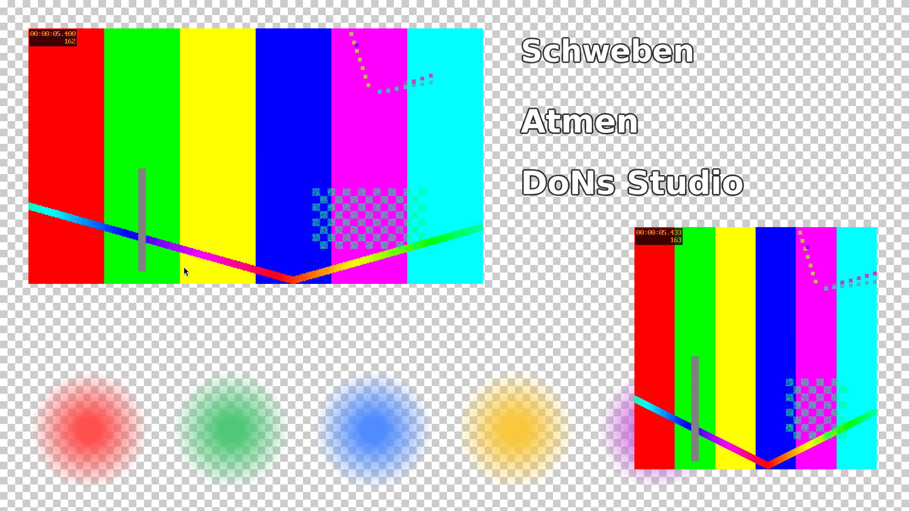
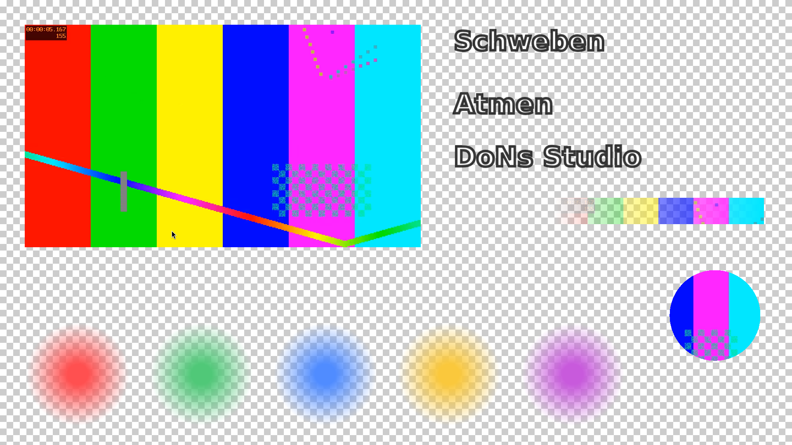

# P01 – Bericht Messprototypen T-01 und T-02

Stand: 2026-11-02. Alle Messwerte stammen vom Studio-PC (Debian 13, Kernel 6.12.113+deb13-amd64, Xfce/xfwm4 unter X11 mit eingeschaltetem Compositing, `DISPLAY=:0.0`, Bildschirm 1920x1080 bei 60 Hz). Kein Xvfb, kein offscreen.

Abnahme Punkt 4 (Nutzer hat Bericht und Bildschirmfotos geprüft): **[OFFEN]**, steht aus.

## Kurzfassung

| | A: C++ / Qt 6 | B: Kern + Qt WebEngine (Chromium) | C: Python / PyQt6 |
|---|---|---|---|
| Gebaut | ja, ohne Warnung | ja, ohne Warnung (Fenster in C++) | entfällt (kein Bauschritt) |
| Gestartet | ja | ja | ja |
| T-01: saubere Starts | 20 von 20 | 20 von 20 | 20 von 20 |
| T-01: erstes Bild, Median | 105,6 ms | 959,7 ms | 159,2 ms |
| T-02: Bildrate (Ziel 30) | 30,0, keine Einbrüche | 30,0, 3 Abstände > 50 ms | 30,0, keine Einbrüche |
| T-02: CPU gesamt, Mittel | 9,8 % | 8,6 % | 10,4 % |
| T-02: CPU der Prozesse, Mittel (100 % = 1 Kern) | 59,2 % | 56,5 % | 70,4 % |
| T-02: RAM der Prozesse (PSS bei 30 s) | 493,9 MiB | 358,8 MiB | 508,3 MiB |
| T-02: GPU-Auslastung, Mittel | 11,0 % | 34,0 % | 10,7 % |
| T-02: WebM-Alpha korrekt | **nein**, deckendes Rechteck | **ja** | **nein**, deckendes Rechteck |

## Prototypen

| Variante | Ordner | Aufbau |
|---|---|---|
| A | `prototypes/a-cpp-qt/` | C++17, QWidget mit QPainter (Software-Zeichnen), Video über Qt Multimedia (QMediaPlayer, QVideoSink, `QVideoFrame::toImage`) |
| B | `prototypes/b-web/` | Kern `core/core.py` (Python-Standardbibliothek, HTTP mit Range) liefert Seite und Testdateien aus; Fenster `host/` (C++, QWebEngineView) zeigt die Seite. Overlay als HTML/CSS, Video mit `<video>` |
| C | `prototypes/c-pyqt/` | gleicher Aufbau wie A, in Python mit PyQt6 |

Gemeinsamer Inhalt von T-02 (alle drei gleich, Lage in ganzen Pixeln):

| Nr. | Quelle | Lage x, y, Breite x Höhe |
|---|---|---|
| 1 | Video `video.webm` (VP9, 960x540, 30 Bilder/s, 10 s, Schleife) | 60, 60, 960x540 |
| 2 | WebM mit Alpha `alpha.webm` (VP9 yuva420p, 512x512, 30 Bilder/s, 10 s, Schleife) | 1340, 480, 512x512 |
| 3–7 | Bilder `bild1.png` … `bild5.png` (256x256, RGBA, weiche Scheiben) | x = 60, 360, 660, 960, 1260; y = 780 |
| 8 | Text «Schweben» (Schweben: ±12 px, Periode 3 s) | 1100, 80 |
| 9 | Text «Atmen» (Atmen: Skalierung 1 ± 0,06, Periode 2,5 s) | 1100, 220 |
| 10 | Text «DoNs Studio» (Schweben und Atmen) | 1100, 360 |

Hintergrund: Schachbrett 16x16 px, hellgrau/weiss. Schrift: DejaVu Sans, fett, 64 px, mit dunkler Kontur.

Inhalt der Alpha-Testdatei: eine kreisende Scheibe, voll deckend; oben ein 64 px hoher Streifen mit Alpha-Verlauf von 0 bis 255; der Rest ist voll transparent.

## Installierte Pakete

Installiert vom Nutzer am 2026-11-02 mit

```
sudo apt install cmake qt6-base-dev qt6-webengine-dev qt6-multimedia-dev python3-pyqt6 python3-pyqt6.qtwebengine python3-pyqt6.qtmultimedia ffmpeg sysstat
```

Versionen (`dpkg-query -W -f='${Package} ${Version}\n' <Paket>`):

| Paket | Version | Grund |
|---|---|---|
| build-essential | 12.12 | war schon installiert |
| cmake | 3.31.6-2 | Prompt |
| qt6-base-dev | 6.8.2+dfsg-9+deb13u2 | Prompt |
| qt6-webengine-dev | 6.8.2+dfsg-4 | Prompt |
| **qt6-multimedia-dev** | 6.8.2-8 | **zusätzlich**, siehe unten |
| python3-pyqt6 | 6.9.0-2 | Prompt |
| python3-pyqt6.qtwebengine | 6.9.0-1 | Prompt |
| **python3-pyqt6.qtmultimedia** | 6.9.0-2 | **zusätzlich**, siehe unten |
| ffmpeg | 7:7.1.5-0+deb13u1 | Prompt |
| sysstat | 12.7.5-2 | Prompt |
| libqt6multimedia6 (Abhängigkeit) | 6.8.2-8 | |
| libavcodec61 (Abhängigkeit) | 7:7.1.5-0+deb13u1 | |
| libvpx9 (Abhängigkeit) | 1.15.0-2.1+deb13u1 | |

Begründung der zwei zusätzlichen Pakete: Ohne Chromium braucht Qt für Video und WebM das Modul Qt Multimedia. Ohne `qt6-multimedia-dev` (A) und `python3-pyqt6.qtmultimedia` (C) hätten A und C in T-02 weder Video noch WebM mit Alpha. `libqt6multimedia6` hängt in Debian von `libavcodec61` ab (`apt-cache depends libqt6multimedia6`), dekodiert also mit FFmpeg. Gerade das ist für die Alpha-Prüfung wichtig. Der Nutzer hat beide Pakete bestätigt und die Paketliste in `prompts/P01-messprototypen.md` ist ergänzt.

## Testdateien

Erzeugt mit `sh prototypes/messung/media_erzeugen.sh` nach `prototypes/media/`. Die Dateien sind nicht im Repo, das Skript erzeugt sie neu (Laufzeit 18,8 s, `time`).

```
$ ffprobe -v error -show_entries stream=codec_name,width,height,pix_fmt,r_frame_rate:stream_tags=alpha_mode:format=duration -of compact alpha.webm
stream|codec_name=vp9|width=512|height=512|pix_fmt=yuv420p|r_frame_rate=30/1|tag:alpha_mode=1
format|duration=10.000000
$ ffprobe ... video.webm
stream|codec_name=vp9|width=960|height=540|pix_fmt=yuv420p|r_frame_rate=30/1
format|duration=10.000000
```

Alpha-Gegenprobe mit beiden VP9-Decodern von FFmpeg (Mittelwert des Alphakanals im ersten Bild, 255 = voll deckend):

```
$ ffmpeg -v error -c:v libvpx-vp9 -i alpha.webm -frames:v 1 -vf "format=rgba,alphaextract,signalstats,metadata=print:key=lavfi.signalstats.YAVG:file=-" -f null -
lavfi.signalstats.YAVG=52.8726
$ ffmpeg -v error -c:v vp9 -i alpha.webm ... (gleich)
lavfi.signalstats.YAVG=255
```

Das bestätigt auf diesem Gerät die Aussage aus `docs/01-festlegungen.md` (FFmpeg-Ticket 8344): Mit libvpx bleibt der Alpha-Kanal erhalten, der eingebaute `vp9`-Decoder verwirft ihn.

## Bau

```
$ cmake -S prototypes/a-cpp-qt -B prototypes/a-cpp-qt/build -DCMAKE_BUILD_TYPE=Release && cmake --build prototypes/a-cpp-qt/build -j8
[100%] Built target p01_a
$ cmake -S prototypes/b-web/host -B prototypes/b-web/host/build -DCMAKE_BUILD_TYPE=Release && cmake --build prototypes/b-web/host/build -j8
[100%] Built target p01_b_host
```

Keine Warnungen und keine Fehler. C braucht keinen Bauschritt.

Korrektur während der Probeläufe: Das Fenster von B endete in T-02 zuerst mit Exit-Code 139 (Speicherzugriffsfehler, stderr leer), weil `QApplication::quit()` direkt im Rückruf `javaScriptConsoleMessage` aufgerufen wurde. Seit der Aufruf über `QTimer::singleShot(0, …)` läuft, endet es in drei Probeläufen und allen Messläufen mit Exit-Code 0. Die Ursache im Einzelnen ist nicht geprüft, weil kein Debugger installiert ist.

## T-01: Start mit echtem Fenstersystem

Befehl: `python3 prototypes/messung/t01.py A|B|C` (20 Starts, 1 s Pause dazwischen). Messbeginn: A 11:13:31, B 11:14:13, C 11:15:15.

Gemessen wird je Start:
- **Erstes Bild:** Zeit vom Augenblick vor `Popen` (CLOCK_MONOTONIC im Messskript) bis zur Ausgabe `FIRST_FRAME_NS` der App (CLOCK_MONOTONIC). A und C melden nach dem ersten `paintEvent` des Fensters, über `QTimer::singleShot(0)`, also nachdem der Backing-Store geleert wurde. B meldet, wenn die Seite nach zwei `requestAnimationFrame` `console.log("FIRST_FRAME")` ausgibt und das Fenster diese Meldung empfängt.
- **Fenster sichtbar:** danach 1 s, dann `quit()`.
- **Sauber:** Exit-Code 0, keine Zeitüberschreitung (30 s), erstes Bild gemeldet und 2 s nach Ende kein Prozess der Sitzung mehr vorhanden (Sitzungs-ID aus `/proc/<pid>/stat`). Bei B prüft das auch, ob alle `QtWebEngineProcess` beendet sind.

Bei B läuft der Kern während aller 20 Starts weiter (so ist der Aufbau gedacht). Gemessen wird nur der Start des Fensters.

Zusammenfassung:

| Variante | sauber | erstes Bild min / Median / max (ms) | stderr-Zeilen |
|---|---|---|---|
| A | 20/20 | 93,4 / 105,6 / 115,7 | 0 |
| B | 20/20 | 909,8 / 959,7 / 1059,7 | 0 |
| C | 20/20 | 144,2 / 159,2 / 173,7 | 0 |

Einzeltabellen (Gesamtdauer = Start bis Ende des Prozesses, einschliesslich 1 s Anzeige):

<details><summary>A: C++ / Qt 6</summary>

| Start | Exit-Code | erstes Bild (ms) | Gesamtdauer (ms) | Restprozesse | stderr-Zeilen | sauber |
|---|---|---|---|---|---|---|
| 1 | 0 | 115.7 | 1127.3 | keine | 0 | ja |
| 2 | 0 | 109.5 | 1120.8 | keine | 0 | ja |
| 3 | 0 | 102.4 | 1118.3 | keine | 0 | ja |
| 4 | 0 | 114.0 | 1129.5 | keine | 0 | ja |
| 5 | 0 | 102.4 | 1114.3 | keine | 0 | ja |
| 6 | 0 | 99.2 | 1111.7 | keine | 0 | ja |
| 7 | 0 | 104.3 | 1116.8 | keine | 0 | ja |
| 8 | 0 | 93.4 | 1106.3 | keine | 0 | ja |
| 9 | 0 | 101.8 | 1114.6 | keine | 0 | ja |
| 10 | 0 | 112.8 | 1123.4 | keine | 0 | ja |
| 11 | 0 | 103.3 | 1115.4 | keine | 0 | ja |
| 12 | 0 | 103.0 | 1115.6 | keine | 0 | ja |
| 13 | 0 | 104.8 | 1116.3 | keine | 0 | ja |
| 14 | 0 | 108.0 | 1121.0 | keine | 0 | ja |
| 15 | 0 | 96.2 | 1110.0 | keine | 0 | ja |
| 16 | 0 | 115.3 | 1129.2 | keine | 0 | ja |
| 17 | 0 | 112.5 | 1124.7 | keine | 0 | ja |
| 18 | 0 | 105.6 | 1118.6 | keine | 0 | ja |
| 19 | 0 | 107.3 | 1119.0 | keine | 0 | ja |
| 20 | 0 | 107.1 | 1121.8 | keine | 0 | ja |

</details>

<details><summary>B: Kern + Qt WebEngine</summary>

| Start | Exit-Code | erstes Bild (ms) | Gesamtdauer (ms) | Restprozesse | stderr-Zeilen | sauber |
|---|---|---|---|---|---|---|
| 1 | 0 | 1059.7 | 2160.3 | keine | 0 | ja |
| 2 | 0 | 962.2 | 2046.3 | keine | 0 | ja |
| 3 | 0 | 959.7 | 2050.5 | keine | 0 | ja |
| 4 | 0 | 934.5 | 2003.6 | keine | 0 | ja |
| 5 | 0 | 1058.6 | 2158.8 | keine | 0 | ja |
| 6 | 0 | 943.9 | 2026.5 | keine | 0 | ja |
| 7 | 0 | 929.1 | 1995.1 | keine | 0 | ja |
| 8 | 0 | 1008.9 | 2078.9 | keine | 0 | ja |
| 9 | 0 | 957.6 | 2029.7 | keine | 0 | ja |
| 10 | 0 | 971.8 | 2055.6 | keine | 0 | ja |
| 11 | 0 | 927.5 | 2014.3 | keine | 0 | ja |
| 12 | 0 | 1008.5 | 2078.0 | keine | 0 | ja |
| 13 | 0 | 1007.5 | 2076.0 | keine | 0 | ja |
| 14 | 0 | 909.8 | 1978.2 | keine | 0 | ja |
| 15 | 0 | 976.2 | 2061.1 | keine | 0 | ja |
| 16 | 0 | 959.2 | 2041.5 | keine | 0 | ja |
| 17 | 0 | 944.6 | 2025.6 | keine | 0 | ja |
| 18 | 0 | 931.6 | 2001.6 | keine | 0 | ja |
| 19 | 0 | 955.5 | 2035.3 | keine | 0 | ja |
| 20 | 0 | 1047.9 | 2129.7 | keine | 0 | ja |

</details>

<details><summary>C: Python / PyQt6</summary>

| Start | Exit-Code | erstes Bild (ms) | Gesamtdauer (ms) | Restprozesse | stderr-Zeilen | sauber |
|---|---|---|---|---|---|---|
| 1 | 0 | 159.7 | 1180.7 | keine | 0 | ja |
| 2 | 0 | 168.8 | 1200.7 | keine | 0 | ja |
| 3 | 0 | 159.2 | 1184.2 | keine | 0 | ja |
| 4 | 0 | 170.9 | 1192.6 | keine | 0 | ja |
| 5 | 0 | 172.0 | 1195.7 | keine | 0 | ja |
| 6 | 0 | 154.1 | 1185.1 | keine | 0 | ja |
| 7 | 0 | 149.1 | 1171.0 | keine | 0 | ja |
| 8 | 0 | 154.0 | 1177.6 | keine | 0 | ja |
| 9 | 0 | 166.6 | 1187.9 | keine | 0 | ja |
| 10 | 0 | 173.7 | 1194.1 | keine | 0 | ja |
| 11 | 0 | 144.2 | 1167.7 | keine | 0 | ja |
| 12 | 0 | 154.4 | 1175.9 | keine | 0 | ja |
| 13 | 0 | 153.4 | 1174.3 | keine | 0 | ja |
| 14 | 0 | 171.8 | 1196.7 | keine | 0 | ja |
| 15 | 0 | 157.5 | 1188.8 | keine | 0 | ja |
| 16 | 0 | 157.9 | 1197.2 | keine | 0 | ja |
| 17 | 0 | 159.3 | 1190.7 | keine | 0 | ja |
| 18 | 0 | 163.6 | 1201.8 | keine | 0 | ja |
| 19 | 0 | 155.0 | 1177.4 | keine | 0 | ja |
| 20 | 0 | 154.0 | 1182.6 | keine | 0 | ja |

</details>

Rohdaten: `docs/messungen/P01-daten/t01-{A,B,C}/ergebnis.json` und `tabelle.md`.

## T-02: Overlay 1920x1080 mit Animationen, 60 s

Befehl: `python3 prototypes/messung/t02.py A|B|C`. Messbeginn: A 11:16:05, B 11:17:24, C 11:18:43.

Ablauf je Variante: App im Vollbild starten (Laufzeit 75 s), 5 s Anlaufzeit, dann 60 s gleichzeitig:

```
LC_ALL=C mpstat 1 60                                     # CPU gesamt (100 - %idle)
LC_ALL=C pidstat -h -u -r -p <PIDs> 1 60                 # CPU und RSS je Prozess
nvidia-smi --query-gpu=timestamp,utilization.gpu,memory.used --format=csv,noheader,nounits -l 1
```

Dazu bei 30 s einmal die PSS aus `/proc/<pid>/smaps_rollup`. Nach den 60 s folgt ein Bildschirmfoto:

```
ffmpeg -hide_banner -loglevel error -y -f x11grab -video_size 1920x1080 -i :0.0+0,0 -frames:v 1 docs/messungen/P01-bilder/t02-<V>.png
```

Gemessene Prozesse: A `p01_a`. B: Kern `python3`, Fenster `p01_b_host` und vier `QtWebEngineProcess` (alle Nachkommen 5 s nach Start). C: `python3`.

Bildrate: Die Apps schreiben Zeitstempel (Epoch-ms) für jedes gezeichnete Bild und jedes neue Videobild. Ausgewertet wird genau das 60-s-Messfenster. Ein **Einbruch** ist ein Abstand zwischen zwei Bildern von mehr als 50 ms (1,5 × 33,3 ms).

### CPU, RAM, GPU

| | A | B | C |
|---|---|---|---|
| CPU gesamt, min / Mittel / max (%, 8 Threads) | 7,6 / 9,8 / 14,3 | 6,0 / 8,6 / 11,3 | 7,4 / 10,4 / 13,0 |
| CPU der Prozesse, min / Mittel / max (% eines Kerns) | 54,0 / 59,2 / 68,0 | 41,0 / 56,5 / 75,0 | 57,0 / 70,4 / 80,0 |
| davon je Prozess (Mittel) | p01_a 59,2 | QtWebEngineProcess 41,7 (praktisch alles in einem Prozess), p01_b_host 14,7, Kern python3 0,0 | python3 70,4 |
| RSS der Prozesse, Mittel (MiB) | 563,3 | 589,4 (Summe, gemeinsame Seiten mehrfach gezählt) | 580,9 |
| PSS der Prozesse bei 30 s (MiB) | 493,9 | 358,8 | 508,3 |
| GPU-Auslastung, min / Mittel / max (%) | 11 / 11,0 / 12 | 13 / 34,0 / 44 | 10 / 10,7 / 13 |
| GPU-Speicher, Mittel (MiB, ganzes System) | 594,2 | 458,1 | 483,2 |

Die GPU-Werte gelten für die ganze Karte, also auch für Xorg und den Compositor von xfwm4. Welcher Anteil auf die Prototypen fällt, ist nicht geprüft.

### Bildrate und Videobilder

| | A | B | C |
|---|---|---|---|
| Overlay-Bilder in 60 s / pro s | 1800 / 30,0 | 1800 / 30,0 | 1800 / 30,0 |
| pro Sekunde min / max | 30 / 30 | 29 / 31 | 30 / 30 |
| Einbrüche > 50 ms / grösster Abstand | 0 / 35,2 ms | 3 / 50,1 ms | 0 / 35,1 ms |
| Video: Bilder pro s / Einbrüche / grösster Abstand | 30,0 / 0 / 34,5 ms | 29,65 / 19 / 100,1 ms | 30,0 / 0 / 36,5 ms |
| Video: Sekunden unter 28 Bildern | 0 | 4 | 0 |
| WebM-Alpha: Bilder pro s / Einbrüche / grösster Abstand | 30,0 / 0 / 47,8 ms | 29,6 / 25 / 83,7 ms | 30,0 / 0 / 35,1 ms |
| WebM-Alpha: Sekunden unter 28 Bildern (min) | 0 | 3 (24) | 0 |
| requestAnimationFrame pro s (nur B) | – | 30,75 | – |

**Achtung, die Werte sind nicht gleichwertig:**
- **Overlay-Bilder:** Bei A und C zählt jeder `paintEvent`, also ein gezeichnetes Bild im Programm. Wann es auf dem Bildschirm erscheint, ist dabei nicht gemessen. Bei B zählt jede Aktualisierung der Animation im rAF-Rückruf, auf Ziel 30 gedrosselt. Auch das ist kein gemessenes Bild auf dem Schirm.
- **Video:** Bei A und C zählt jedes dekodierte Bild, das bei `QVideoSink` ankommt. Bei B zählt jedes Bild, das laut `requestVideoFrameCallback` dem Compositor übergeben wurde. Die Einbrüche bei B betreffen also die Darstellung, die bei A/C die Dekodierung. Ein gleichwertiges Mass für A/C fehlt.
- **rAF bei B:** `requestAnimationFrame` lief mit 30,75 pro Sekunde, nicht mit den 60 Hz des Bildschirms. Die Ursache ist nicht geprüft (möglich wären Drosselung in Qt WebEngine oder der Compositor).

Verlauf pro Sekunde, WebM-Alpha bei B (zeigt, wo die Einbrüche liegen):
`30, 29, 30, 30, 30, 30, 28, 30, 30, 30, 30, 30, 30, 30, 30, 30, 29, 30, 30, 30, 30, 30, 30, 29, 30, 30, 28, 28, 24, 28, 30, 30, 30, 30, 30, 30, 27, 30, 30, 30, 30, 30, 30, 31, 29, 30, 29, 30, 30, 30, 30, 30, 30, 30, 30, 30, 27, 30, 30, 30`

Die vollen Verläufe stehen in `ergebnis.json` (`verlauf_pro_s`).

### Sichtprüfung WebM-Alpha

Bildschirmfotos, jeweils nach dem 60-s-Messfenster:

| Variante | Bild | Befund (Claude, Sichtprüfung des Nutzers steht aus) |
|---|---|---|
| A |  | **Alpha fehlt.** Die WebM erscheint als volles, deckendes Rechteck mit dem Testbild und verdeckt den rechten Teil von Bild 5. Weder die Scheibe noch der Verlaufsstreifen sind zu erkennen. |
| B |  | **Alpha korrekt.** Sichtbar sind nur die deckende Scheibe und oben der Streifen mit Verlauf von transparent nach deckend. Der Rest zeigt das Schachbrett. |
| C |  | **Alpha fehlt**, wie bei A. |

Ursache bei A und C (gemessen, Feld `app_info` in `ergebnis.json`): Qt Multimedia liefert die Bilder der Alpha-WebM im Pixelformat `NV12`. Dieses Format hat keinen Alphakanal. Laut stderr verwendet Qt Multimedia FFmpeg 7.1.5 und sieht die Hardware-Decoder `cuda`, `vdpau` und `vulkan`. Ob das Bild in der Hardware oder mit dem eingebauten `vp9`-Decoder dekodiert wurde, ist nicht geprüft. Beide liefern nach der Gegenprobe oben bzw. nach `NV12` keinen Alpha.

Prüfpunkt für den Nutzer **[OFFEN]**: Bitte die drei Bilder unter `docs/messungen/P01-bilder/` ansehen und den Befund bestätigen oder korrigieren.

Rohdaten je Variante unter `docs/messungen/P01-daten/t02-{A,B,C}/`: `ergebnis.json` (Auswertung), `mpstat.txt`, `pidstat.txt`, `nvidia-smi.csv`, `app-zeitstempel.json`, `app-stderr.txt`. Die Ausgabe des Messskripts steht in `t02-{A,B,C}-ausgabe.txt`. Die Spalte «je Befehl» in den Ausgabedateien wurde zuerst falsch gebildet (Mittel statt Summe über gleichnamige Prozesse). `t02.py` ist korrigiert, und `ergebnis.json` wurde aus den gespeicherten `pidstat.txt` neu ausgewertet (betrifft nur B: QtWebEngineProcess 10,4 → 41,7). In `t02-B-ausgabe.txt` steht noch der alte Wert.

## Einschätzung von Claude (kein Entscheid)

Diese Einschätzung ist **nicht** belegt und nur ein Vorschlag. Der Entscheid liegt beim Nutzer.

- Die Last ist bei allen drei Varianten für 1080p30 mit 10 Quellen gering: 9 bis 10 % der ganzen CPU, rund 0,6 bis 0,7 Kerne. Die Bildrate wird erreicht. Die Last allein trennt die Varianten also nicht.
- Was die Varianten trennt, ist der WebM-Alpha. Mit Qt Multimedia 6.8.2 aus Debian (A und C) fehlt er in dieser Form. B stellt ihn korrekt dar. Für A oder C bräuchte es einen eigenen Dekodierweg mit libvpx (zum Beispiel direkt über libavcodec mit dem Decoder `libvpx-vp9`). Dieser Weg ist nicht gemessen.
- B braucht etwa 1 s bis zum ersten Bild (A 0,1 s), nutzt die GPU stärker und zeigt bei den Videos einzelne Einbrüche bis 100 ms. Ob die Einbrüche im Stream sichtbar wären, ist nicht geprüft.
- OBS holt die Overlays ohnehin als Browserquelle (CEF, also Chromium). Mit B entspricht die Vorschau im Editor derselben Darstellungsart wie die Ausgabe. Das ist eine Folgerung, nicht gemessen; T-04 steht aus.
- C braucht etwa 20 % mehr CPU als A, ist bei gleichem Aufbau aber sonst gleichwertig.

## Geänderte und neue Dateien

| Datei | Art |
|---|---|
| `.gitignore` | neu (Build-Ordner, `prototypes/media/`, `__pycache__/`) |
| `prototypes/a-cpp-qt/CMakeLists.txt`, `main.cpp` | neu |
| `prototypes/b-web/core/core.py` | neu |
| `prototypes/b-web/host/CMakeLists.txt`, `main.cpp` | neu |
| `prototypes/b-web/web/t01.html`, `overlay.html` | neu |
| `prototypes/c-pyqt/main.py` | neu |
| `prototypes/messung/common.py`, `t01.py`, `t02.py`, `media_erzeugen.sh` | neu |
| `docs/messungen/P01-bericht.md` | neu (dieser Bericht) |
| `docs/messungen/P01-daten/…`, `docs/messungen/P01-bilder/…` | neu (Messdaten, Bildschirmfotos) |
| `prompts/P01-messprototypen.md` | Paketliste um `qt6-multimedia-dev` und `python3-pyqt6.qtmultimedia` ergänzt (Auftrag des Nutzers) |
| `docs/04-offene-punkte.md` | offene Punkte aus P01 ergänzt |

## Nicht erledigt

- **[OFFEN]** Sichtprüfung der Bildschirmfotos und Lesen des Berichts durch den Nutzer (Abnahme Punkt 4).
- **[OFFEN]** A und C nutzen QPainter in Software (QWidget). Den GPU-Weg von Qt (Qt Quick, Szenengraph) habe ich nicht gemessen. Er bräuchte weitere Pakete (zum Beispiel `qt6-declarative-dev`, QML-Module).
- **[OFFEN]** Ein Dekodierweg mit Alpha für A und C (libvpx-vp9 direkt) ist nicht gebaut und nicht gemessen.
- **[OFFEN]** Ob Qt Multimedia die WebM in Hardware (cuda/vdpau) oder in Software dekodiert hat, ist nicht geprüft.
- **[OFFEN]** Ursache der rAF-Rate von rund 30/s in Qt WebEngine und der Video-Einbrüche bei B ist nicht geprüft.
- **[OFFEN]** Ursache des Exit-Codes 139 bei sofortigem `quit()` im Konsolen-Rückruf (B) ist nicht geprüft, kein Debugger installiert.
- **[OFFEN]** Die Zeit «erstes Bild» misst bei allen Varianten den Zeitpunkt aus Sicht der App, nicht den Zeitpunkt auf dem Bildschirm.
- Nicht Teil des Auftrags: NDI, obs-websocket, Browserquelle in OBS (T-03 bis T-05).

## Annahmen

1. Variante B nutzt als «Chromium als Darstellung» Qt WebEngine 6.8.2 (laut Qt-Dokumentation auf Chromium aufgebaut). Ein eigenständiger Chromium-Browser war nicht in der Paketliste und wurde nicht gemessen.
2. Der Kern von B ist ein Platzhalter in Python (nur Standardbibliothek). In welcher Sprache der echte Kern geschrieben wird, ist offen. Er liefert in T-02 nur Dateien aus und braucht 0,0 % CPU.
3. In T-01 bei B läuft der Kern schon und es wird nur das Fenster gestartet, entsprechend dem Aufbau «Kern läuft dauerhaft, Fenster kommt dazu».
4. A und C laufen in T-02 im Vollbild (`showFullScreen`), damit die Leinwand genau 1920x1080 auf dem 1920x1080-Bildschirm ist. B ebenso.
5. Die Videos enthalten VP9, weil Qt WebEngine in Debian ohne proprietäre Codecs (H.264) gebaut sein könnte. Das ist nicht geprüft; VP9 läuft in allen drei Varianten.
6. Schrift DejaVu Sans statt Be Vietnam Pro, weil Be Vietnam Pro nicht installiert ist (`fc-list`).
7. Kernel ist 6.12.113+deb13-amd64 (`uname -r`). In `docs/02-umgebung.md` steht 6.12.107; die Datei habe ich nicht geändert, weil das nicht Teil des Auftrags ist. **[OFFEN]**
8. Regel 8 (Schalter zum Abschalten) wende ich auf die Messprototypen nicht an, weil sie keine Teile der Software sind.

## Ausgeführte Befehle (Auswahl, chronologisch)

```
echo $DISPLAY $XDG_SESSION_TYPE                 # :0.0 x11
xrandr --current | grep '\*'                     # 1920x1080 60.00*
xfconf-query -c xfwm4 -p /general/use_compositing   # true
LANG=C apt-cache policy <Pakete>                 # Kandidaten, siehe Tabelle
LANG=C apt-cache depends libqt6multimedia6       # libavcodec61, libavformat61, …
# Installation durch den Nutzer (sudo), siehe oben
ffmpeg -decoders | grep -i vp9                   # vp9, libvpx-vp9, vp9_cuvid, vp9_vaapi, vp9_qsv, vp9_v4l2m2m
sh prototypes/messung/media_erzeugen.sh
cmake -S … -B … && cmake --build …               # A und B
./a-cpp-qt/build/p01_a --mode t01                # Probestart: exit 0
python3 c-pyqt/main.py --mode t01                # Probestart: exit 0
./b-web/host/build/p01_b_host --mode t01 --url … # Probestart: exit 0
… --mode t02 --duration 8                        # Probelauf: A 0, C 0, B 139 → korrigiert → 3× exit 0
python3 prototypes/messung/t01.py A|B|C          # je 20/20 sauber
python3 prototypes/messung/t02.py A|B|C          # Exit-Code der Apps je 0
```

## Quellen

Die folgenden URLs habe ich in dieser Sitzung **nicht** abgerufen; sie stammen aus dem Wissensstand von Claude und sind als Verweise im Code genannt. Die Aussagen zum Alpha-Kanal sind oben auf diesem Gerät gemessen.

- FFmpeg-Ticket VP9-Alpha: https://trac.ffmpeg.org/ticket/8344
- VP9 mit FFmpeg kodieren: https://trac.ffmpeg.org/wiki/Encode/VP9
- FFmpeg-Filter (geq, testsrc2, alphaextract, signalstats): https://ffmpeg.org/ffmpeg-filters.html
- FFmpeg x11grab: https://ffmpeg.org/ffmpeg-devices.html#x11grab
- sysstat (pidstat, mpstat): https://sysstat.github.io/
- proc(5), Felder in `/proc/<pid>/stat` und `smaps_rollup`: https://man7.org/linux/man-pages/man5/proc.5.html
- Qt 6.8 QMediaPlayer: https://doc.qt.io/qt-6.8/qmediaplayer.html
- Qt 6.8 QVideoSink: https://doc.qt.io/qt-6.8/qvideosink.html
- Qt 6.8 QVideoFrame::toImage: https://doc.qt.io/qt-6.8/qvideoframe.html#toImage
- Qt 6.8 QWebEnginePage::javaScriptConsoleMessage: https://doc.qt.io/qt-6.8/qwebenginepage.html#javaScriptConsoleMessage
- Qt 6.8 QWebEngineSettings: https://doc.qt.io/qt-6.8/qwebenginesettings.html
- PyQt6: https://www.riverbankcomputing.com/static/Docs/PyQt6/
- Python `time.monotonic_ns`: https://docs.python.org/3/library/time.html#time.monotonic_ns
- Python `http.server`: https://docs.python.org/3/library/http.server.html
- C++ `steady_clock`: https://en.cppreference.com/w/cpp/chrono/steady_clock
- HTTP Range, RFC 9110 Abschnitt 14: https://www.rfc-editor.org/rfc/rfc9110#section-14
- requestVideoFrameCallback: https://developer.mozilla.org/en-US/docs/Web/API/HTMLVideoElement/requestVideoFrameCallback
- WEBGL_debug_renderer_info: https://developer.mozilla.org/en-US/docs/Web/API/WEBGL_debug_renderer_info
- CSS paint-order: https://developer.mozilla.org/en-US/docs/Web/CSS/paint-order
- Debian-Pakete: Ausgaben von `apt-cache policy` und `dpkg-query` auf diesem Gerät
