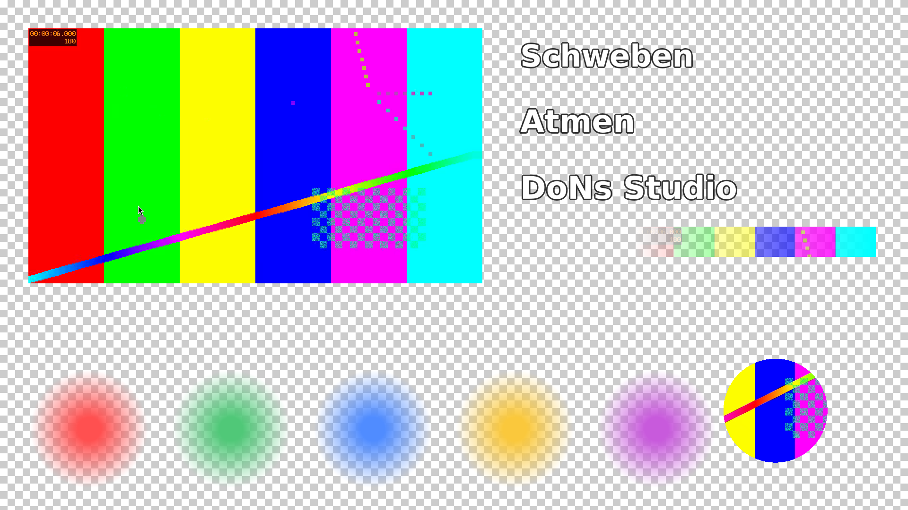
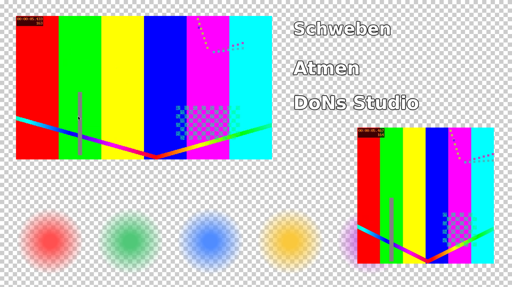
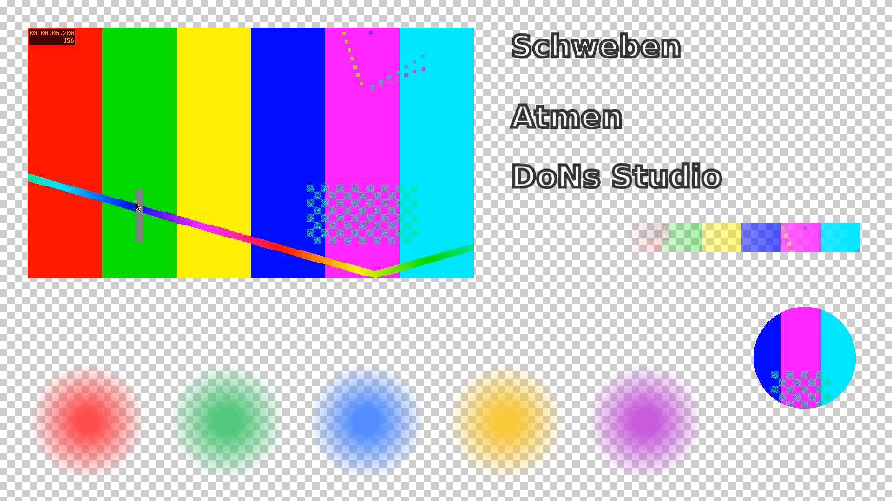

# P02 – Bericht Messprototypen 2: Dekodierweg für A (M1), Bildabgriff für B (M2)

Stand: 2026-11-02. Alle Messwerte stammen vom Studio-PC (Debian 13, Kernel 6.12.113+deb13-amd64, Xfce/xfwm4 unter X11 mit Compositing, `DISPLAY=:0.0`, 1920x1080 bei 60 Hz). Kein Xvfb, keine offscreen-Plattform von Qt.

Abnahme Punkt 4 (der Nutzer hat Bericht und Bildschirmfotos geprüft): **[OFFEN]**, steht aus.

## Kurzfassung

| | A (P01) | A mit libvpx (M1) | B (P01) | B mit Abgriff (M2), 1 Overlay | B mit Abgriff (M2), 2 Overlays |
|---|---|---|---|---|---|
| WebM-Alpha korrekt | **nein** | **ja** (Alpha-Mittel im 1. Bild 52,87, Referenz 52,87) | **ja** | ja (Seite gleich wie B) | ja (Seite gleich wie B) |
| CPU gesamt, Mittel (8 Threads) | 9,8 % (Wdh. heute: 10,7 %) | 14,3 % | 8,6 % (Wdh. heute: 10,7 %) | 15,8 % sichtbar / 13,2 % verdeckt / 14,0 % ausserhalb | 26,4 % / 27,5 % / 27,8 % |
| CPU der Prozesse, Mittel (% eines Kerns) | 59,2 (Wdh.: 60,5) | 80,1 | 56,5 (Wdh.: 68,0) | 109,2 / 89,9 / 90,6 | 192,5 / 202,2 / 200,6 |
| RAM der Prozesse, PSS bei 30 s | 493,9 MiB (Wdh.: 493,8) | 84,5 MiB | 358,8 MiB (Wdh.: 373,6) | 414,0 / 398,3 / 401,0 MiB | 515,5 / 528,7 / 533,5 MiB |
| GPU-Auslastung, Mittel (ganze Karte) | 11,0 % (Wdh.: 11,6) | 36,5 % | 34,0 % (Wdh.: 33,9) | 27,3 / 29,2 / 28,0 % | 33,9 / 34,8 / 35,1 % |
| Overlay-Bilder pro s / Einbrüche > 50 ms | 30,0 / 0 | 30,0 / 0 | 30,0 / 3 (Wdh.: 30,03 / 0) | – | – |
| Videobilder pro s / Einbrüche (Video, Alpha) | 30,0 / 0, 0 | 30,0 / 63, 63 (max. 57,7 ms) | 29,65 / 19; 29,6 / 25 | – | – |
| Abgriffe pro s mit neuem Inhalt | – | – | – | 29,98 / 29,98 / 30,0 | 26,4 / 25,8 / 29,1 bis 29,4 |
| Abgriff in den Speicher, Median | – | – | – | 4,1 bis 5,9 ms | 1. Overlay 19,4 bis 20,6 ms, 2. Overlay 5,5 bis 5,7 ms |
| BGRA → UYVY, Median je Bild (1 Thread) | – | – | – | 2,5 bis 3,9 ms | 2,6 bis 3,3 ms |
| Minimiert | – | – | – | **0 neue Bilder** (Chromium rendert nicht, Abgriff ist schwarz) | **0 neue Bilder** |

«Wdh.» = Wiederholung der P01-Prototypen in dieser Sitzung (12:31 und 12:32), mit demselben Skript `t02.py`. Bei M2 stehen drei Werte für sichtbar / verdeckt / ausserhalb des Bildschirms.

## Prototypen

| Messung | Ordner | Aufbau |
|---|---|---|
| M1 | `prototypes/a-cpp-qt-libvpx/` | Kopie von `a-cpp-qt/main.cpp`. Overlay, Lage, Zeichnen und Messausgabe sind gleich geblieben. Die zwei Videoquellen kommen aus `decoder.cpp` (libavformat/libavcodec/libswscale, ein Thread je Video) statt aus Qt Multimedia. `alpha.webm`: Decoder ausdrücklich `libvpx-vp9`. `video.webm`: Standard-Decoder (gewählt wurde `vp9`). Ausgabe als `QImage::Format_ARGB32_Premultiplied`, Übergabe an das Fenster per `QMetaObject::invokeMethod` (QueuedConnection). |
| M2 | `prototypes/b-web-capture/host/` | Neues Fenster-Programm in C++. Kern und Seite sind unverändert aus `prototypes/b-web/` (`core/core.py`, `web/overlay.html`). Je Overlay ein `QWebEngineView` 1920x1080. Ein Takt alle 1/30 s holt von jedem Overlay ein Bild in den Speicher. Ein eigener Arbeits-Thread je Overlay wandelt nach `ARGB32_Premultiplied` (BGRA im Speicher), dann nach UYVY und zusätzlich nach UYVA (`convert.cpp`, ohne Qt). |

Die P01-Prototypen sind unverändert.

### M1: Dekodierweg

- `avformat_open_input` → `av_find_best_stream` → `avcodec_find_decoder_by_name("libvpx-vp9")` bzw. `avcodec_find_decoder` → `avcodec_send_packet`/`avcodec_receive_frame` → `sws_scale` nach `AV_PIX_FMT_BGRA` → `QImage::Format_ARGB32` → `convertTo(Format_ARGB32_Premultiplied)` (nur bei Pixelformat mit Alpha).
- Wiedergabe in Echtzeit nach den Zeitstempeln der Bilder (`sleep_until`). Am Dateiende wird der Decoder geleert, an den Anfang gesprungen (`av_seek_frame`, `avcodec_flush_buffers`) und in Schleife weitergespielt.
- `thread_count = 0` (automatisch, wie die Voreinstellung des `ffmpeg`-Befehls).
- Gemessen (Feld `app_info` in `ergebnis.json`): `alpha_decoder = libvpx-vp9`, `alpha_pixel_format = yuva420p`, `alpha_first_frame_alpha_mean = 52.8726`; `video_decoder = vp9`, `video_pixel_format = yuv420p`. Der Alpha-Mittelwert stimmt mit der Gegenprobe aus P01 überein (`ffmpeg -c:v libvpx-vp9 … alphaextract,signalstats` → `YAVG=52.8726`).

### M2: gewählter Weg für den Bildabgriff

**Gewählt: `QQuickWidget::grabFramebuffer()`** auf das innere Darstellungs-Widget des `QWebEngineView`. Der `QWebEngineView` in Qt 6.8 enthält als Kind ein `QQuickWidget` (gemessen: Kinder `QVBoxLayout, QWebEnginePage, QQuickWidget`, Feld `info.view_children`). Laut Qt-Dokumentation «Renders a frame and reads it back into an image» und «This is a potentially expensive operation». Das Fenster bleibt dabei ein echtes X11-Fenster, das verdeckt oder ausserhalb des Bildschirms liegen kann.

Begründung:
- Er liefert `Format_RGBA8888_Premultiplied` (Wert 18), also **mit** Alphakanal. Für NDI mit Alpha (UYVA) ist das nötig.
- Er ist schneller als `QWidget::grab()`: Median 5,85 ms gegenüber 20,61 ms bei einem sichtbaren Overlay. Die CPU des Fensterprozesses lag bei 65,4 % statt 101,3 % eines Kerns.
- Er braucht keine neuen Pakete. Qt Quick Widgets (`qt6-declarative-dev` 6.8.2+dfsg-7) war schon als Abhängigkeit von `qt6-webengine-dev` installiert.

Verworfen:
- **`QWidget::grab()`** auf den `QWebEngineView`: Er funktioniert (30 neue Bilder pro Sekunde), liefert aber `Format_RGB32` (Wert 4), also **ohne** Alpha, und ist langsamer (siehe oben). Gemessen als Lauf `m2-1-sichtbar-widget`. Quelle: https://doc.qt.io/qt-6.8/qwidget.html#grab
- **`QQuickRenderControl`** (Qt Quick Szene ohne Fenster): Die Klasse rendert nur eine Qt Quick Szene (`QQuickWindow`) in ein eigenes Ziel. Sie bräuchte also die QML-Variante `WebEngineView` statt des Widgets und deutlich mehr Code. Ob Chromium in einer so gerenderten Szene als «sichtbar» gilt, steht in der Dokumentation nicht. Nicht gebaut, nicht gemessen. Quelle: https://doc.qt.io/qt-6.8/qquickrendercontrol.html
- **offscreen-Plattform von Qt** (`QT_QPA_PLATFORM=offscreen`): Regel 6 und der Prompt verlangen die echte X11-Sitzung. Zudem heisst es in einem Forenbeitrag (Sekundärquelle, ohne Datum und Version geprüft), die offscreen-Plattform unterstütze das von Qt WebEngine benötigte EGL nicht. Nicht gemessen. Quelle: Suchergebnis zu https://forum.qt.io/post/474927 (Inhalt nicht selbst abgerufen, nur Auszug aus der Websuche).

### M2: Sichtbarkeitsfälle

| Fall | Umsetzung | Bildschirmfoto nach dem Messfenster |
|---|---|---|
| sichtbar | `showFullScreen()`. Bei 2 Overlays liegt das zweite über dem ersten, das erste ist also verdeckt. | Overlay zu sehen (Helligkeit YAVG 183) |
| verdeckt | wie sichtbar, nach 1 s legt sich ein schwarzes Vollbildfenster (`QWidget`) darüber | schwarz (YAVG 16,0) |
| minimiert | wie sichtbar, nach 3 s `showMinimized()` | Desktop (YAVG 119) |
| ausserhalb | Fenster ohne Rahmen bei x = 3840, y = 1080 × Nummer, mit `Qt::X11BypassWindowManagerHint` | Desktop (YAVG 119). Gemessene Lage 3840,0 und 3840,1080 (`app_info`) |

Ohne `X11BypassWindowManagerHint` schob xfwm4 das Fenster auf den Bildschirm zurück (gemessen in einem Probelauf: Lage 0,27 statt 3840,0). Dieser Fall war also zuerst nicht unsichtbar.

## Installierte Pakete

Vom Nutzer am 2026-11-02 im zweiten Terminal installiert:

```
sudo apt install libavformat-dev libavcodec-dev libavutil-dev libswscale-dev
```

| Paket | Version | Grund |
|---|---|---|
| libavformat-dev | 7:7.1.5-0+deb13u1 | M1: WebM öffnen und Pakete lesen |
| libavcodec-dev | 7:7.1.5-0+deb13u1 | M1: Decoder `libvpx-vp9`/`vp9` wählen und dekodieren |
| libavutil-dev | 7:7.1.5-0+deb13u1 | M1: `AVFrame`, Pixelformate |
| libswscale-dev | 7:7.1.5-0+deb13u1 | M1: yuva420p/yuv420p → BGRA |
| libswresample-dev | 7:7.1.5-0+deb13u1 | Abhängigkeit von libavcodec-dev, nicht direkt genutzt |

Versionen geprüft mit `dpkg-query -W -f='${Package} ${Version}\n' …`. pkg-config meldet libavformat 61.7.103, libavcodec 61.19.101, libavutil 59.39.100, libswscale 8.3.100. Libvpx meldet beim Öffnen `v1.15.0` (stderr), Paket `libvpx9` 1.15.0-2.1+deb13u1 (seit P01).

Nicht installiert:
- `pkg-config`, weil `pkgconf` 1.8.1-4 `/usr/bin/pkg-config` schon bereitstellt.
- Für M2 nichts.

Geprüft vor der Installation: `apt-cache policy`, `apt-cache depends libavcodec-dev libavformat-dev libavutil-dev libswscale-dev`, `apt-get install -s …`.

## Bau

```
$ cmake -S prototypes/a-cpp-qt-libvpx -B prototypes/a-cpp-qt-libvpx/build -DCMAKE_BUILD_TYPE=Release && cmake --build prototypes/a-cpp-qt-libvpx/build -j8
[100%] Built target p02_a_libvpx
$ cmake -S prototypes/b-web-capture/host -B prototypes/b-web-capture/host/build -DCMAKE_BUILD_TYPE=Release && cmake --build prototypes/b-web-capture/host/build -j8
[100%] Built target p02_b_capture
```

Keine Warnungen, keine Fehler.

## M1: Variante A mit libvpx-vp9

### Start (T-01, 20 Starts)

Befehl: `python3 prototypes/messung/m1.py A-libvpx t01`. Er führt `t01.py` unverändert aus und ersetzt nur das Programm und den Ablageort. Beginn 12:29:04.

| | sauber | erstes Bild min / Median / max (ms) | stderr-Zeilen |
|---|---|---|---|
| A mit libvpx | 20/20 | 112,6 / 125,7 / 139,0 | 0 |
| A (P01, zum Vergleich) | 20/20 | 93,4 / 105,6 / 115,7 | 0 |

Im Modus T-01 dekodiert M1 kein Video; der Unterschied zu A ist also nicht dem Decoder zuzuordnen. Ursache nicht geprüft. Einzelwerte: `docs/messungen/P02-daten/m1-A-libvpx/t01-A/tabelle.md`.

### Overlay 60 s (T-02)

Befehl: `python3 prototypes/messung/m1.py A-libvpx` (führt `t02.py` unverändert aus), Beginn 12:29:53. Zum Vergleich in derselben Sitzung: `python3 prototypes/messung/m1.py A` (12:31:08) und `python3 prototypes/messung/m1.py B` (12:32:24). Diese beiden Läufe starten die unveränderten P01-Programme. Messbefehle wie in P01:

```
LC_ALL=C mpstat 1 60
LC_ALL=C pidstat -h -u -r -p <PIDs> 1 60
nvidia-smi --query-gpu=timestamp,utilization.gpu,memory.used --format=csv,noheader,nounits -l 1
ffmpeg -hide_banner -loglevel error -y -f x11grab -video_size 1920x1080 -i :0.0+0,0 -frames:v 1 <bild>
```

| | A mit libvpx (M1) | A (Wdh.) | B (Wdh.) | A (P01) | B (P01) |
|---|---|---|---|---|---|
| Exit-Code | 0 | 0 | 0 | 0 | 0 |
| CPU gesamt min / Mittel / max (%) | 12,3 / 14,3 / 20,0 | 8,4 / 10,7 / 20,4 | 8,4 / 10,7 / 13,0 | 7,6 / 9,8 / 14,3 | 6,0 / 8,6 / 11,3 |
| CPU der Prozesse min / Mittel / max (% eines Kerns) | 71 / 80,1 / 94 | 53 / 60,5 / 71 | 55 / 68,0 / 79 | 54 / 59,2 / 68 | 41 / 56,5 / 75 |
| je Prozess (Mittel) | p02_a_libvpx 80,1 | p01_a 60,5 | QtWebEngineProcess 51,0, p01_b_host 16,9, python3 0,0 | p01_a 59,2 | QtWebEngineProcess 41,7, p01_b_host 14,7 |
| RSS der Prozesse, Mittel (MiB) | 121,8 | 563,6 | 606,6 | 563,3 | 589,4 |
| PSS bei 30 s (MiB) | 84,5 | 493,8 | 373,6 | 493,9 | 358,8 |
| GPU-Auslastung min / Mittel / max (%) | 34 / 36,5 / 39 | 11 / 11,6 / 16 | 5 / 33,9 / 38 | 11 / 11,0 / 12 | 13 / 34,0 / 44 |
| GPU-Speicher, Mittel (MiB, ganzes System) | 315,9 | 593,3 | 445,0 | 594,2 | 458,1 |
| Overlay-Bilder pro s / Einbrüche / grösster Abstand | 30,0 / 0 / 39,6 ms | 30,0 / 0 / 35,2 ms | 30,03 / 0 / 33,5 ms | 30,0 / 0 / 35,2 ms | 30,0 / 3 / 50,1 ms |
| Video: pro s / Einbrüche / grösster Abstand | 30,0 / 63 / 57,7 ms | 30,0 / 0 / 35,1 ms | 29,75 / 19 / 83,6 ms | 30,0 / 0 / 34,5 ms | 29,65 / 19 / 100,1 ms |
| WebM-Alpha: pro s / Einbrüche / grösster Abstand | 30,0 / 63 / 57,7 ms | 30,0 / 0 / 48,5 ms | 29,73 / 15 / 83,8 ms | 30,0 / 0 / 47,8 ms | 29,6 / 25 / 83,7 ms |
| Sekunden unter 28 Bildern (Video / Alpha) | 0 / 0 | 0 / 0 | 2 / 2 | 0 / 0 | 4 / 3 |
| WebM-Alpha korrekt | **ja** | nein | ja | nein | ja |

Achtung, wie in P01 sind die Werte nicht gleichwertig:
- Bei M1 zählt ein Videobild, wenn es im GUI-Thread ankommt (nach Dekodieren, Umwandeln und Übergabe über die Ereignisschleife). Bei A mit Qt Multimedia zählt die Ankunft bei `QVideoSink`, bei B `requestVideoFrameCallback`.
- Die 63 Einbrüche bei M1 sind bei Video und Alpha gleich viele, und der grösste Abstand ist 57,7 ms. Pro Sekunde kommen trotzdem 29 bis 31 Bilder an, also ist kein Bild ausgefallen: Ein spätes Bild wird vom nächsten eingeholt. Die Ursache (Takt von `sleep_until`, Übergabe über die Ereignisschleife oder belegter GUI-Thread) ist nicht geprüft **[OFFEN]**.
- Mehr CPU bei M1 (80 statt 60 % eines Kerns): M1 dekodiert in Software (libvpx, FFmpeg-`vp9`) und wandelt mit swscale um. Ob Qt Multimedia in A in Hardware dekodiert hat, ist weiterhin nicht geprüft (P01).
- Die höhere GPU-Auslastung bei M1 (36,5 % statt 11,6 %) ist nicht erklärt. M1 nutzt die GPU nicht direkt. Der Wert gilt für die ganze Karte (Xorg, Compositor) **[OFFEN]**.
- Deutlich weniger RAM bei M1 (PSS 84,5 statt 493,8 MiB). Vermutlich lädt M1 Qt Multimedia und dessen Hardware-Decoder-Kontexte nicht; nicht geprüft.

### Sichtprüfung WebM-Alpha

| Lauf | Bild | Befund (Claude; Sichtprüfung des Nutzers steht aus) |
|---|---|---|
| M1 |  | **Alpha korrekt.** Sichtbar sind nur die deckende Scheibe (rechts unten) und oben der Streifen mit Verlauf von transparent nach deckend, der Rest zeigt das Schachbrett. Bild 5 ist nicht verdeckt. Im Video ist der Mauszeiger zu sehen (x11grab zeichnet ihn standardmässig mit), das gehört nicht zum Overlay. |
| A, Wdh. |  | Alpha fehlt wie in P01 (deckendes Rechteck). |
| B, Wdh. |  | Alpha korrekt wie in P01. |

Zahl dazu: Mittel des Alphakanals im ersten Bild der Alpha-WebM = **52,8726** (M1, vor dem Vormultiplizieren), gleich wie `ffmpeg -c:v libvpx-vp9` in P01. Ohne Alpha wäre der Wert 255.

## M2: Variante B, Bilder ohne Fenster abgreifen

Befehl je Lauf (Beginn in Klammern):

```
python3 prototypes/messung/m2.py 1-sichtbar        --count 1 --visibility visible                 (12:12:09)
python3 prototypes/messung/m2.py 1-verdeckt        --count 1 --visibility covered                 (12:13:34)
python3 prototypes/messung/m2.py 1-minimiert       --count 1 --visibility minimized               (12:14:51)
python3 prototypes/messung/m2.py 1-ausserhalb      --count 1 --visibility offscreen               (12:16:07)
python3 prototypes/messung/m2.py 1-sichtbar-widget --count 1 --visibility visible --grab widget   (12:17:23)
python3 prototypes/messung/m2.py 2-sichtbar        --count 2 --visibility visible                 (12:18:45)
python3 prototypes/messung/m2.py 2-verdeckt        --count 2 --visibility covered                 (12:20:01)
python3 prototypes/messung/m2.py 2-minimiert       --count 2 --visibility minimized               (12:21:18)
python3 prototypes/messung/m2.py 2-ausserhalb      --count 2 --visibility offscreen               (12:22:35)
```

`m2.py` folgt dem Ablauf von `t02.py` und nutzt dessen Auswertefunktionen (`parse_pidstat`, `parse_mpstat`, `stat`, `rate`). `t02.py` selbst ist unverändert. Die Messbefehle (mpstat, pidstat, nvidia-smi, x11grab) sind dieselben. Gemessene Prozesse: `p02_b_capture` mit allen `QtWebEngineProcess` (Nachkommen 5 s nach Start) und der Kern `python3`. Zusätzlich speichert das Programm bei 68 s (nach dem Messfenster) je Overlay ein Kontrollbild aus dem Speicher. Die UYVY-Umwandlung desselben Bildes wird mit `ffmpeg -f rawvideo -pix_fmt uyvy422 -video_size 1920x1080` zurück nach PNG gewandelt.

Begriffe:
- **Abgriffe:** Aufrufe von `grabFramebuffer()`, Ziel 30/s.
- **Neue Bilder:** Abgriffe, deren Inhalt sich vom vorigen unterscheidet (`memcmp` über das ganze Bild). Das ist das Mass dafür, ob Chromium weiter rendert.
- **Seite:** Zeitstempel aus `overlay.html` (rAF-Aktualisierungen, `requestVideoFrameCallback`), am Ende per `runJavaScript("JSON.stringify(stats)")` geholt.

### Ein Overlay

| | sichtbar | verdeckt | minimiert | ausserhalb | sichtbar, `QWidget::grab` |
|---|---|---|---|---|---|
| Exit-Code | 0 | 0 | 0 | 0 | 0 |
| Abgriffe pro s / Einbrüche > 50 ms / grösster Abstand | 30,0 / 0 / 35,2 ms | 30,0 / 0 / 35,1 ms | 30,0 / 0 / 34,5 ms | 30,0 / 0 / 35,0 ms | 30,0 / 0 / 35,0 ms |
| **neue Bilder pro s** / Einbrüche / grösster Abstand | **29,98** / 1 / 67,3 ms | **29,98** / 1 / 66,0 ms | **0,0** | **30,0** / 0 / 35,0 ms | **30,0** / 0 / 35,0 ms |
| Seite: Animation pro s | 30,0 | 29,98 | 0,0 | 30,0 | 30,0 |
| Seite: Video / Alpha pro s | 29,7 / 29,55 | 29,75 / 29,73 | 0 / 0 | 29,75 / 29,68 | 29,72 / 29,7 |
| Seite: Video-Einbrüche / Alpha-Einbrüche | 17 / 27 | 14 / 16 | – | 15 / 19 | 15 / 17 |
| Abgriff Median / p95 / max (ms) | 5,85 / 7,50 / 15,19 | 5,28 / 9,75 / 24,78 | 5,45 / 6,55 / 22,88 | 4,05 / 7,10 / 24,63 | 20,61 / 25,07 / 29,37 |
| Bildformat des Abgriffs | RGBA8888_Premultiplied | ebenso | ebenso | ebenso | RGB32 (ohne Alpha) |
| Umwandlung → BGRA (`convertTo`), Median (ms) | 4,26 | 2,05 | 4,05 | 2,06 | 2,19 |
| **BGRA → UYVY**, Median / p95 (ms) | 3,85 / 5,28 | 2,54 / 4,28 | 6,04 / 8,10 | 2,68 / 7,90 | 3,05 / 4,60 |
| BGRA → UYVA, Median / p95 (ms) | 2,60 / 4,57 | 2,56 / 4,72 | 3,97 / 8,27 | 2,70 / 6,43 | 2,69 / 3,66 |
| verworfene Bilder (Umwandlung noch belegt), ganze Laufzeit | 4 | 3 | 3 | 4 | 2 |
| CPU gesamt min / Mittel / max (%) | 12,7 / 15,8 / 19,4 | 11,2 / 13,2 / 16,2 | 7,3 / 10,7 / 16,7 | 11,2 / 14,0 / 20,6 | 14,7 / 18,1 / 20,5 |
| CPU der Prozesse, Mittel (% eines Kerns) | 109,2 | 89,9 | 62,3 | 90,6 | 130,9 |
| davon p02_b_capture / QtWebEngineProcess | 65,4 / 43,8 | 53,2 / 36,6 | 62,3 / 0,1 | 58,9 / 31,6 | 101,3 / 29,6 |
| RSS Mittel / PSS bei 30 s (MiB) | 642,3 / 414,0 | 625,6 / 398,3 | 605,4 / 367,5 | 632,9 / 401,0 | 618,8 / 384,2 |
| GPU-Auslastung min / Mittel / max (%) | 13 / 27,3 / 37 | 9 / 29,2 / 43 | 9 / 21,4 / 24 | 10 / 28,0 / 43 | 9 / 28,0 / 43 |
| GPU-Speicher, Mittel (MiB) | 441,3 | 463,0 | 434,6 | 436,4 | 435,0 |

### Zwei Overlays gleichzeitig (ein Prozess, zwei `QWebEngineView`)

Werte je Overlay als «Overlay 1 / Overlay 2».

| | sichtbar (2 über 1) | verdeckt | minimiert | ausserhalb |
|---|---|---|---|---|
| Exit-Code | 0 | 0 | 0 | 0 |
| Abgriffe pro s | 30,0 / 30,02 | 30,0 / 30,0 | 30,0 / 30,0 | 30,0 / 30,0 |
| Abgriffe: Einbrüche > 50 ms / grösster Abstand | 253, 66,5 ms / 271, 80,0 ms | 281, 55,3 ms / 276, 71,5 ms | 0, 40,5 ms / 3, 53,3 ms | 288, 54,8 ms / 427, 69,7 ms |
| **neue Bilder pro s** | **26,4 / 26,45** | **25,82 / 25,8** | **0 / 0** | **29,42 / 29,1** |
| neue Bilder: Sekunden unter 28 | 53 / 51 | 50 / 52 | 60 / 60 | 7 / 11 |
| neue Bilder: Einbrüche / grösster Abstand | 461, 83,2 ms / 477, 84,3 ms | 294, 55,3 ms / 520, 71,5 ms | – | 295, 90,6 ms / 473, 100,4 ms |
| Seite: Animation pro s | 29,98 / 30,0 | 30,02 / 30,0 | 0 / 0 | 30,0 / 29,98 |
| Seite: Video pro s / Alpha pro s | 29,47, 28,52 / 29,28, 28,63 | 29,63, 28,5 / 29,75, 28,93 | 0 | 29,42, 28,78 / 29,62, 29,38 |
| Seite: Alpha-Einbrüche / grösster Abstand | 85, 100,1 ms / 84, 83,5 ms | 87, 89,3 ms / 62, 112,3 ms | – | 69, 100,4 ms / 42, 103,3 ms |
| Abgriff Median (ms) | 19,42 / 5,70 | 20,64 / 5,53 | 5,26 / 5,53 | 19,89 / 5,61 |
| BGRA → UYVY, Median / p95 (ms) | 3,30, 4,56 / 2,69, 4,69 | 3,10, 4,56 / 2,65, 5,74 | 6,45, 8,0 / 6,15, 8,01 | 3,20, 5,01 / 2,61, 5,49 |
| BGRA → UYVA, Median (ms) | 3,19 / 2,88 | 3,18 / 2,73 | 5,98 / 5,76 | 3,02 / 3,15 |
| verworfene Bilder | 71 / 93 | 44 / 38 | 2 / 3 | 75 / 73 |
| CPU gesamt min / Mittel / max (%) | 24,3 / 26,4 / 31,0 | 25,7 / 27,5 / 34,1 | 14,8 / 19,2 / 22,0 | 25,5 / 27,8 / 33,0 |
| CPU der Prozesse, Mittel (% eines Kerns) | 192,5 | 202,2 | 129,5 | 200,6 |
| davon p02_b_capture / QtWebEngineProcess | 136,4 / 56,0 | 146,5 / 55,8 | 129,4 / 0,1 | 142,0 / 58,6 |
| RSS Mittel / PSS bei 30 s (MiB) | 845,3 / 515,5 | 861,6 / 528,7 | 803,7 / 470,7 | 863,1 / 533,5 |
| GPU-Auslastung min / Mittel / max (%) | 20 / 33,9 / 40 | 22 / 34,8 / 40 | 19 / 30,6 / 33 | 20 / 35,1 / 41 |

### Befunde M2

1. **Verdeckt und ausserhalb des Bildschirms rendert Chromium weiter mit 30 Bildern pro Sekunde.** Mit einem Overlay sind es 29,98 bzw. 30,0 neue Bilder pro Sekunde, gleich viel wie sichtbar. Unter X11 meldet Qt dem Chromium offenbar keine Verdeckung (Folgerung, nicht im Code geprüft).
2. **Minimiert rendert Chromium nicht mehr.** Ab dem Minimieren gibt es keine rAF-Aufrufe, keine Videobilder und keine neuen Inhalte mehr. `QtWebEngineProcess` braucht 0,1 % CPU. `grabFramebuffer()` liefert dann ein **schwarzes** Bild (`P02-bilder/m2-1-minimiert-abgriff-1.png`). Das deckt sich mit Berichten zu Qt 5.13+ (Qt-Forum 112200, QTBUG-50818). Ob Chromium-Schalter wie `--disable-renderer-backgrounding` daran etwas ändern, ist nicht geprüft **[OFFEN]**.
3. **Ein Overlay:** Der Abgriff kostet im Median 4 bis 6 ms im GUI-Thread, die Umwandlung BGRA → UYVY 2,5 bis 3,9 ms in einem eigenen Thread (einfacher C++-Code, ein Thread, ohne SIMD von Hand). Gesamt-CPU 13 bis 16 % (P01-B ohne Abgriff: 8,6 %, Wdh. 10,7 %).
4. **Zwei Overlays:** Abgriffe im Mittel 30 pro Sekunde. Der Abgriff des ersten Overlays dauert dann aber im Median rund 20 ms statt 5 ms. Beide Abgriffe zusammen brauchen rund 25 ms des 33-ms-Takts, der Takt verrutscht, und es gibt 250 bis 430 Abstände über 50 ms. Neue Bilder: 26 pro Sekunde (sichtbar/verdeckt) bzw. 29 pro Sekunde (ausserhalb). Ursache der 20 ms nicht geprüft. Möglich wäre ein Warten auf den Bildwechsel (60 Hz = 16,7 ms) im ersten Aufruf je Takt **[OFFEN]**. Ein Abgriff in getrennten Threads oder Prozessen je Overlay ist nicht gemessen.
5. **Videos in der Seite:** Mit zwei Overlays steigen die Einbrüche beim Alpha-Video (bis 87 in 60 s, grösster Abstand 112 ms). Mit einem Overlay sind es so viele wie in P01.
6. **Kontrollbilder:** Abgriff und rückgewandeltes UYVY zeigen das Overlay vollständig und farbrichtig (`P02-bilder/m2-1-sichtbar-abgriff-1.png`, `…-uyvy-1.png`, Sichtprüfung Claude). Die Bildschirmfotos zeigen, dass das Overlay bei «verdeckt», «minimiert» und «ausserhalb» tatsächlich nicht auf dem Schirm war.
7. **Alpha im Abgriff:** Die Seite `overlay.html` hat einen deckenden Hintergrund (Schachbrett). Ob ein transparenter Seitenhintergrund im Abgriff als Alpha ankommt, ist mit dieser Seite nicht prüfbar und nicht gemessen **[OFFEN]**.
8. **CPU-Anteil der Umwandlung überschätzt:** Der Arbeits-Thread rechnet je Bild sowohl UYVY als auch UYVA. Für NDI bräuchte es nur eines. Die CPU von `p02_b_capture` enthält zudem den `memcmp` für «neue Bilder» (Median unter 0,1 ms, bei gleichen Bildern bis 1,4 ms).

### Einordnung zu NDI (keine Messung von NDI)

Laut NDI-Dokumentation ist UYVY/UYVA bevorzugt, weil das interne Farbumwandlungen spart. BGRA kostet mehr Speicherbandbreite. Wer auf der CPU umwandeln müsste, soll laut derselben Seite die Umwandlung besser dem SDK überlassen («it is better to let the SDK perform the conversion»). Ist das Bild auf der GPU, ist die Umwandlung dort vorzuziehen. Quelle: https://docs.ndi.video/all/developing-with-ndi/sdk/performance-and-implementation (abgerufen). Die gemessenen 2,5 bis 4 ms je Bild für BGRA → UYVY sind also nur eine Obergrenze für einen einfachen eigenen Weg. Die NDI-Codierung selbst ist nicht gemessen.

Die Farbmatrix BT.709 im begrenzten Bereich ist eine Annahme. Laut NDI-Dokumentation gilt Rec.709 für HD (xres > 720). Ob NDI begrenzten oder vollen Bereich erwartet und ob UYVA vormultipliziert sein soll, steht dort nicht (https://docs.ndi.video/all/developing-with-ndi/sdk/frame-types, abgerufen). BGRA ist laut derselben Seite «not pre-multiplied». Der Abgriff liefert vormultipliziert. Für NDI mit BGRA müsste also zurückgerechnet werden **[OFFEN]**.

## Vergleichstabelle A (P01), A mit libvpx (M1), B (P01), B mit Abgriff (M2)

| | A (P01) | A mit libvpx (M1) | B (P01) | B mit Abgriff (M2), 1 Overlay, verdeckt | B mit Abgriff (M2), 2 Overlays, ausserhalb |
|---|---|---|---|---|---|
| Messzeit | 2026-11-02 11:16 | 12:29 | 11:17 | 12:13 | 12:22 |
| WebM-Alpha korrekt | nein | ja | ja | ja (Seite wie B) | ja (Seite wie B) |
| Bild in den Speicher für NDI | nicht gebaut (bei A liegt das Bild als QImage schon im Speicher; nicht gemessen) | ebenso | nein | ja, 30 neue Bilder pro s | ja, 29,1 bis 29,4 neue Bilder pro s |
| Start, erstes Bild Median | 105,6 ms | 125,7 ms | 959,7 ms | nicht gemessen | nicht gemessen |
| CPU gesamt, Mittel | 9,8 % | 14,3 % | 8,6 % | 13,2 % | 27,8 % |
| CPU der Prozesse, Mittel (% eines Kerns) | 59,2 | 80,1 | 56,5 | 89,9 | 200,6 |
| PSS bei 30 s | 493,9 MiB | 84,5 MiB | 358,8 MiB | 398,3 MiB | 533,5 MiB |
| GPU-Auslastung, Mittel (ganze Karte) | 11,0 % | 36,5 % | 34,0 % | 29,2 % | 35,1 % |
| Overlay-Bilder pro s / Einbrüche | 30,0 / 0 | 30,0 / 0 | 30,0 / 3 | 29,98 / 1 (Seite: 1) | Seite 30,0 / 1 und 4; Abgriff siehe oben |
| Video pro s / Einbrüche (Video; Alpha) | 30,0 / 0; 0 | 30,0 / 63; 63 | 29,65 / 19; 25 | 29,75 / 14; 16 | 29,42 / 36, 29,62 / 33; Alpha 69 und 42 |

Für die Abgriffs-Spalten von M2 sind die ehrlicheren Vergleichsfälle «verdeckt» und «ausserhalb», weil die Overlays im echten Betrieb nicht auf dem Schirm des Studio-PCs liegen würden. Die übrigen Fälle stehen in den Tabellen oben.

## Einschätzung von Claude (kein Entscheid)

Diese Einschätzung ist **nicht** belegt und nur ein Vorschlag. Der Entscheid liegt beim Nutzer.

- Der Alpha-Unterschied aus P01 ist mit M1 aufgehoben: A kann WebM mit Alpha korrekt darstellen, wenn es selbst über libavcodec mit `libvpx-vp9` dekodiert. Das kostet etwa 20 % eines Kerns mehr als A mit Qt Multimedia und braucht rund 200 Zeilen eigenen Decoder-Code (`decoder.cpp` und `decoder.h`). Die 63 Abstände über 50 ms bei M1 sind ungeklärt. Bei weniger als 60 ms und ohne fehlende Bilder wären sie im Stream vermutlich kaum sichtbar, das ist aber nicht geprüft.
- B kann die Bilder ohne sichtbares Fenster in den Speicher holen, solange das Fenster nicht minimiert ist (verdeckt oder ausserhalb des Bildschirms). Ein Overlay geht gut. Für zwei Overlays reicht der einfache Weg (beide Abgriffe nacheinander im GUI-Thread) nicht ganz: Es kommen 26 bis 29 statt 30 neue Bilder pro Sekunde, mit vielen unregelmässigen Abständen. Das müsste vor einem Entscheid für B mit NDI verbessert und erneut gemessen werden (zum Beispiel ein Prozess je Overlay).
- Für A spricht: weniger RAM, schneller Start, gleichmässige Bildrate, Bilder liegen ohnehin als `QImage` im Speicher (für NDI direkt verfügbar), keine Abhängigkeit vom Verhalten von Chromium beim Verdecken oder Minimieren.
- Für B spricht: Die Darstellung entspricht der Browserquelle in OBS (Hauptweg der Ausgabe), Alpha und Videos ohne eigenen Decoder, HTML/CSS für Text und Animationen. Die Browserquelle in OBS ist weiterhin nicht gemessen (T-04).
- Beide Varianten liegen bei 1080p30 mit einem Overlay unter 15 % CPU gesamt. Die Last allein trennt sie also weiterhin nicht.

## Geänderte und neue Dateien

| Datei | Art |
|---|---|
| `prototypes/a-cpp-qt-libvpx/CMakeLists.txt`, `main.cpp`, `decoder.h`, `decoder.cpp` | neu (M1) |
| `prototypes/b-web-capture/host/CMakeLists.txt`, `main.cpp`, `convert.h`, `convert.cpp` | neu (M2) |
| `prototypes/messung/m1.py` | neu (führt `t01.py`/`t02.py` unverändert mit umgelenkten Pfaden aus) |
| `prototypes/messung/m2.py` | neu (Messung M2, nutzt die Auswertung aus `t02.py`) |
| `docs/messungen/P02-bericht.md` | neu (dieser Bericht) |
| `docs/messungen/P02-daten/…` | neu (Rohdaten: `ergebnis.json`, `mpstat.txt`, `pidstat.txt`, `nvidia-smi.csv`, `app-zeitstempel.json`, `app-stderr.txt`, Ausgaben der Skripte) |
| `docs/messungen/P02-bilder/…` | neu (Bildschirmfotos `m1-*/t02-*.png`, `m2-*-bildschirm.png`; Kontrollbilder `m2-*-abgriff-*.png`, `m2-*-uyvy-*.png`) |
| `docs/04-offene-punkte.md` | Punkte aus P02 ergänzt |

Unverändert: alle P01-Prototypen, `t01.py`, `t02.py`, `common.py`, `overlay.html`, `core.py`.

Commits: `bdd6300` (Prototyp M2), `f4bccab` (M2 Messskript und Daten), `865661e` (Prototyp M1, Messskript und Daten), dazu der Commit mit diesem Bericht.

## Nicht erledigt

- **[OFFEN]** Sichtprüfung der Bildschirmfotos und Lesen des Berichts durch den Nutzer (Abnahme Punkt 4).
- **[OFFEN]** Ursache der 63 Abstände über 50 ms bei den Videobildern von M1.
- **[OFFEN]** Ursache der höheren GPU-Auslastung bei M1 (36,5 % gegenüber 11,6 % bei A).
- **[OFFEN]** Ursache des langsameren ersten Bildes im T-01 bei M1 (125,7 ms gegenüber 105,6 ms), obwohl T-01 kein Video dekodiert.
- **[OFFEN]** Zwei Overlays bei B: Abgriff des ersten Overlays rund 20 ms. Ursache nicht geprüft. Abgriff in getrennten Threads oder Prozessen nicht gemessen.
- **[OFFEN]** Minimiert: Ob Chromium-Schalter (`--disable-renderer-backgrounding`, `--disable-background-timer-throttling`) das Rendern im minimierten Fenster erhalten, ist nicht geprüft. Für die Messung nicht nötig, weil «verdeckt» und «ausserhalb» funktionieren.
- **[OFFEN]** Alpha im Abgriff bei transparenter Seite nicht geprüft (Seite ist deckend und sollte unverändert bleiben).
- **[OFFEN]** Farbmatrix und Bereich für NDI-UYVY, Vormultiplikation bei UYVA: aus der NDI-Dokumentation nicht vollständig zu klären, das SDK ist nicht installiert.
- **[OFFEN]** Bei A (beide Varianten) ist ein Abgriff des fertigen Overlay-Bildes in den Speicher nicht gebaut und nicht gemessen. Bei QPainter in Software liegt das Bild ohnehin im Speicher; der Aufwand dafür ist nicht gemessen.
- **[OFFEN]** Die Umwandlung BGRA → UYVY ist einfacher C++-Code ohne eigenes SIMD. Eine schnellere Umsetzung (zum Beispiel libswscale oder GPU) ist nicht gemessen.
- **[OFFEN]** Die BT.709-Koeffizienten in `convert.cpp` stammen aus dem Wissensstand von Claude. Die ITU-Seite habe ich abgerufen, sie zeigt die Werte aber nicht. Nicht gegen das PDF der Empfehlung geprüft.
- Nicht Teil des Auftrags: NDI-SDK, NDI-Senden, obs-websocket, Browserquelle in OBS, Variante C.

## Annahmen

1. «Nicht sichtbar» wird in drei Arten gemessen: verdeckt durch ein anderes Fenster, minimiert und ausserhalb des Bildschirms (am Fenstermanager vorbei). Der Prompt nennt «verdeckt oder minimiert». «Ausserhalb» kam dazu, weil es dem späteren Betrieb (Overlay nur für NDI, nicht auf dem Schirm) am nächsten kommt.
2. Zwei Overlays laufen in **einem** Prozess mit zwei `QWebEngineView`, so wie ein Fenster-Programm später zwei NDI-Ausgänge bedienen könnte. Zwei getrennte Prozesse sind nicht gemessen.
3. Im Fall «sichtbar» mit zwei Overlays liegen beide im Vollbild, das zweite über dem ersten. Zwei 1920x1080-Fenster passen nicht gleichzeitig ganz auf den 1920x1080-Schirm.
4. Farbmatrix BT.709, begrenzter Bereich, Chroma als Mittel zweier Pixel. Layout UYVY und UYVA nach der NDI-Dokumentation.
5. Der Abgriff ist vormultipliziert (`RGBA8888_Premultiplied`) und wird für die Umwandlung als vormultipliziertes BGRA genutzt. Bei deckender Seite spielt das keine Rolle.
6. Die Wiederholung der P01-Messungen A und B in dieser Sitzung dient nur dem Vergleich unter gleichen Bedingungen. Die P01-Daten sind nicht überschrieben (eigene Ablage unter `P02-daten/m1-A` und `m1-B`).
7. Regel 8 (Schalter zum Abschalten) wende ich wie in P01 auf die Messprototypen nicht an.
8. M1 nutzt für `video.webm` den Standard-Decoder von FFmpeg. Gewählt wurde `vp9` (Software). Hardware-Decoder (`vp9_cuvid` u. a.) sind nicht ausgewählt worden.

## Ausgeführte Befehle (Auswahl, chronologisch)

```
git pull                                                     # Bereits aktuell
echo $DISPLAY $XDG_SESSION_TYPE                              # :0.0 x11
LANG=C apt-cache policy libavcodec-dev libavformat-dev libavutil-dev libswscale-dev pkg-config pkgconf
LANG=C apt-cache depends libavcodec-dev libavformat-dev libavutil-dev libswscale-dev libswresample-dev
LANG=C apt-get install -s libavcodec-dev libavformat-dev libavutil-dev libswscale-dev
which pkg-config; pkg-config --version                       # /usr/bin/pkg-config, 1.8.1
cmake -S prototypes/b-web-capture/host -B … && cmake --build …
p02_b_capture --grab widget|framebuffer --visibility visible|covered|minimized|offscreen --duration 15   # Probeläufe
python3 prototypes/messung/m2.py <NAME> --count 1|2 --visibility … [--grab widget]   # 9 Läufe, siehe oben
ffmpeg -v error -i m2-*-bildschirm.png -vf signalstats,metadata=print:key=lavfi.signalstats.YAVG:file=- -f null -
# Installation durch den Nutzer: sudo apt install libavformat-dev libavcodec-dev libavutil-dev libswscale-dev
dpkg-query -W -f='${Package} ${Version}\n' libavformat-dev libavcodec-dev libavutil-dev libswscale-dev libswresample-dev
cmake -S prototypes/a-cpp-qt-libvpx -B … && cmake --build …
p02_a_libvpx --mode t02 --media prototypes/media --stats … --duration 10   # Probelauf: exit 0, Alpha-Mittel 52.8726
p02_a_libvpx --mode t01                                       # exit 0
python3 prototypes/messung/m1.py A-libvpx t01                 # 20/20 sauber
python3 prototypes/messung/m1.py A-libvpx                     # exit 0
python3 prototypes/messung/m1.py A                            # exit 0 (Wiederholung P01)
python3 prototypes/messung/m1.py B                            # exit 0 (Wiederholung P01)
```

## Quellen

In dieser Sitzung **abgerufen**:
- Qt 6.8 QWidget (`grab`, `render`): https://doc.qt.io/qt-6.8/qwidget.html
- Qt 6.8 QQuickWidget (`grabFramebuffer`, Offscreen-Puffer): https://doc.qt.io/qt-6.8/qquickwidget.html
- Qt 6.8 QQuickRenderControl: https://doc.qt.io/qt-6.8/qquickrendercontrol.html
- Qt 6.8 WebEngine Platform Notes (nichts zu offscreen oder minimiert): https://doc.qt.io/qt-6.8/qtwebengine-platform-notes.html
- Qt 6.8 WebEngine Debugging (Chromium-Schalter, `QTWEBENGINE_CHROMIUM_FLAGS`): https://doc.qt.io/qt-6.8/qtwebengine-debugging.html
- Qt 6.8 QImage (Formate, Werte 4, 5, 6, 18, `reinterpretAsFormat`): https://doc.qt.io/qt-6.8/qimage.html
- Qt-Forum, verdecktes/minimiertes QWebEngineView rendert nicht (Qt 5.13/5.14): https://forum.qt.io/topic/112200/offscreen-rendering-does-not-work-with-qt-5-13-5-14
- NDI Frame-Typen (UYVY, UYVA, BGRA, Rec.709): https://docs.ndi.video/all/developing-with-ndi/sdk/frame-types
- NDI Leistung und Umsetzung: https://docs.ndi.video/all/developing-with-ndi/sdk/performance-and-implementation
- FFmpeg 7.1 Dekodier-API (send/receive, EAGAIN, EOF, Leeren): https://ffmpeg.org/doxygen/7.1/group__lavc__decoding.html
- ITU-R BT.709 (Seite der Empfehlung, Koeffizienten nicht darauf): https://www.itu.int/rec/R-REC-BT.709
- Websuche «QWebEngineView grab hidden minimized…», Ergebnisse nur als Auszüge gelesen, Seiten **nicht abgerufen**: https://forum.qt.io/post/580712, https://forum.qt.io/topic/93521/webengineview-failed-to-grabtoimage, https://bugreports.qt.io/browse/QTBUG-50818, https://phabricator.kde.org/D15095?id=40494, https://forum.qt.io/post/474927, https://bugreports-test.qt.io/browse/QTBUG-79021

**Nicht abgerufen** (Wissensstand von Claude, im Code genannt):
- FFmpeg `avcodec_find_decoder_by_name`: https://ffmpeg.org/doxygen/7.1/group__lavc__core.html
- FFmpeg libswscale: https://ffmpeg.org/doxygen/7.1/group__libsws.html
- Qt 6.8 `QMetaObject::invokeMethod`: https://doc.qt.io/qt-6.8/qmetaobject.html#invokeMethod-5
- Qt 6.8 `QWebEnginePage::runJavaScript`: https://doc.qt.io/qt-6.8/qwebenginepage.html#runJavaScript
- Qt 6.8 QWebEngineSettings: https://doc.qt.io/qt-6.8/qwebenginesettings.html
- FFmpeg-Ticket VP9-Alpha: https://trac.ffmpeg.org/ticket/8344
- OBS-Commit zu libvpx (aus dem Prompt): https://git.tjdev.de/mirror/obs-studio/commit/f2ad6ab0762c1433f7919ceb3fc41a57532366fe
- Quellen der Messwerkzeuge wie in P01 (sysstat, x11grab, proc(5))

Debian-Pakete: Ausgaben von `apt-cache policy`, `apt-cache depends`, `apt-get install -s`, `dpkg-query` und `pkg-config` auf diesem Gerät.
