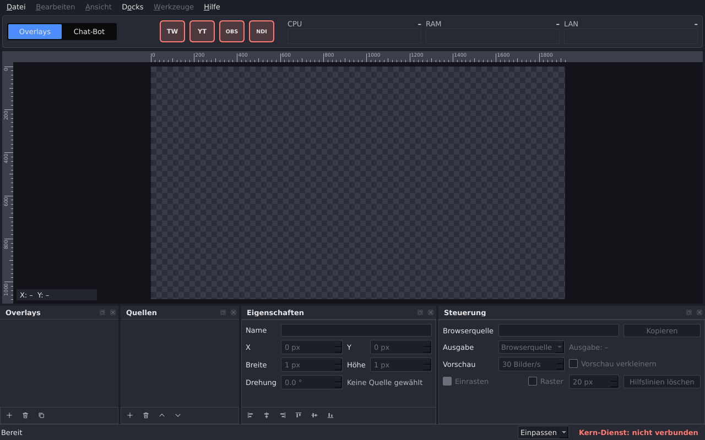

# P05 – Bericht Nachträge zum Overlay-Modell und Fenster-Gerüst

Stand: 2026-11-02. Alle Messwerte stammen vom Studio-PC (Debian 13, Kernel 6.12.113+deb13-amd64, Xfce/xfwm4 unter X11, `DISPLAY=:0.0`, `XDG_SESSION_TYPE=x11`). Kein Xvfb, keine offscreen-Plattform von Qt.

Abnahme Punkt 5 (Handtest durch den Nutzer): ausstehend, Schritte im Abschnitt «Handtest».

## Kurzfassung

| Abnahme | Ergebnis |
|---|---|
| 1. Bau ohne Warnungen mit `-Wall -Wextra`, alle Schalter einzeln abschaltbar | ja: 0 Warnungen im sauberen Neubau und mit `DSS_BUILD_APP=OFF`, `DSS_BUILD_TESTS=OFF`, `DSS_BUILD_CLI=OFF` sowie allen dreien aus |
| 2. `ctest --test-dir build` | 7 von 7 bestanden (neu: `tst_canvasview` 21 Fälle, `bildschirmfoto`; `tst_overlaymodel` jetzt 64 Fälle) |
| 3. Startprüfung `scripts/startpruefung.py --runs 20` | 20/20 sauber in allen drei Fällen (Lauf 16:07). Ein früherer Lauf ergab für `dss-app` 15/20, Ursache: gesperrte Sitzung (Abschnitt «Startprüfung») |
| 4. Bildschirmfoto im Bericht, Abweichungen aufgelistet | ja: `docs/berichte/P05-bilder/fenster-1280x800.png`, Abweichungen im Abschnitt «Vergleich mit dem Bild des Nutzers» |
| 5. Handtest durch den Nutzer | ausstehend |

Teil A, Punkt 3 (Format): Auf dem Studio-PC gibt es keine echten Overlay-Dateien, `format_version` bleibt `1`:

```
$ ls ~/.local/share/dons-streaming-studio ; echo rc=$?      (2026-11-02 15:40:59 +0100)
ls: Zugriff auf '/home/dominik/.local/share/dons-streaming-studio' nicht möglich: Datei oder Verzeichnis nicht gefunden
rc=2
```

## Teil A: Nachträge zum Overlay-Modell

### Adresse

`dss::addressFromName` ersetzt nach dem Kleinschreiben `ß` → `ss`, `æ` → `ae`, `ø` → `oe`, `ł` → `l`. Grossbuchstaben (`Æ`, `Ø`, `Ł`, `ẞ`) sind dann schon klein; `QString::toLower()` macht aus `ẞ` (U+1E9E) ein `ß` (geprüft im Test «Eszett gross»). Neue Testfälle in `tst_overlaymodel::addressFromName`: «Straße» → `strasse`, «STRAẞE» → `strasse`, «Æble æble» → `aeble-aeble`, «Øl øl» → `oel-oel`, «Łódź łąka» → `lodz-laka`, «Grüße aus Køge» → `gruesse-aus-koege`.

### Video wiederholen

| Stelle | Änderung |
|---|---|
| Modell (`overlay.h`) | `Source::loop`, Standard `false`. `validateSource` weist `loop = true` bei Bild und Text ab (der Wert würde dort nicht gespeichert). |
| Datei (`overlayjson.cpp`) | `video.loop` (true/false), Pflichtfeld wie alle Felder; bei `image` ein unbekanntes Feld |
| `OverlayStore::addVideoSource` | neuer Parameter `loop` |
| `dss-cli` | `quelle-video ADRESSE DATEI [--wiederholen]`; Ausgabe «…, Wiederholen ja/nein»; `quelle-liste` hat die Spalte «Wiederholen» (`ja`/`nein` bei Video, `–` sonst); `--wiederholen` bei anderen Befehlen ist ein falscher Aufruf (Exit-Code 2) |
| `docs/06-overlay-format.md` | Feld `loop`, Beispiel mit `"loop": false`, Hinweis zu Ton (nicht im Format), Drehrichtung nachgeführt (entschieden), Adressregel 3 neu |

Neue Testfälle: `jsonRoundTrip` mit `loop = true`; `jsonRejected` «Wiederholen fehlt», «Wiederholen kein bool», «Wiederholen bei Bild»; `invalidValuesRejected` «Wiederholen bei Bild», «Wiederholen bei Text»; `tst_overlaystore::saveAndLoadGiveSameOverlay` mit einem Video mit und einem ohne Wiederholen; `formatDocExample` prüft `loop = false` aus dem Beispiel.

Probelauf `dss-cli` (Scratch-Datenordner, 2026-11-02):

```
$ dss-cli --datenordner … overlay-neu "Grüße aus Køge" 1920 1080
Overlay «Grüße aus Køge» angelegt: Adresse gruesse-aus-koege, 1920x1080
$ dss-cli --datenordner … quelle-video gruesse-aus-koege prototypes/media/alpha.webm --wiederholen
Quelle 1 «alpha.webm» (video) hinzugefügt, Datei media/09445b26…bdf.webm, Wiederholen ja
$ dss-cli --datenordner … quelle-video gruesse-aus-koege prototypes/media/video.webm
Quelle 2 «video.webm» (video) hinzugefügt, Datei media/4e6a0d7f…285.webm, Wiederholen nein
$ dss-cli --datenordner … quelle-liste gruesse-aus-koege
Nr  Art    Sichtbar  X  Y  Breite  Höhe  Drehung  Wiederholen  Name
1   video  ja        0  0  1920    1080  0.0 °    ja           alpha.webm
2   video  ja        0  0  1920    1080  0.0 °    nein         video.webm
3   image  ja        0  0  1920    1080  0.0 °    –            bild1.png
$ dss-cli --datenordner … quelle-bild gruesse-aus-koege prototypes/media/bild1.png --wiederholen ; echo $?
Fehler: --wiederholen gilt nur für quelle-video.
(Hilfe)
2
```

Die Overlay-Datei enthält danach `"video": {"file": "media/…", "loop": true}` bzw. `false`.

## Teil B: Fenster-Gerüst

### Aufbau

| Datei | Inhalt |
|---|---|
| `src/app/theme.h/.cpp` | alle Farben (`Theme`, `darkTheme()`), daraus Palette und Stylesheet; Werte aus dem Bild des Nutzers abgelesen (Pixel, siehe unten) |
| `src/app/mainwindow.h/.cpp` | Menüleiste, Aufbau der Bereiche, Docks, Statuszeile, Speichern und Laden der Anordnung, «Über» |
| `src/app/headerbar.h/.cpp` | Kopfbereich: Modul-Reiter, vier Verbindungsknöpfe, drei Anzeigen |
| `src/app/canvaswidget.h/.cpp` | Leinwand: zeichnet nur, rechnet über `dss_common` |
| `src/app/docks.h/.cpp` | die vier Docks mit ihren Bedienelementen |
| `src/app/symbols.h/.cpp`, `src/app/symbole/*.svg` | Symbole, zur Laufzeit aus dem Quellordner geladen |
| `src/common/canvasview.h/.cpp` | Rechnung der Leinwand-Ansicht: Einpassen, Leinwand-Pixel unter dem Zeiger, Text «X: … Y: …», Striche der Lineale. Nur Qt Core (Regel 9) |
| `tests/tst_canvasview.cpp` | Test dieser Rechnung ohne Qt Gui |
| `tests/bildschirmfoto_pruefen.py` | ctest-Fall `bildschirmfoto` |
| `src/app/main.cpp` | Stil Fusion, Palette und Stylesheet aus dem Theme, Option `--bildschirmfoto` |

Regel 9: Das Fenster enthält keine Logik. Was rechnet (Einpassen, Zeigerposition, Lineale), steht in `dss_common/canvasview` und ist dort getestet. Die Ereignis-Behandler ändern kein Layout: `mouseMoveEvent`/`leaveEvent` der Leinwand merken sich nur die Zeigerposition und rufen `update()`; der Modul-Reiter schaltet die Seite eines `QStackedWidget` um; `closeEvent` speichert die Anordnung.

### Bereiche

| Bereich | Umsetzung |
|---|---|
| Menüleiste | Datei → Beenden (`Ctrl+Q`); Docks → die vier Docks ein- und ausblenden (`QDockWidget::toggleViewAction`); Hilfe → Über (Name, Version aus `dss::version()`, Qt-Version zur Laufzeit `qVersion()`). Bearbeiten, Ansicht, Werkzeuge sind leer und ausgegraut. |
| Kopfbereich | Reiter «Overlays» / «Chat-Bot» (Chat-Bot: Seite mit «Noch nicht vorhanden»). Knöpfe Twitch, YouTube, OBS, NDI mit Zustand «nicht verbunden» (Eigenschaft `state`, roter Rahmen, Tooltip «Twitch: nicht verbunden»). Anzeigen CPU, RAM, LAN mit Titel, Wert «–» und leerer Verlaufsfläche. |
| Leinwand | Platzhalter 1920x1080, Lineale oben und links in Pixeln der Leinwand (beschriftet je nach Zoom alle 1, 2, 5, 10, 20, 50 … Pixel, bei 1280x800 alle 200, kleine Striche alle 20), Schachbrettmuster (Felder 10 Bildschirm-Pixel), dunkler Rand. «Einpassen» rechnet bei jedem Zeichnen aus der aktuellen Grösse, passt also auch nach dem Ändern der Fenstergrösse. «X: … Y: …» unten links in ganzen Leinwand-Pixeln (abgerundet), «X: –  Y: –» ausserhalb der Leinwand und wenn der Zeiger die Fläche verlässt. |
| Docks unten | Overlays (leere Liste; Hinzufügen, Löschen, Kopieren ausgegraut), Quellen (leere Liste; Hinzufügen, Entfernen, nach vorne, nach hinten ausgegraut), Eigenschaften (Name, X, Y, Breite, Höhe, Drehung ausgegraut, «Keine Quelle gewählt», sechs Ausrichtknöpfe ausgegraut), Steuerung (Browserquelle, Kopieren, Ausgabe, «Ausgabe: –», Vorschau, Vorschau verkleinern, Einrasten, Raster, Hilfslinien löschen, alles ausgegraut). Jedes Dock lässt sich lösen, verschieben und schliessen. |
| Statuszeile | links «Bereit», rechts Auswahl «Einpassen» (einziger Eintrag) und «Kern-Dienst: nicht verbunden» (rot) |
| Design | dunkel, Farben nur in `src/app/theme.cpp`; Stil Fusion mit Palette und Stylesheet aus dem Theme |
| Fenster | Grösse, Lage und Anordnung der Docks (`saveGeometry`, `saveState` mit Version 1) in `~/.config/dons-streaming-studio/fenster.ini` (`QStandardPaths::GenericConfigLocation`, also `$XDG_CONFIG_HOME/…`, wenn gesetzt). Beim Start geladen; Standard 1280x800, Docks nebeneinander. |

Farben aus dem Bild (Pixel gelesen mit einem kleinen Python-Skript ohne Fremdpakete im Scratch-Ordner, Beispiele): Menüleiste `#1d1f26` (500,14), Kopfbereich/Docks `#272a33` (140,58), Rahmen und Lineal `#3c404d` (100,100), Rand der Leinwand `#13141a` (100,300), Schachbrett `#383c48`/`#2b2e38` (280,130 / 290,130), Reiter `#4c8dff` (30,58), Auswahl `#284cb8` (130,600), grün `#5fd38d` (267,45), rot `#ff7b72` (371,58).

### Symbole

Die Dateien liegen unter `src/app/symbole/` und werden beim Start aus diesem Ordner gelesen (Pfad beim Bau festgelegt, `DSS_SYMBOL_DIR`). Ersetzen: Datei mit gleichem Namen ablegen, `dss-app` neu starten, kein neuer Bau nötig. Format: **SVG**, Fläche 64x64 (`viewBox="0 0 64 64"`); angezeigt werden sie in 28x28 (Verbindungen) bzw. 14x14 Pixeln (Docks). PNG würde ebenfalls geladen, aber nur unter dem `.svg`-Namen; das ist nicht geprüft. Fehlt eine Datei, steht im Protokoll «Symbol fehlt: …» und der Knopf zeigt seinen Ersatztext (geprüft: `twitch.svg` kurz entfernt, Knopf zeigte «TW», Exit-Code 0).

| Datei | Knopf | Ersatztext |
|---|---|---|
| `twitch.svg` | Twitch | TW |
| `youtube.svg` | YouTube | YT |
| `obs.svg` | OBS | OBS |
| `ndi.svg` | NDI | NDI |
| `hinzufuegen.svg`, `entfernen.svg`, `kopieren.svg` | Overlays: hinzufügen, löschen, kopieren (Quellen: hinzufügen, entfernen) | +, –, K |
| `nach-oben.svg`, `nach-unten.svg` | Quellen: nach vorne, nach hinten | ↑, ↓ |
| `ausrichten-links.svg`, `ausrichten-mitte-waagrecht.svg`, `ausrichten-rechts.svg`, `ausrichten-oben.svg`, `ausrichten-mitte-senkrecht.svg`, `ausrichten-unten.svg` | Eigenschaften: Ausrichten | erster Buchstabe des Tooltips |

Die vier Verbindungssymbole sind neutrale Beschriftungen (Text in DejaVu Sans fett), keine Markenlogos. Für SVG braucht Qt zur Laufzeit das Paket `qt6-svg-plugins` (6.8.2-3, war installiert, von `libqt6gui6` empfohlen: `apt-cache show libqt6gui6` → `Recommends: … qt6-svg-plugins …`). Es steht neu in `scripts/pakete.txt`; `scripts/einrichten.sh` meldet danach «Alles da».

## Ausgeführte Befehle und Ergebnisse

### Vorbereitung

```
$ git pull --rebase origin main
Fast-forward 1947d0b..2414536 (CLAUDE.md, Regel 17)
$ ls ~/.local/share/dons-streaming-studio        → nicht vorhanden (siehe oben)
$ LANG=C dpkg-query -W -f='${Package} ${Version}\n' qt6-svg-plugins libqt6svg6
libqt6svg6 6.8.2-3
qt6-svg-plugins 6.8.2-3
$ command -v xwd ffmpeg xdotool                → /usr/bin/xwd, /usr/bin/ffmpeg (kein xdotool)
```

**Es wurde kein neues Paket installiert.**

### Bau (Abnahme 1)

```
$ date '+%F %T %z'
2026-11-02 16:00:02 +0100
$ rm -rf build && cmake -S . -B build -DCMAKE_BUILD_TYPE=Debug && cmake --build build -j8 > build.log 2>&1 ; echo rc=$?
rc=0
$ grep -c -i -E 'warning|error' build.log
0
$ touch src/app/canvaswidget.cpp && cmake --build build --verbose 2>&1 | grep -c -- '-Wall -Wextra'
1
```

Schalter, je frischer Build-Ordner im Scratch-Ordner (`grep 'Built target' | grep -v autogen`):

| Schalter | rc | Warnungen | gebaut |
|---|---|---|---|
| `-DDSS_BUILD_APP=OFF` | 0 | 0 | dss_common, dss-cli, dss-core, tst_version, tst_unixsignals, tst_overlaymodel, tst_canvasview, tst_overlaystore |
| `-DDSS_BUILD_TESTS=OFF` | 0 | 0 | dss_common, dss-core, dss-cli, dss-app |
| `-DDSS_BUILD_CLI=OFF` | 0 | 0 | dss_common, dss-core, tst_unixsignals, tst_version, tst_canvasview, tst_overlaymodel, tst_overlaystore, dss-app |
| alle drei `OFF` | 0 | 0 | dss_common, dss-core |

Mit `DSS_BUILD_APP=OFF` fehlt auch der ctest-Fall `bildschirmfoto` (er braucht `dss-app`).

Jeder Teil-Commit von Teil B wurde einzeln gebaut (Worktree im Scratch-Ordner, je 0 Warnungen, rc 0). Dabei fiel auf, dass der Commit «Docks, Statuszeile» die neue Signatur von `MainWindow` ohne die passende Zeile in `main.cpp` enthielt; die Zeile wurde in diesen Commit nachgetragen (vor dem Push).

`ldd build/tests/tst_canvasview`: nur `libQt6Test.so.6` und `libQt6Core.so.6` (kein Qt Gui).

### Tests (Abnahme 2)

```
$ date '+%F %T %z' ; ctest --test-dir build
2026-11-02 16:08:56 +0100        (Endstand; gleiches Ergebnis um 16:01:18)
1/7 tst_version         Passed
2/7 tst_unixsignals     Passed
3/7 tst_overlaymodel    Passed
4/7 tst_canvasview      Passed
5/7 media_vorbereiten   Passed
6/7 tst_overlaystore    Passed
7/7 bildschirmfoto      Passed    0.21 sec
100% tests passed, 0 tests failed out of 7
$ build/tests/tst_overlaymodel | grep Totals
Totals: 64 passed, 0 failed, 0 skipped, 0 blacklisted
$ build/tests/tst_overlaystore | grep Totals
Totals: 18 passed, 0 failed, 0 skipped, 0 blacklisted
$ build/tests/tst_canvasview | grep Totals
Totals: 21 passed, 0 failed, 0 skipped, 0 blacklisted
$ env -u DISPLAY ctest --test-dir build -R bildschirmfoto
1/1 Test #7: bildschirmfoto ...***Skipped        (ohne X11: übersprungen, Exit-Code 77)
```

`tst_canvasview` prüft: Einpassen bei Begrenzung durch Höhe und durch Breite; für fünf Leinwand-/Flächengrössen, dass die Leinwand ganz innen liegt, mittig ist und den Abstand auf einer Achse berührt; kleine und leere Fläche; Leinwand-Pixel an Ecken, Mitte, Rundung und knapp ausserhalb auf allen vier Seiten; Text «X: 12  Y: 1079» bzw. «X: –  Y: –»; Hauptschritt der Lineale (Bild des Nutzers: 200); Striche 0 bis 1920 mit Haupt-, Mittel- und kleinen Strichen; gröbere Unterteilung.

`bildschirmfoto` führt `dss-app --bildschirmfoto` in der X11-Sitzung aus (mit leerem eigenem `XDG_CONFIG_HOME`) und prüft: Exit-Code 0, Protokollzeile «Bildschirmfoto gespeichert», PNG mit 1280x800 laut IHDR, keine Konfiguration geschrieben.

### Startprüfung (Abnahme 3)

`scripts/startpruefung.py` startet `dss-app` seit P05 mit einem eigenen temporären `XDG_CONFIG_HOME` je Fall, damit die 20 Starts die Fenstereinstellungen des Nutzers nicht ändern. Ab Start 2 lädt `dss-app` also die beim vorigen Beenden gespeicherte Anordnung; nach dem Fall wird geprüft, dass `fenster.ini` geschrieben wurde (`config_saved` in der Zusammenfassung).

Endstand:

```
$ python3 scripts/startpruefung.py --runs 20 --out docs/berichte/P05-daten ; echo rc=$?
(Beginn 2026-11-02 16:07:22 +0100)
rc=0
```

| Fall | sauber | bis Start min / Median / max (ms) | Beenden min / Median / max (ms) |
|---|---|---|---|
| `dss-core`, SIGTERM | 20/20 | 4,3 / 5,7 / 6,2 | 0,7 / 0,9 / 1,9 |
| `dss-core`, SIGINT | 20/20 | 4,2 / 5,4 / 7,4 | 0,7 / 0,9 / 1,0 |
| `dss-app`, SIGTERM | 20/20 | 137,6 / 145,8 / 158,4 | 8,3 / 12,3 / 14,4 |

Bei allen 60 Starts Exit-Code 0, keine Restprozesse, keine unerwarteten Zeilen; bei `dss-app` war das Fenster 20 von 20 Mal sichtbar, `fenster.ini` wurde geschrieben. Bis zum ersten Zeichnen braucht `dss-app` jetzt etwa 146 ms statt 98 ms (P04, leeres Fenster).

Früherer Lauf (16:01:26) und Ursache:

| Lauf | `dss-app` sauber | Auffällig |
|---|---|---|
| 1, 16:02:26 | 15/20 | Start 7, 8, 14: erstes Zeichnen erst nach 1,9 / 2,5 / 2,3 s; Start 9 bis 13: kein «Fenster gezeichnet» innerhalb 10 s (Exit-Code trotzdem 0, keine Restprozesse) |
| 2, 16:04:26 | 20/20 | max. 160,6 ms |
| Endstand, 16:08:22 | 20/20 | max. 158,4 ms |

Rohdaten: `docs/berichte/P05-daten/startpruefung-app-sigterm-lauf1.*`, `…-lauf2.*`, Endstand `startpruefung-*.json/.md`.

Ursache untersucht (2026-11-02, 16:04 bis 16:06):

```
$ xset q | grep -A2 -i 'screen saver'
  prefer blanking:  yes    allow exposures:  yes
  timeout:  600    cycle:  600
$ xset s activate ; (2 Starts von dss-app mit eigenem XDG_CONFIG_HOME)
1 gezeichnet nach 1499 ms … Map State: IsViewable
2 gezeichnet nach 2168 ms … Map State: IsViewable
$ xset s reset ; (weitere Starts)
… gezeichnet nach None … Map State: IsUnMapped
$ ps -eo comm | grep -i lock
light-locker
$ loginctl show-session 1 -p Active     → Active=no   (X-Sitzung des Nutzers, VT 7)
$ cat /sys/class/tty/tty0/active        → tty8         (Anmeldebildschirm von lightdm)
```

Ergebnis: Bei aktivem Bildschirmschoner zeichnet das Fenster erst nach 1,5 bis 2,2 s (wie Start 7, 8, 14). Sobald `light-locker` die Sitzung gesperrt hat, wird ein neues Fenster nicht abgebildet und nie gezeichnet (wie Start 9 bis 13). Vor dem Lauf 1 hatte es über 10 Minuten keine Eingabe gegeben (Timeout 600 s). Das passt zu Lauf 1; dass genau das dort geschah, ist nicht bewiesen (es gibt kein Protokoll des Bildschirmschoners), und was die Sperre vor Start 14 aufhob, ist nicht geprüft. **Nebenwirkung:** `xset s activate` hat die Sitzung des Nutzers gesperrt; der Nutzer musste sie entsperren. Am System wurde nichts geändert. Siehe `docs/04-offene-punkte.md` Punkt 26.

### Fensteranordnung speichern und laden

Geprüft mit einem Skript im Scratch-Ordner (eigener `XDG_CONFIG_HOME`; Fenstergrösse über `XResizeWindow` aus `libX11.so.6` per `ctypes`, weil `xdotool` fehlt), 2026-11-02 15:58:

```
Start 1: 1280 800
nach Ändern: (1100, 700)
Ende 1: (0, … SIGTERM erhalten, schliesse Fenster … beendet, Exit-Code 0)
ini: ['fenster.ini']
Start 2: (1100, 700)
Ende 2: (0, …)
```

Das Speichern der Dock-Anordnung (geschlossenes oder gelöstes Dock) ist nur über den Handtest geprüft (kein Werkzeug zum Klicken installiert). Der echte Konfigurationsordner `~/.config/dons-streaming-studio` wurde in dieser Sitzung nicht angelegt (geprüft nach Tests und Startprüfung).

## Bildschirmfoto und Vergleich mit dem Bild des Nutzers (Abnahme 4)

```
$ build/src/app/dss-app --bildschirmfoto bild.png      (über ctest-Fall bildschirmfoto, 16:08:56)
… info Fenster gezeichnet
… info Bildschirmfoto gespeichert: …/bildschirmfoto.png (1280x800)
… info beendet, Exit-Code 0
$ sha256sum docs/berichte/P05-bilder/fenster-1280x800.png
636898d5e086bb095d563a60dce6e7ee3a079bca87d390fb90c5be9c343aa764
```



Gleich wie auf `docs/bilder/oberflaeche.png`: Reihenfolge und Lage aller Bereiche, Menütitel, Reiter «Overlays» blau gewählt, vier Verbindungsknöpfe, drei Anzeigen mit Titel und Fläche, Leinwand 1920x1080 an derselben Stelle (Lineal 0 bei x = 278, 1800 bei x ≈ 980, Leinwand-Ecke unten rechts bei ≈ 1025/543), Beschriftung der Lineale alle 200 mit kleinen Strichen alle 20, Anzeige «X: – Y: –» unten links, vier Docks in derselben Reihenfolge mit denselben Beschriftungen, Statuszeile mit «Bereit», «Einpassen» und Kern-Dienst rechts. Farben aus dem Bild übernommen.

Abweichungen, die ich sehe:

| Nr | Stelle | Bild des Nutzers | Bildschirmfoto | Grund |
|---|---|---|---|---|
| 1 | Schrift | andere Schrift (schmaler, nicht bestimmt) | DejaVu Sans, Standard von Qt auf dem Studio-PC; Texte etwas breiter | Schrift nicht vorgegeben, `[OFFEN]` |
| 2 | Verbindungsknöpfe | Logos; Twitch grün, YouTube grau, OBS und NDI rot | «TW», «YT», «OBS», «NDI»; alle rot | Auftrag: neutrale Beschriftung, Zustand «nicht verbunden» |
| 3 | Anzeigen CPU, RAM, LAN | Werte «1 %», «0.8 / 7.8 GiB», «↓ 0 ↑ 0 kbit/s», farbige Verlaufslinien | «–», leere Fläche | Auftrag: ohne Daten |
| 4 | Leinwand | Quellen (Rechtecke, gedrehtes Rechteck, Text) | leer | Auftrag: ohne Daten |
| 5 | Listen Overlays, Quellen | «Overlay 1» bis «Overlay 3», Quellen mit Augen-Symbol | leer | Auftrag: ohne Daten |
| 6 | Knöpfe unter den Listen und Ausrichtknöpfe | hell | ausgegraut (dunkler) | Auftrag |
| 7 | Eigenschaften | Felder bedienbar | ausgegraut | Auftrag |
| 8 | Zahlenfelder | Pfeile ▲▼ rechts | Pfeilfelder ohne sichtbare Pfeile | Stylesheet, `[OFFEN]` Punkt 30 |
| 9 | Steuerung | Adresse `http://192.0.2.2:8080/o/03a4…`, «Ausgabe: verfügbar», alles bedienbar, Einrasten angehakt (blau) | Adresse leer, «Ausgabe: –», alles ausgegraut, Einrasten angehakt (grau) | Auftrag: ohne Daten, ausgegraut |
| 10 | Statuszeile | «✔ Kern-Dienst: verbunden» grün | «Kern-Dienst: nicht verbunden» rot | Auftrag: keine Verbindung zum Kern |
| 11 | Menüs Bearbeiten, Ansicht, Werkzeuge | normal | ausgegraut | Auftrag: leer und ausgegraut |
| 12 | Breite der Docks | Overlays ≈ 230, Quellen ≈ 230, Eigenschaften ≈ 370, Steuerung ≈ 440 Pixel | ≈ 215, 215, 352, 482 Pixel | Qt verteilt den Rest; Annahme 4 |
| 13 | Abstand Reiter – Verbindungsknöpfe | Knöpfe ab x ≈ 266 | ab x ≈ 290 | breitere Schrift (Nr. 1) |
| 14 | Wert «–» der Anzeigen | – | als kurzer Strich, wirkt wie «-» | Schrift (Nr. 1) |
| 15 | Knöpfe der Dock-Titel (lösen, schliessen) | heller, etwas grösser | kleiner und dunkler (Fusion) | Stil |

## Handtest

Grund (Regel 10): Aussehen und Bedienung mit Maus kann Claude Code nicht selbst prüfen (kein Werkzeug zum Klicken installiert). Im Terminal der Xfce-Sitzung, im Ordner des Repos, nach `git pull` und `cmake --build build -j8`:

1. `build/src/app/dss-app` – Fenster sieht aus wie `docs/berichte/P05-bilder/fenster-1280x800.png`. Fenstergrösse mit der Maus mehrmals ändern: Die Leinwand passt immer ganz in die Fläche, die Lineale gehen mit.
2. Zeiger über die Leinwand bewegen: Ecke oben links zeigt etwa «X: 0  Y: 0», Ecke unten rechts etwa «X: 1919  Y: 1079», die Werte passen zu den Linealen; ausserhalb der Leinwand «X: –  Y: –».
3. Dock «Quellen» mit × schliessen und über Menü «Docks» → «Quellen» wieder öffnen; Dock «Steuerung» mit dem Knopf links vom × lösen und mit Doppelklick auf seinen Titel wieder andocken.
4. Reiter «Chat-Bot» → «Noch nicht vorhanden», zurück zu «Overlays»; Menü «Hilfe» → «Über …» zeigt Version 0.1.0 und Qt 6.8.2; dann Menü «Datei» → «Beenden», danach `echo $?` → `0`.
5. Fenster verschieben, Grösse ändern, ein Dock schliessen, beenden und `build/src/app/dss-app` erneut starten: Lage, Grösse und Anordnung sind wie vor dem Beenden. Zum Zurücksetzen: `rm ~/.config/dons-streaming-studio/fenster.ini`.

## Geänderte und neue Dateien

| Datei | Art | Commit (Nummern vor `git pull --rebase` beim Push) |
|---|---|---|
| `src/common/address.h/.cpp`, `tests/tst_overlaymodel.cpp`, `docs/06-overlay-format.md` | geändert | 197fa73 |
| `src/common/overlay.h/.cpp`, `overlayjson.cpp`, `overlaystore.h/.cpp`, `src/cli/main.cpp`, `tests/tst_overlaymodel.cpp`, `tests/tst_overlaystore.cpp`, `docs/06-overlay-format.md` | geändert | 331dd06 |
| `src/app/theme.*`, `symbols.*`, `headerbar.*`, `symbole/*.svg` (15 Dateien) neu; `src/app/main.cpp`, `mainwindow.*`, `CMakeLists.txt` geändert | neu / geändert | 80a4953 |
| `src/common/canvasview.*`, `tests/tst_canvasview.cpp`, `src/app/canvaswidget.*` neu; `src/common/CMakeLists.txt`, `tests/CMakeLists.txt`, `src/app/CMakeLists.txt`, `mainwindow.cpp` geändert | neu / geändert | ce543c3 |
| `src/app/docks.*` neu; `mainwindow.*`, `main.cpp` (eine Zeile), `CMakeLists.txt` geändert | neu / geändert | 150962b |
| `tests/bildschirmfoto_pruefen.py` neu; `src/app/main.cpp`, `tests/CMakeLists.txt`, `scripts/startpruefung.py`, `scripts/pakete.txt`, `README.md` geändert | neu / geändert | d205214 |
| `docs/berichte/P05-bericht.md`, `P05-bilder/`, `P05-daten/` neu; `docs/00-uebergabe.md`, `01-festlegungen.md`, `04-offene-punkte.md` (Punkte 26 bis 32), `05-quellen.md` geändert | neu / geändert | Bericht-Commit |

`src/core/`, `prototypes/`, `web/` und `scripts/einrichten.sh` sind unverändert.

## Nicht erledigt

- Handtest durch den Nutzer (Abnahme 5).
- **[OFFEN]** Schrift des Fensters (Abweichung 1, Punkt 29).
- **[OFFEN]** Bedeutung des grauen YouTube-Symbols auf dem Bild; Farbe je Verbindungszustand ist eine Annahme (Punkt 27).
- **[OFFEN]** Pfeile der Zahlenfelder (Punkt 30).
- **[OFFEN]** Bildschirmschoner und `light-locker` stören Fenstertests nach 10 Minuten ohne Eingabe (Punkt 26).
- Nicht geprüft: Speichern der Dock-Anordnung nach Schliessen oder Lösen eines Docks (nur Handtest, Schritt 5); Schliessen über den Schliessknopf des Fenstermanagers und über «Datei → Beenden» (Handtest, Schritt 4).
- Nicht geprüft: ob die Symbole auch als PNG unter dem Namen `….svg` laden.
- Ändern von «Wiederholen» bei einer bestehenden Video-Quelle (Punkt 31).
- Nicht Teil des Auftrags: Verbindung Fenster–Kern, echte Werte, Overlays und Quellen in den Docks, Zeichnen von Quellen, Rückfrage beim Umbenennen, Ton, Browserquelle, Webserver, helles Design, Einrasten, Raster, Hilfslinien.

## Annahmen

1. **Farbe der Verbindungsknöpfe**: rot = nicht verbunden, grün = verbunden (nach dem Bild: OBS und NDI rot, Twitch grün).
2. **Werte der ausgegrauten Elemente** in «Steuerung» (30 Bilder/s, Raster 20 px, Einrasten angehakt, Raster nicht angehakt) und in «Eigenschaften» (0 px, 0 px, 1 px, 1 px, 0.0 °) sind vom Bild übernommen; «Ausgabe: verfügbar» wurde zu «Ausgabe: –» (keine Daten). Punkt 32.
3. **Einstellungsdatei** `~/.config/dons-streaming-studio/fenster.ini` (Ordnername wie der Datenordner aus P04, Format INI über `QSettings`).
4. **Breite der Docks** beim ersten Start: 230/230/370/440 Pixel angefordert (wie auf dem Bild), Qt verteilt den Rest auf die Docks.
5. **Stil Fusion** für alle Desktop-Umgebungen, damit das Aussehen nicht vom Desktop abhängt.
6. **Modul-Reiter** als zwei umschaltbare Knöpfe (wie auf dem Bild), nicht als Reiterleiste. Der Reiter «Chat-Bot» wechselt nur die Fläche in der Mitte, die Docks bleiben.
7. **Verbindungsknöpfe** sind bedienbar, tun aber noch nichts (nicht ausgegraut, damit der Zustand «nicht verbunden» in Farbe sichtbar ist).
8. **Lineale** zeigen Striche nur über der Leinwand (0 bis Breite bzw. Höhe), wie auf dem Bild.
9. **Zeigerposition** wird abgerundet (Pixel, in dem der Zeiger liegt).
10. **`--bildschirmfoto`** lädt und speichert keine Fenstereinstellungen, damit das Bild immer 1280x800 mit Standardanordnung zeigt.
11. **Symbole** werden aus dem Quellordner geladen (Pfad beim Bau festgelegt); ein verschobenes Repo braucht einen neuen Bau.

## Quellen

Nicht abgerufen in dieser Sitzung (aus dem Wissensstand, im Code als Verweis genannt):

- Qt 6.8, Style Sheets Reference: https://doc.qt.io/qt-6.8/stylesheet-reference.html
- Qt 6.8, QPalette: https://doc.qt.io/qt-6.8/qpalette.html
- Qt 6.8, QStyleFactory (Stil «Fusion»): https://doc.qt.io/qt-6.8/qstylefactory.html
- Qt 6.8, QMainWindow (`saveState`/`restoreState` mit Version, `objectName` der Docks): https://doc.qt.io/qt-6.8/qmainwindow.html#saveState
- Qt 6.8, QStandardPaths (`GenericConfigLocation` unter Linux `~/.config`): https://doc.qt.io/qt-6.8/qstandardpaths.html
- Qt 6.8, QWidget::grab: https://doc.qt.io/qt-6.8/qwidget.html#grab
- Qt 6.8, QString::normalized, toLower: https://doc.qt.io/qt-6.8/qstring.html
- PNG (Third Edition), IHDR: https://www.w3.org/TR/png-3/#11IHDR
- CMake 3.31, `SKIP_RETURN_CODE`: https://cmake.org/cmake/help/v3.31/prop_test/SKIP_RETURN_CODE.html
- Xlib, `XResizeWindow` (nur im Prüfskript): https://www.x.org/releases/current/doc/libX11/libX11/libX11.html
- XDG Base Directory Specification (`XDG_CONFIG_HOME`): https://specifications.freedesktop.org/basedir-spec/latest/
- Unicode, Gross-/Kleinschreibung von U+1E9E: https://www.unicode.org/charts/PDF/U1E00.pdf
- Debian-Pakete und Systemzustand: Ausgaben von `dpkg-query`, `apt-cache`, `xset q`, `loginctl`, `ps` auf diesem Gerät
