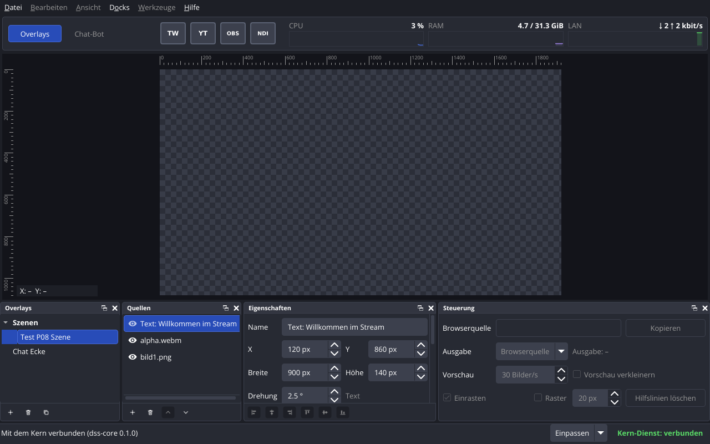
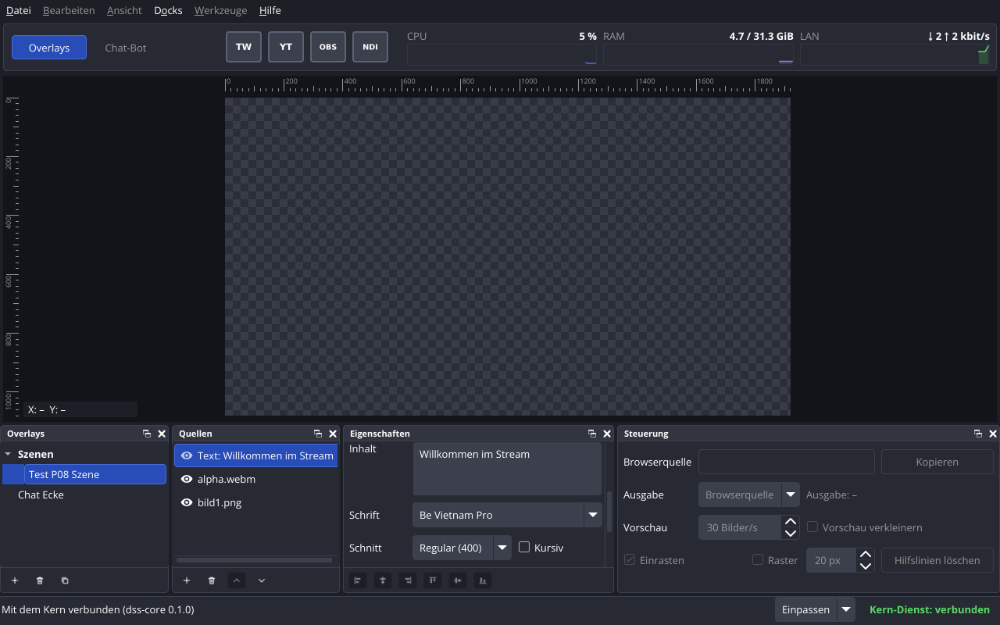

# P08 – Bericht Bearbeiten im Fenster

Stand: 2026-11-03. Alle Messwerte stammen vom Studio-PC (Debian 13, Kernel 6.12.113+deb13-amd64, Xfce/xfwm4 unter X11, `DISPLAY=:0.0`, Qt 6.8.2+dfsg-9+deb13u2, fontconfig 2.15.0-2.3). Kein Xvfb und kein offscreen: Fenstertests liefen in der aktiven X11-Sitzung (vor den Prüfungen `loginctl show-session … -p State -p LockedHint` → `State=active`, `LockedHint=no`).

Auftrag: `prompts/P08-bearbeiten.md`. Entscheide des Nutzers vor dem Auftrag (2026-11-02): 1 Löschen mit Rückfrage, 2 Änderungen wirken sofort, 3 kein Rückgängig (E-22, SOLL), 4 Be Vietnam Pro als Datei im Repo und Standard, 5 Auswahl installierte Schriften + Be Vietnam Pro + «Datei wählen …», der Kern kopiert die Datei, 6 Overlays frei verschiebbar, Ordner mit einer Ebene, Reihenfolge in einer Datei des Kerns, 7 Umbenennen fragt nach der Adresse, Standard «nein», 8 vorderste Quelle oben.

Abnahme Handtest: offen (Schritte unten).

## Kurzfassung

| Abnahme | Ergebnis |
|---|---|
| Bau ohne Warnungen mit `-Wall -Wextra`, jeder Schalter einzeln abschaltbar | ja: 0 Warnungen im Arbeitsordner, im frischen Klon, mit jedem der vier Schalter einzeln aus und mit allen dreien des P07-Stands aus (nur `dss-core`) |
| `ctest --test-dir build`, auch im frischen Klon | 23 von 23 im Arbeitsordner und im frischen Klon (neu: `tst_overlayliste`, `tst_schriften`, `tst_aenderungen`, `tst_windowedit`, `tst_bearbeiten`, `tst_fensterbearbeiten`) |
| Startprüfung `--runs 20` | 20/20 sauber in allen vier Fällen |
| `docs/06-overlay-format.md`, `docs/08-kern-schnittstelle.md` | nachgeführt: `liste.json` (06), Schnittstelle Version 2 mit allen Änderungen, `change_result`, `get_fonts`/`font_list`, Speichern (08) |
| Handtest | offen, 5 Schritte unten |

**Es wurde kein Paket installiert.** fontconfig 2.15.0-2.3 (Programme `fc-list`, `fc-query`) war schon installiert. Die Header der Bibliothek (`libfontconfig-dev`) fehlen; statt sie zu installieren, ruft der Kern die Programme auf (Begründung in Teil F).

## Teil A – Änderungen über die Schnittstelle

- Jede Änderung ist eine Nachricht vom Fenster an den Kern; nur der Kern ändert Daten und schreibt Dateien. 18 Änderungsarten: `create_overlay`, `rename_overlay`, `copy_overlay`, `remove_overlay`, `move_overlay`, `create_folder`, `rename_folder`, `remove_folder`, `move_folder`, `set_folder_expanded`, `add_image_source`, `add_video_source`, `add_text_source`, `remove_source`, `move_source`, `update_source`, `set_text_font`, `replace_image_file`. Dazu `get_fonts`/`font_list` und die Antwort `change_result` (mit `request_id`, bei Erfolg die Kennung des Neuen). Felder, Bereiche und Fehlercodes: `docs/08-kern-schnittstelle.md`, Abschnitt «Änderungen (P08)».
- Reihenfolge im Kern: zuerst `overlay_changed`/`overlay_list` an **alle** Fenster, danach `change_result` an das fragende. So hat das Fenster beim Ergebnis schon den neuen Stand (zum Beispiel, um ein neues Overlay zu wählen).
- **Version der Schnittstelle 1 → 2.** Grund: `overlay_list` hat jetzt `entries` mit Ordnern statt einer flachen Liste; ein Fenster mit Version 1 würde die Nachricht ablehnen. Kern und Fenster mit verschiedener Version trennen sich wie bisher mit `protocol_version`.
- **Zusammenfassen häufiger Änderungen** (Pfeil im Zahlenfeld gedrückt halten, Tippen im Textfeld): Das Fenster hat je Feld (`<Quelle>/<Feld>`) höchstens eine Änderung unterwegs; was dazwischen kommt, ersetzt den wartenden Wert und geht nach der Antwort weg. Zahlenfelder schicken erst bei Enter oder beim Verlassen (`keyboardTracking` aus, https://doc.qt.io/qt-6.8/qabstractspinbox.html#keyboardTracking-prop), die Pfeile sofort. Gemessen in `tst_bearbeiten::frequentChangesAreCombined`: 200 Schritte in Folge → 3 Nachrichten an den Kern, Endwert stimmt. Solange ein Feld eine Änderung unterwegs hat, überschreibt ein eintreffendes `overlay_changed` das Feld nicht (sonst springt der Wert beim Tippen zurück).
- **Verzögertes Speichern** (`src/common/savescheduler.*`): Overlay-Dateien nach 300 ms ohne weitere Änderung, spätestens 1000 ms nach der ersten ungespeicherten. Grund: Ein gehaltener Pfeil schreibt sonst die Datei bis zu 30 Mal je Sekunde neu (`QSaveFile`, atomar). Anlegen, Kopieren, Löschen, `liste.json` und Kopien im Datenordner werden sofort geschrieben. Vor dem Beenden (`quit_request`, SIGTERM, SIGINT) und vor dem Neuladen (SIGHUP) speichert der Kern alles Offene. Nach `kill -9` gehen höchstens die Änderungen der letzten Sekunde verloren (`tst_bearbeiten::restartKeepsEverything` prüft beide Wege).
- Zeiten mit `Qt::CoarseTimer`; dessen Abweichung von bis zu 5 % (https://doc.qt.io/qt-6.8/qt.html#TimerType-enum) berücksichtigen die Grenzen in `tst_aenderungen` (Idle ≥ 280 ms, Höchstwert 950 bis 1900 ms).
- Kein Token in einer Nachricht (unverändert seit P07, geprüft in `tst_protocol` und `tst_kernverbindung`).

## Teil B – Reihenfolge und Ordner der Overlay-Liste

- Neue Datei `<Datenordner>/liste.json` (`format_version` 1), atomar geschrieben, beschrieben in `docs/06-overlay-format.md`, Abschnitt «Liste». Code: `src/common/overlaylist.*`, `src/common/overlaystore.cpp`.
- Inhalt: Einträge der obersten Ebene (Overlay oder Ordner), je Ordner Name, `expanded` und Overlays. Ordner im Ordner ist im Format nicht möglich.
- Fehlende Overlays kommen nach Name ans Ende der obersten Ebene, Einträge zu fehlenden Overlays fallen weg (nur im Speicher, bis zur nächsten Änderung). Eine kaputte Datei wird gemeldet (`list_error` in `overlay_list`, Statuszeile des Fensters) und nicht überschrieben; die Liste fällt auf «nach Name» zurück, Änderungen der Liste werden abgewiesen.
- Ein neues Overlay kommt ans Ende der obersten Ebene, eine Kopie direkt nach das Original im selben Ordner.
- `dss-cli overlay-liste` zeigt dieselbe Reihenfolge mit Spalte «Ordner».

## Teile C, D, E – Docks im Fenster

Die drei Teile sind **ein** Commit (`72a27ae`), weil sie dieselben Dateien ändern (`mainwindow.*`, `mainwindowedit.cpp`, `docks.*`, `dockviews.*`, `src/common/windowedit.*`); einzeln wären die Zwischenstände nicht baubar gewesen. Dieser Commit wurde allein gebaut und geprüft (frischer Klon, 0 Warnungen, 17 von 17 Tests des damaligen Stands).

Schalter `DSS_APP_EDITING` (CMake, Standard `ON`): aus → das Fenster zeigt nur an wie in P07 (Knöpfe ausgegraut, kein Ziehen, keine Kontextmenüs). Die Oberfläche ist dünn (Regel 9): Ziele beim Ziehen, Umrechnung der Zeilen in Stellen, neue Adresse beim Umbenennen, Dateifilter, Drehung in Zehntelgrad, Farbtext, Schnitte je Familie und Auswahl der Schriftdatei stehen in `src/common/windowedit.*` und `src/common/overlaylist.*` ohne Qt Gui und werden dort getestet.

**Dock «Overlays»** (`OverlayTree`): Ordner fett, aufklappbar (gespeichert mit `set_folder_expanded`). Ziehen: Overlays umsortieren, in Ordner hinein (auf den Ordner) und heraus, Ordner umsortieren; ein Ordner auf einen Ordner oder in einen Ordner wird abgewiesen. Das Fenster verschiebt beim Ziehen selbst nichts, es schickt `move_overlay`/`move_folder` und zeigt den Stand vom Kern. Knöpfe hinzufügen, entfernen, kopieren; Kontextmenü: Overlay anlegen …, Umbenennen …, Kopieren, Löschen …, Ordner anlegen …, Ordner umbenennen …, Ordner löschen …. Anlegen fragt Name, Breite, Höhe (Vorschlag «Neues Overlay», 1920 × 1080). Umbenennen fragt nur dann nach der Adresse, wenn sie sich ändern würde; Standard und Escape ist «Adresse behalten» (Entscheid 7). Löschen von Overlay und Ordner mit Rückfrage, Standard «Abbrechen»; Overlays eines gelöschten Ordners kommen auf die oberste Ebene. Ein neues oder kopiertes Overlay wird gewählt.

**Dock «Quellen»** (`SourceList`): vorderste Quelle oben. Knopf «+» mit Menü Bild … / Video … / Text, entfernen (Rückfrage), nach vorne, nach hinten; Klick aufs Auge schaltet sichtbar/ausgeblendet, ohne die Auswahl zu ändern; Ziehen ändert die Reihenfolge (`move_source`). Doppelklick oder Kontextmenü: Umbenennen. Bild und Video: Dateiwahl mit Filter «Bilder (*.png *.jpg *.jpeg)» bzw. «Videos (*.webm *.mp4)»; der Kern kopiert die Datei in den Datenordner. Text: Inhalt «Text», Be Vietnam Pro Regular. Lage und Grösse einer neuen Quelle wie bisher 0/0 in Overlaygrösse (Punkt 20).

**Dock «Eigenschaften»**: Name, X, Y, Breite, Höhe (ganze Pixel; X/Y −100 000 bis 100 000, Breite/Höhe 1 bis 100 000), Drehung 0.0 bis 359.9 ° mit einer Nachkommastelle, über 359.9 springt sie auf 0.0, gespeichert in Zehntelgrad. Seite je Art: Bild «Datei ersetzen …»; Video «Wiederholen»; Text Inhalt (mehrzeilig), Schrift, Schnitt, Kursiv, Grösse (px, ab 1), Farbe (Farbwahl mit Deckkraft, gespeichert `#RRGGBBAA`), Ausrichtung Links/Mitte/Rechts. «Kursiv» ist nur wählbar, wenn die Familie kursive Schnitte hat. Ein leerer Name wird nicht geschickt; das Feld zeigt wieder den alten Namen und die Statuszeile einen Hinweis. Fehler vom Kern zeigt die Statuszeile 10 s lang. Die Knöpfe zum Ausrichten unten bleiben ausgegraut (E-10). Das Dock hat eine Bildlaufleiste, weil die Felder einer Textquelle in der Standardhöhe (215 px) nicht Platz haben (Punkt 49).



`P08-bilder/bearbeiten.png`: Testkern mit Ordner «Szenen» (aufgeklappt) und Overlay «Test P08 Szene» darin, darunter «Chat Ecke» auf der obersten Ebene. Quellen Text (vorne, gewählt), `alpha.webm`, `bild1.png`. «Eigenschaften» zeigt Name, X 120, Y 860, Breite 900, Höhe 140, Drehung 2.5 ° und die Art «Text».



`P08-bilder/bearbeiten-text.png`: wie oben, «Eigenschaften» bis zur Seite der Art gerollt (`--eigenschaften-art`): Inhalt, Schrift «Be Vietnam Pro», Schnitt «Regular (400)», Kursiv. Zu sehen ist auch die blaue Fläche links neben dem gewählten Overlay im Ordner (Punkt 48) und eine waagrechte Bildlaufleiste unter der Quellenliste, weil der Name der Textquelle breiter ist als das Dock.

Erzeugt mit `sh docs/berichte/P08-daten/bildschirmfoto.sh <bild> [--eigenschaften-art]` (eigener Datenordner, eigener Kern, eigene Verbindung, eigenes `XDG_CONFIG_HOME`): App rc 0, Kern rc 0, «keine Einstellungen geschrieben», im Protokoll des Kerns «Schriften geladen: 132 Schnitte».

## Teil F – Schriften

**Be Vietnam Pro** liegt unter `src/common/schriften/be-vietnam-pro/` (18 TTF-Dateien Thin bis Black, je aufrecht und kursiv, zusammen 2,4 MB, dazu `OFL.txt`). Ort: bei `dss_common`, weil Kern (Standardschrift neuer Textquellen, Kopie in den Datenordner) und Fenster (Auswahl) sie brauchen; der Pfad kommt als `DSS_BUILTIN_FONT_DIR` beim Bau (`src/common/CMakeLists.txt`). Die Schrift des Fensters (Open Sans, `src/app/schriften/`) gehört nur dem Fenster und bleibt dort.

| Punkt | Wert |
|---|---|
| Bezug | Repo google/fonts, Ordner `ofl/bevietnampro`, Commit `c13390277dfb1fcc7415d84ef7ef9cfc1e52f8c1` (2026-03-03), https://github.com/google/fonts/tree/c13390277dfb1fcc7415d84ef7ef9cfc1e52f8c1/ofl/bevietnampro |
| Prüfung des Bezugs | Git-Blob-Prüfsumme (SHA-1) jeder Datei gleich wie in der Liste der GitHub-API (`api.github.com/repos/google/fonts/contents/ofl/bevietnampro?ref=c133902…`) |
| Version | 1.002 (Name-Tabelle 5 «Version 1.002; ttfautohint (v1.8.3)») |
| Lizenz | SIL Open Font License 1.1 (`OFL.txt` am Bezugsort, `METADATA.pb`: `license: "OFL"`, Name-Tabelle 13); Copyright 2021 The Be Vietnam Pro Project Authors (https://github.com/bettergui/BeVietnamPro) |
| sha256 | `OFL.txt` `6b7f8f73609a25ea78c891e34cf37b06f8a676b7ea986e941e43b009110f2a85`, `BeVietnamPro-Regular.ttf` `cd1ef6e9d7db28ad5cdb88a65ccbe693870e60d340b791f349d248342b4fe4c3` |

**Datei zu Name und Schnitt.** Qt nennt keinen Pfad zu einer Schrift. Weg: fontconfig über die schon installierten Programme `fc-list` (alle installierten Schriften) und `fc-query` (einzelne Dateien: Be Vietnam Pro, Schriftdateien im Datenordner), Format `%{file}\t%{index}\t%{family[0]}\t%{style[0]}\t%{weight}\t%{slant}\t%{variable}\n` (https://www.freedesktop.org/software/fontconfig/fontconfig-user.html). Gründe: fontconfig ist die Quelle, aus der auch Qt unter Linux seine Schriften kennt; die Bibliothek direkt zu nutzen bräuchte `libfontconfig-dev` (nicht installiert, Regel 5); die Programme laufen ohne zu blockieren über `QProcess` im Kern, nur beim ersten `get_fonts` und nach neuen Dateien. Das Gewicht von fontconfig (0 bis 215) wird umgerechnet wie `FcWeightToOpenType` in fontconfig 2.15.0 (https://gitlab.freedesktop.org/fontconfig/fontconfig/-/blob/2.15.0/src/fcweight.c) in 100 bis 900 wie in der Overlay-Datei.

Gemessen am 2026-11-03 00:42 (Zeit mit `date +%s%N` vor und nach dem Befehl): `fc-list --format …` 9 / 8 / 8 ms bei 191 Zeilen, `fc-query --format …` der 18 Be-Vietnam-Pro-Dateien 4 ms. Das ganze Laden im Kern (`FontCatalogLoader`: `fc-list`, dann `fc-query`, über `QProcess`) misst `tst_schriften::loaderOnThisPc`: 13 / 13 / 14 ms (2026-11-03 00:48, `./tst_schriften loaderOnThisPc`); das ist der Wert in `docs/08`.

Auswahl im Fenster: Familien (Be Vietnam Pro zuerst, dann nach Name), Trennstrich, «Datei wählen …». Schnitt als «Name (Gewicht)», zum Beispiel «Bold (700)»; kursive Schnitte erscheinen nicht doppelt, sondern über «Kursiv». Zur Wahl sucht `resolveFontFace` den Schnitt mit passendem Kursiv und dem nächsten Gewicht (bei gleichem Abstand das schwerere) und das Fenster schickt `set_text_font` mit Familie, Gewicht, Kursiv und Datei. Der Kern kopiert die Datei in den Datenordner (gleiche Prüfsumme → eine Kopie, wie in P04). «Datei wählen …» schickt nur die Datei; Gewicht und Kursiv liest der Kern dann mit `fc-query`.

Variable Schriften (Annahme, `[OFFEN]`, Punkt 45): Die Grundform einer variablen Datei kommt nicht in die Auswahl, benannte Schnitte derselben Datei schon. Auf dem Studio-PC gibt es keine variable Schrift (alle 191 Zeilen mit `variable = False`, `tests/daten/schriften/fc-list.txt`, 2026-11-03); geprüft ist der Weg nur mit erfundenen Zeilen in `tst_schriften`. Ein Zeichner müsste bei einer variablen Datei die Achse `wght` selbst setzen.

Hinweis: Die Lizenzen der Systemschriften wurden nicht geprüft (laut Auftrag; die Software bleibt privat). Eine gewählte Systemschrift wird in den Datenordner kopiert und später von der Browserquelle ausgeliefert.

## Ausgeführte Befehle und Ergebnisse

### Bau

```
$ cmake -S . -B <scratch>/build-<Schalter> -D<Schalter>=OFF && cmake --build <scratch>/build-<Schalter> -j8 ; grep -c 'warning:'
```

| Variante (frischer Build-Ordner im Scratch-Ordner) | Zeit (Ende) | rc | Warnungen | gebaut / ctest |
|---|---|---|---|---|
| Arbeitsordner `build/` (voll) | 2026-11-03 | 0 | 0 | ctest 23/23 |
| frischer Klon, Stand `3c7c4ed` | 2026-11-03 00:38 | 0 | 0 | ctest 23/23 |
| `-DDSS_APP_EDITING=OFF` | 00:30 | 0 | 0 | ctest 23/23 (`tst_fensterbearbeiten`: 4 bestanden, 4 übersprungen) |
| `-DDSS_BUILD_CLI=OFF` | 00:31 | 0 | 0 | ctest 23/23 (Lauf 2026-11-03 00:44, 23,8 s) |
| `-DDSS_BUILD_APP=OFF` | 00:32 | 0 | 0 | ctest 19/19 |
| `-DDSS_BUILD_TESTS=OFF` | 00:32 | 0 | 0 | dss-app, dss-cli, dss-core |
| `-DDSS_BUILD_APP=OFF -DDSS_BUILD_CLI=OFF -DDSS_BUILD_TESTS=OFF` | 00:44 | 0 | 0 | dss-core |

Jeder P08-Commit einzeln gebaut (frischer Klon, `git checkout <commit>`): siehe Abschnitt «Commits».

### Tests

```
$ ctest --test-dir build --output-on-failure
23/23 bestanden
$ cd build/tests && XDG_CONFIG_HOME=$PWD/fenster-config ./<test>     (2026-11-03 00:42, einzeln für die Fallzahlen)
```

| Test (neu) | Ergebnis | Inhalt |
|---|---|---|
| `tst_overlayliste` | 19 bestanden | `liste.json` lesen und schreiben, fehlende und überzählige Einträge, kaputte Datei, Ordner im Ordner abgewiesen, Ziele beim Ziehen, Rückfall nach Name |
| `tst_schriften` | 23 bestanden | Ausgabe von `fc-list` (echte Kopie `tests/daten/schriften/fc-list.txt`, 191 Zeilen), Gewicht wie FcWeightToOpenType, variable Grundform übergangen, Sortierung, Auflösung Name und Schnitt → Datei, `fc-query` auf Be Vietnam Pro |
| `tst_aenderungen` | 57 bestanden | ohne Qt Gui: jede Änderungsart hin und zurück, Felder je Art, `null`, ungültige Anfragen (Tabelle), `change_result`, `font_list`, Änderungen auf das Modell anwenden, `moveSource`, Zeiten des verzögerten Speicherns, verzögertes und sofortiges Schreiben im Store |
| `tst_windowedit` | 22 bestanden | Logik des Fensters ohne Qt Gui gegen echte Schriftdaten (DejaVu Sans mit Book 400 und Bold 700, DejaVu Sans Mono mit kursiv) |
| `tst_bearbeiten` | 9 bestanden | Kern als eigener Prozess, zwei Verbindungen: jede Art von Änderung einmal, beide Fenster bekommen dieselbe Änderung, Ordner, Quellen, Schriftliste (neue Kopie kommt auch beim zweiten Fenster an), ungültige Nachrichten, Zusammenfassen (200 Schritte → 3 Nachrichten), Neustart nach SIGTERM und nach `kill -9` → alles wie vorher |
| `tst_fensterbearbeiten` | 7 bestanden, 1 übersprungen | echtes `MainWindow` in der X11-Sitzung mit eigenem Kern: Baum mit Ordnern, Eigenschaften Text (Zahlen, Inhalt, Schrift, Schnitt, Kursiv, Ausrichtung), Seiten Bild und Video, Quellenliste (Auge, Ziehen, nach vorne/hinten, Umbenennen per Doppelklick), Overlays anlegen/umbenennen mit Rückfrage/kopieren/löschen. Übersprungen: der Fall für `DSS_APP_EDITING=OFF` (umgekehrt im Bau mit Schalter aus) |

Angepasst: `tst_protocol` (Version 2, `overlay_list` mit `entries`), `tst_kernverbindung` (Version 2). Dialoge in `tst_fensterbearbeiten` beantwortet ein Zeitgeber über die Knöpfe des Dialogs. Datei- und Farbwahl prüft kein Test (Punkt 46). `tst_fensterbearbeiten` lief 5 Mal hintereinander ohne Fehler.

Fehler, die erst die Tests in P08 gefunden haben, im jeweiligen Teil behoben:

1. `CoreClient::listData()` gab eine Kopie zurück; ein Zeiger aus `summary()` darauf zeigte ins Leere. Jetzt Referenz; vor Dialogen kopiert das Fenster die Werte, weil während des Dialogs eine neue Liste kommen kann.
2. Neustart in `tst_bearbeiten`: Der zweite Abzug fehlte ein Overlay, weil die Verbindung den Abbruch noch nicht bemerkt hatte; der Test wartet jetzt darauf.
3. Annahme «DejaVu Sans hat Oblique» war falsch: Auf dem Studio-PC hat DejaVu Sans nur Book 400 und Bold 700 (`fc-list`). Test an die echten Daten angepasst.
4. `QTreeView::branch` mit Hintergrund blendete die Pfeile der Ordner aus; zurückgenommen (Punkt 48).

### Startprüfung

```
$ python3 scripts/startpruefung.py --runs 20 --out docs/berichte/P08-daten   (Beginn 2026-11-03 00:34:44 +0100)
```

| Fall | sauber | Start ms (min / Median / max) | Beenden ms (min / Median / max) |
|---|---|---|---|
| `core-sigterm` | 20/20 | 14.3 / 18.9 / 21.0 | 1.4 / 1.7 / 3.7 |
| `core-sigint` | 20/20 | 14.4 / 19.2 / 21.1 | 1.5 / 1.6 / 1.9 |
| `app-sigterm` | 20/20 | 171.0 / 178.5 / 193.2 | 10.7 / 13.1 / 15.6 |
| `app-kern-sigterm` | 20/20 | 161.6 / 175.7 / 184.7 | 12.0 / 14.8 / 18.1 |

Einzelwerte: `docs/berichte/P08-daten/startpruefung-*.json` und `.md`. Gegenüber P07 startet das Fenster im Median etwa 18 ms langsamer (P07: 160.0 / 158.7 ms); Ursache nicht geprüft.

## Handtest

Grund (Regel 10): Bedienung mit der Maus (Ziehen in den Listen), die Dialoge des Systems für Datei- und Farbwahl und das Aussehen lassen sich hier nicht automatisch prüfen (Punkt 46). Was oben geprüft ist (Nachrichten, Speichern, Neustart, Abweisungen, Felder), muss der Nutzer nicht wiederholen. Der Handtest nutzt die echten Daten in `~/.local/share/dons-streaming-studio` und den echten Dienst. Im Terminal der Xfce-Sitzung, im Ordner des Repos:

1. **Overlay und Ordner.** `git pull && cmake -S . -B build && cmake --build build -j8 && build/src/app/dss-app &`. Im Dock «Overlays» Knopf «+» → Name «Handtest P08», 1920 × 1080 → «Anlegen». Rechtsklick in die Liste → «Ordner anlegen …» → «Handtest Ordner» → «OK». «Handtest P08» mit der Maus auf «Handtest Ordner» ziehen, dann den Ordner ganz nach oben ziehen, zu- und wieder aufklappen. Erwartet: das neue Overlay ist gewählt; beim Ziehen zeigt ein Strich oder Rahmen das Ziel; die Liste bleibt nach dem Loslassen so. Kontrolle: `build/src/cli/dss-cli overlay-liste` → erste Zeile «Handtest Ordner  Handtest P08  handtest-p08 …».
2. **Quellen.** «Handtest P08» gewählt. Im Dock «Quellen» Knopf «+» → «Bild …» → `prototypes/media/bild1.png`; «+» → «Video …» → `prototypes/media/alpha.webm`; «+» → «Text». Erwartet: jede neue Quelle steht oben und ist gewählt. Dann «bild1.png» mit der Maus ganz nach oben ziehen, «Text: Text» wählen und Knopf «nach hinten» (Pfeil nach unten), dann auf das Auge vor «alpha.webm» klicken. Erwartet von oben: «bild1.png», «alpha.webm» (Auge zu), «Text: Text». Kontrolle: `build/src/cli/dss-cli quelle-liste handtest-p08` → Nr. 1 `text`, Nr. 2 `video` mit Sichtbar «nein», Nr. 3 `image`.
3. **Eigenschaften.** «Text: Text» wählen. X 100, Y 50, Breite 800, Höhe 200 (je mit Enter), Drehung 12.5; Inhalt «Hallo», Enter, «Welt»; Schrift «Liberation Sans», Schnitt «Bold (700)», Kursiv an, Grösse 64, Farbe: eine Farbe mit Deckkraft (Alpha) etwa 50 % → «OK», Ausrichtung «Mitte». Dann «alpha.webm» wählen und «Wiederholen» anhaken. Erwartet: «alpha.webm» und danach «Text: Text» wieder wählen zeigt alle Werte wie eingegeben; der Farbknopf zeigt die Farbe. Kontrolle: `build/src/cli/dss-cli quelle-liste handtest-p08` → Text: 100, 50, 800, 200, 12.5 °; Video: Wiederholen «ja».
4. **Umbenennen und Löschen.** Rechtsklick auf «Handtest P08» → «Umbenennen …» → «Handtest P08 neu» → «OK». Erwartet: Frage «Adresse ändern?» mit Bisher `handtest-p08`, Neu `handtest-p08-neu`; Enter drücken (Standard «Adresse behalten»). Doppelklick auf «bild1.png» → «Logo» → «OK». Knopf «Overlay kopieren» → «Handtest P08 neu Kopie» erscheint unter dem Original und ist gewählt. Diese Kopie: Knopf «Overlay löschen» → in der Frage «Abbrechen» (Kopie bleibt), noch einmal → «Löschen». Rechtsklick auf «Handtest Ordner» → «Ordner löschen …» → «Löschen». Erwartet: «Handtest P08 neu» steht danach auf der obersten Ebene. Kontrolle: `build/src/cli/dss-cli overlay-liste` → «Handtest P08 neu» mit Adresse `handtest-p08`, Ordner «–», keine Kopie.
5. **Schliessen, öffnen, aufräumen.** Fenster mit dem Schliessknopf (×) schliessen, `systemctl --user is-active dss-core.service` → `inactive`. `build/src/app/dss-app &` → erwartet: «Handtest P08 neu» mit «Logo», «alpha.webm» (Auge zu, Wiederholen an) und «Text: Text» mit allen Werten aus Schritt 3. Aufräumen: «Handtest P08 neu» wählen → Knopf «Overlay löschen» → «Löschen», Fenster schliessen. `build/src/cli/dss-cli overlay-liste` → «Handtest P08 neu» fehlt. Die Kopien von `bild1.png`, `alpha.webm` und der Liberation-Sans-Datei unter `~/.local/share/dons-streaming-studio/media/` bleiben liegen (Punkt 24).

Bitte dabei auch auf das Aussehen achten: Einfügestrich beim Ziehen, blaue Fläche neben einem gewählten Overlay im Ordner (Punkt 48), Bildlaufleiste in «Eigenschaften» (Punkt 49).

Beobachtung vor dem Handtest (nicht geändert): In den echten Daten liegt noch «Handtest P07» mit Adresse `handtest-p07-2` ohne Quellen (`dss-cli overlay-liste`, 2026-11-03 00:42). Laut Bericht P07 waren beide Handtest-Overlays gelöscht worden. Löschen bei Bedarf im Fenster (Rechtsklick → «Löschen …»).

## Commits

| Commit | Teil | einzeln gebaut |
|---|---|---|
| `cd21f63` | B: Reihenfolge und Ordner der Overlay-Liste in `liste.json` | ja: 0 Warnungen, 17/17 |
| `c254fbc` | F: Be Vietnam Pro 1.002 im Repo, Auswahl der Schriften über fontconfig | ja: 0 Warnungen, 17/17 |
| `1c77713` | A: Änderungen über die Schnittstelle (Version 2), verzögertes Speichern | ja: 0 Warnungen, 17/17 |
| `72a27ae` | C, D, E: Overlays, Quellen und Eigenschaften im Fenster bearbeiten | ja: 0 Warnungen, 17/17 |
| `3c7c4ed` | Tests | ja (= frischer Klon oben): 0 Warnungen, 23/23 |
| (dieser) | Bericht und Dokumente | nur Dokumente |

Je Commit ein frischer Klon mit `git checkout <commit>`, `cmake --build -j8`, `ctest` (B und F: 2026-11-03 00:45). B und F stehen vor A, weil A die Liste (B) in `overlay_list` und die Schriften (F) in `font_list` braucht. Die Tests sind ein eigener Commit nach dem Auftrag («ein Commit pro Teil (A bis F, Tests, Bericht)»); die Commits davor bestehen die Tests ihres Stands.

## Geänderte und neue Dateien

Neu:
- `src/common/overlaylist.*`, `fontcatalog.*`, `savescheduler.*`, `windowedit.*`, `src/common/schriften/be-vietnam-pro/` (18 TTF, `OFL.txt`)
- `src/app/dialogs.*`, `dockviews.*`, `mainwindowedit.cpp`
- `tests/tst_overlayliste.cpp`, `tst_schriften.cpp`, `tst_aenderungen.cpp`, `tst_windowedit.cpp`, `tst_bearbeiten.cpp`, `tst_fensterbearbeiten.cpp`, `tests/daten/schriften/fc-list.txt` (Kopie der Ausgabe von `fc-list` des Studio-PCs)
- `docs/berichte/P08-bericht.md`, `P08-bilder/` (2 Bilder), `P08-daten/` (Startprüfung, `bildschirmfoto.sh`)

Geändert:
- `src/common/protocol.*`, `coreclient.*`, `overlay.*`, `overlaystore.*`, `src/common/CMakeLists.txt`
- `src/core/coreservice.*`, `src/core/main.cpp`; `src/cli/main.cpp`
- `src/app/main.cpp` (`--eigenschaften-art`), `mainwindow.*`, `docks.*`, `theme.cpp`, `src/app/CMakeLists.txt` (Bibliothek `dss_app_ui`, Schalter `DSS_APP_EDITING`)
- `tests/CMakeLists.txt`, `tst_protocol.cpp`, `tst_kernverbindung.cpp`
- `docs/00-uebergabe.md`, `docs/03-funktionen-entwurf.md` (E-22), `docs/04-offene-punkte.md`, `docs/05-quellen.md`, `docs/06-overlay-format.md`, `docs/07-bauplan.md`, `docs/08-kern-schnittstelle.md`, `README.md`

Ausserhalb des Repos: nichts geändert. Alle Prüfläufe mit eigenem Datenordner, eigener Verbindung und eigenem `XDG_CONFIG_HOME`; `~/.config/dons-streaming-studio/fenster.ini` und die echten Daten blieben unberührt.

## Nicht erledigt

- Handtest durch den Nutzer (oben).
- Datei- und Farbwahl nicht automatisch geprüft (Punkt 46).
- Auflösung eines bestehenden Overlays ändern: nicht Teil von P08 (Punkt 47).
- Laut Auftrag nicht Teil: Zeichnen (P09), Steuerung/Browserquelle (P10), Rückgängig (E-22), Ausrichten/Einrasten/Raster (E-10), TX-06 bis TX-16, Löschen ungenutzter Kopien (Punkt 24).

## Annahmen

- Eine neu hinzugefügte Quelle wird gewählt (wie ein neues Overlay laut Auftrag).
- Zwei Fenster ändern dasselbe Feld: Es gilt, was zuletzt beim Kern ankommt (Punkt 50).
- 300 ms / 1000 ms für das verzögerte Speichern; nach `kill -9` höchstens etwa 1 s verloren.
- Zahlenfelder schicken bei Enter, beim Verlassen und bei jedem Pfeilschritt, nicht bei jeder Ziffer.
- Bereiche X/Y −100 000 bis 100 000, Breite/Höhe/Grösse 1 bis 100 000 im Fenster (Modell: Breite, Höhe, Grösse ab 1).
- Schnitt bei Familienwechsel: nächstes Gewicht, bei gleichem Abstand das schwerere.
- Variable Schriften: nur benannte Schnitte (Punkt 45, `[OFFEN]`).
- Neue Textquelle: Inhalt «Text», Be Vietnam Pro Regular, übrige Werte die Vorgaben des Modells.

## `[OFFEN]`

- Übersetzung von Qt: `qtbase_de.qm` enthält «ß» (zum Beispiel «Schließen», «Größe»), deshalb nicht geladen; Texte von Qt selbst (Kontextmenü der Textfelder) bleiben englisch. Ob die System-Dialoge für Datei und Farbe «ß» zeigen, ist nicht geprüft (Punkt 44).
- Variable Schriften und die Achse `wght` im Zeichner (Punkt 45).

## Quellen

- Auftrag: `prompts/P08-bearbeiten.md`
- Be Vietnam Pro: https://github.com/google/fonts/tree/c13390277dfb1fcc7415d84ef7ef9cfc1e52f8c1/ofl/bevietnampro, Dateien über https://raw.githubusercontent.com/google/fonts/c13390277dfb1fcc7415d84ef7ef9cfc1e52f8c1/ofl/bevietnampro/, Prüfsummen über https://api.github.com/repos/google/fonts/contents/ofl/bevietnampro?ref=c13390277dfb1fcc7415d84ef7ef9cfc1e52f8c1; Projekt https://github.com/bettergui/BeVietnamPro; Lizenz SIL OFL 1.1 (`OFL.txt`, Verweis https://scripts.sil.org/OFL)
- fontconfig: https://www.freedesktop.org/software/fontconfig/fontconfig-user.html, https://gitlab.freedesktop.org/fontconfig/fontconfig/-/blob/2.15.0/src/fcweight.c
- Qt 6.8: https://doc.qt.io/qt-6.8/qabstractitemview.html (DragDropMode, DropIndicatorPosition), https://doc.qt.io/qt-6.8/qabstractspinbox.html#keyboardTracking-prop, https://doc.qt.io/qt-6.8/qt.html#TimerType-enum, https://doc.qt.io/qt-6.8/qstatusbar.html#showMessage, https://doc.qt.io/qt-6.8/qprocess.html, https://doc.qt.io/qt-6.8/qsavefile.html, https://doc.qt.io/qt-6.8/qttest-index.html, https://doc.qt.io/qt-6.8/qwidget.html#grab, https://doc.qt.io/qt-6.8/qmainwindow.html#saveState
- Paket qt6-translations-l10n 6.8.2-2 (Datei `qtbase_de.qm`, lokal gelesen)
