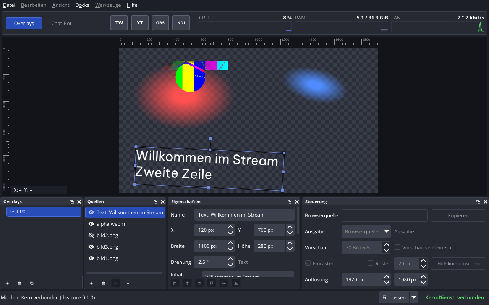
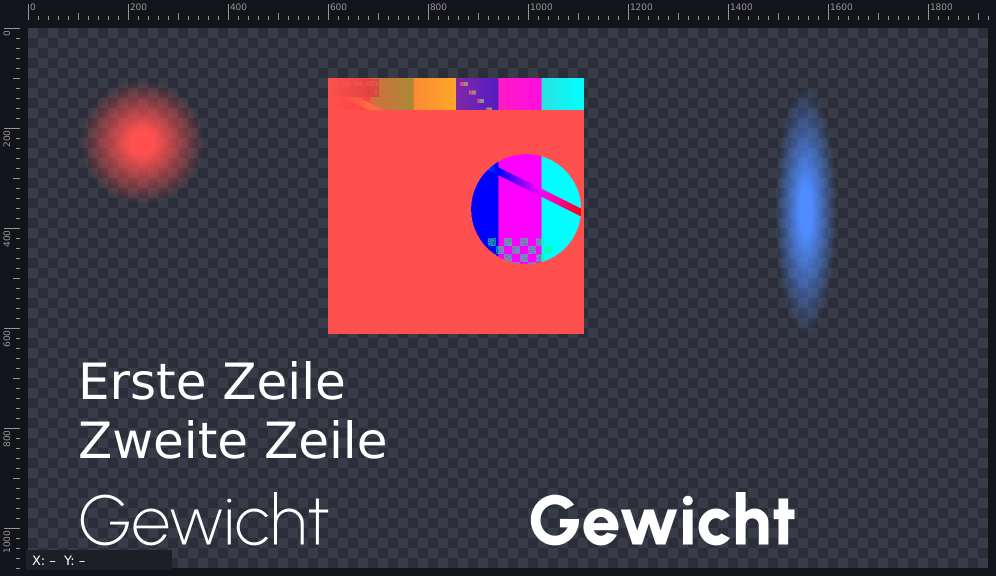

# P09 – Bericht Zeichner im Editor

Stand: 2026-11-03. Alle Messwerte stammen vom Studio-PC (Debian 13, Kernel 6.12.113+deb13-amd64, Xfce/xfwm4 unter X11, `DISPLAY=:0.0`, Qt 6.8.2+dfsg-9+deb13u2, FFmpeg 7.1.5-0+deb13u1, NVIDIA 550.163.01). Kein Xvfb und kein offscreen: Fenstertests und Messungen liefen in der aktiven X11-Sitzung (vor jedem Lauf `loginctl show-session … -p LockedHint` → `LockedHint=no`).

Auftrag: `prompts/P09-zeichner-editor.md`. Entscheide des Nutzers (2026-11-03): 1 Kopfbereich fest, 2 Fläche neben Einträgen im Ordner frei, 3 Qt-Texte deutsch ohne «ß», 4 variable Schriften mit Achse `wght`, 5 Auflösung im Dock «Steuerung», 6 Bild und Video gestreckt, neue Quellen in Originalgrösse, 7 Ecke mit Seitenverhältnis (Shift frei), Kante nur Breite oder Höhe, 8 Drehgriff, Shift rastet auf 15° ein, Drehung um die Mitte im Uhrzeigersinn, 9 Ende eines Videos leer / «Am Ende anhalten» / «Wiederholen», 10 Video läuft ab dem Wählen des Overlays.

Abnahme Handtest: offen (Abschnitt «Handtest»).

## Kurzfassung

| Abnahme | Ergebnis |
|---|---|
| Bau ohne Warnungen mit `-Wall -Wextra`, jeder Schalter einzeln abschaltbar | ja: 0 Warnungen im Arbeitsordner (Debug), im Release-Bau, im frischen Klon und mit jedem der sieben Schalter einzeln aus sowie mit den dreien des P07-Stands zusammen aus (nur `dss-core`) |
| `ctest --test-dir build`, auch im frischen Klon | 28 von 28 im Arbeitsordner und im frischen Klon (neu: `tst_sourcegeometry`, `tst_canvasedit`, `tst_qmfile`, `tst_medien`, `tst_leinwand`) |
| Startprüfung `--runs 20` | 20/20 sauber in allen vier Fällen (nach Behebung eines Lesefehlers im Prüfskript, siehe «Startprüfung») |
| Leistung wie T-02 (1920x1080, 10 Quellen, 2 Videos, 60 s), Ziel 30 Bilder/s ohne Einbrüche über 50 ms | erreicht: Leinwand, Video und WebM-Alpha je 30,0 Bilder/s, 0 Einbrüche, grösster Abstand 40,2 ms (Debug) bzw. 40,1 ms (Release); `dss-app` 60,2 % (Debug) bzw. 49,6 % (Release) eines Kerns |
| `docs/06-overlay-format.md`, `docs/08-kern-schnittstelle.md` | nachgeführt: Overlay-Format 2 mit `video.hold_at_end` (06), Schnittstelle Version 3 mit `set_overlay_size`, `data_dir`, `warning` (08) |
| Handtest | offen, 5 Prüfungen (unten) |

**Es wurde kein Paket installiert.** FFmpeg (libavformat, libavcodec, libswscale, libavutil 7.1.5) und libvpx sind seit P02 vorhanden; `pkg-config` findet sie.

## Teil A – Nachträge

- **Kopfbereich fest (E-23):** Menüleiste und Kopfbereich sind zusammen das Menü-Widget des Hauptfensters (`QMainWindow::setMenuWidget`, https://doc.qt.io/qt-6.8/qmainwindow.html#setMenuWidget). Qt legt es über alle Bereiche der Docks; links oder rechts angedockte Docks beginnen darunter. Geprüft in `tst_fensterbearbeiten::headerAboveLeftDock` (Dock links angedockt, Oberkante des Docks unter der Unterkante des Kopfbereichs, Menü und Kopfbereich so breit wie das Fenster).
- **Fläche links neben gewählten Einträgen im Ordner (Punkt 48):** Ursache im Quellcode von Qt 6.8.2: `QTreeView::drawRow` füllt den Einzug vor `drawBranches` mit `PE_PanelItemViewRow`, und das Stylesheet nimmt dafür den Hintergrund von `::item:selected` (`qtreeview.cpp` Zeilen 1803-1841, `qstylesheetstyle.cpp` Zeilen 4840-4869). `OverlayTree::drawBranches` übermalt den Einzug jetzt zuerst mit dem Hintergrund der Liste und zeichnet dann die Pfeile wie bisher. `show-decoration-selected: 0` und eine Regel für `::branch:selected` hatten keine Wirkung bzw. blendeten die Pfeile aus (wie in P08).
- **Qt-Texte deutsch ohne «ß» (Punkt 44):** Beim Bau liest das Werkzeug `dss-qm-ohne-ss` die Datei `qtbase_de.qm` von Qt (Paket qt6-translations-l10n 6.8.2-2), ersetzt in allen Übersetzungen «ß» durch «ss» (und «ẞ» durch «SS») und schreibt die Kopie nach `build/src/app/uebersetzungen/`. Aufbau der Datei nach dem Lesecode von Qt (`qtranslator.cpp`, v6.8.2): Übersetzungen sind UTF-16; weil sich ihre Länge ändert, setzt das Werkzeug die Stellen im Block «Hashes» neu. Ergebnis auf dem Studio-PC: 72 Ersetzungen, 222 470 → 222 614 Byte, die Kopie enthält kein «ß» mehr, Qt lädt sie (`QTranslator::load` → `true`) und übersetzt zum Beispiel «Close» als «Schliessen» (`tst_qmfile`). Logik in `dss_common` (`qmfile.*`), ohne Qt Gui getestet.
- **Auflösung (Punkt 47):** neue Änderung `set_overlay_size` (Breite 1 bis 7680, Höhe 1 bis 4320); die Quellen behalten ihre Pixelwerte. Dock «Steuerung»: zwei Zahlenfelder Breite und Höhe, bedienbar bei gewähltem Overlay; die übrigen Elemente bleiben ausgegraut (P10). Wie in P08 überschreibt ein eintreffendes `overlay_changed` die Felder nicht, solange eine Änderung unterwegs ist (Schlüssel `<Overlay>/size`).
- **«Am Ende anhalten» (Entscheid 9):** Feld `holdAtEnd` im Modell, `video.hold_at_end` in der Datei und in `update_source`, Option `--am-ende-anhalten` und Spalte «Am Ende anhalten» in `dss-cli`, Kästchen im Dock «Eigenschaften» (ausgegraut, solange «Wiederholen» an ist).
- **`format_version` 1 → 2:** Auf dem Studio-PC gibt es eine echte Overlay-Datei mit `format_version` 1 (`grep -h '"format_version"' ~/.local/share/dons-streaming-studio/overlays/*.json` → `1`, 2026-11-03). `hold_at_end` ist im neuen Format Pflichtfeld (strenges Lesen wie bisher). Damit die Datei weiter lädt, liest der Kern Version 1 und 2; bei 1 gilt `hold_at_end = false` (das bisherige Verhalten). Geschrieben wird immer 2. Ein älterer Kern lehnt Version 2 ab, statt das Feld still zu verlieren. Geprüft mit einer Kopie der echten Datei (`tst_overlaymodel::formatVersion1Loads`). Die Liste `liste.json` und `tokens.json` bleiben bei Version 1.
- **Schnittstelle Version 2 → 3:** `overlay` und `overlay_changed` tragen Overlays im Format 2, die ein Fenster der Version 2 als ungültig verwerfen würde. Dazu `set_overlay_size`, `data_dir` im `hello` des Kerns (das Fenster liest die Dateien der Quellen für den Zeichner, schreibt aber nie hinein, K-03) und `warning` in `change_result`.
- **Grösse neuer Bild- und Videoquellen (Entscheid 6):** Der Kern liest die Grösse mit libavformat/libavcodec (`src/media/mediainfo.*`): Bild = Pixel der Datei, Video = Grösse des ersten dekodierten Bildes. Ist sie nicht lesbar, bekommt die Quelle die Grösse des Overlays, und `change_result.warning` (Statuszeile des Fensters) bzw. «Warnung:» bei `dss-cli` meldet es. Schalter `DSS_MEDIA_SIZE`. Geprüft für PNG, JPEG, WebM mit Alpha, WebM, MP4 und eine unlesbare Datei (`tst_medien`).

## Teil B – Zeichner im Editor

- **Ablauf:** `SourceRenderer` (`src/app/sourcerenderer.*`) zeichnet alle sichtbaren Quellen des gewählten Overlays in Zeichenreihenfolge (Nr. 1 hinten). Die Leinwand legt die Abbildung Overlay → Leinwand fest (Einpassen, Massstab aus `CanvasFit`); jede Quelle wird um ihre Mitte im Uhrzeigersinn gedreht (`QPainter::rotate`, positiver Winkel im Uhrzeigersinn bei y nach unten, https://doc.qt.io/qt-6.8/qpainter.html#rotate). Rechnungen (Mitte, Ecken, Umrechnung lokal ↔ Overlay, Treffer, Zeilen, Ausrichtung, Achse `wght`) in `src/common/sourcegeometry.*` ohne Qt Gui.
- **Bild:** PNG und JPEG über `QImage`, geladen in einem `QThreadPool` (2 Threads), nicht im Thread der Oberfläche, gestreckt auf die Box, glatt skaliert.
- **Text (TX-01 bis TX-05):** Die Schriftdatei aus dem Datenordner wird mit `QFontDatabase::addApplicationFont` geladen. Schnitt und Kursiv über Gewicht und Stil; bei einer variablen Datei (Tabelle `fvar` mit Achse `wght`, OpenType-Spezifikation) setzt der Zeichner `QFont::setVariableAxis("wght", Gewicht)` (Punkt 45). Grösse in Pixeln, Farbe mit Deckkraft, Ausrichtung waagrecht. Zeilen nur an den Zeilenwechseln des Inhalts, oben beginnend, ohne Hinting (`PreferNoHinting`), damit die Breite nicht vom Massstab abhängt. Text über die Box hinaus wird am Rand der Box abgeschnitten (Annahme, `[OFFEN]`, Punkt 52). Nimmt Qt eine andere Datei derselben Familie (Vergleich der Tabelle `head`), meldet das Fenster es auf der Konsole (Punkt 57).
- **Video und WebM mit Alpha:** `VideoPlayer` (`src/media/videoplayer.*`) dekodiert im eigenen Thread wie M1 aus P02: `libvpx-vp9`, wenn der Matroska-Eintrag `alpha_mode` = 1 ist, sonst der Standard-Decoder (FFmpegs `vp9` verwirft den Alpha, https://trac.ffmpeg.org/ticket/8344). `sws_scale` nach BGRA, danach vormultipliziert; das Fenster legt ein `QImage` `Format_ARGB32_Premultiplied` ohne Kopie über den Puffer. Gestreckt auf die Box. Ende nach Entscheid 9; Start beim Wählen des Overlays (Entscheid 10); kein Ton (P12). Alpha-Mittel des ersten Bildes von `alpha.webm` vor dem Vormultiplizieren: 52,8726, gleich wie `ffmpeg … alphaextract,signalstats` (`tst_medien::alphaDecoderAndNumber`) und wie P02.
- **Takt:** Solange ein Video läuft, zeichnet die Leinwand mit 30 Bildern/s, sonst nur bei Änderungen. Der Zeitgeber (`Qt::PreciseTimer`, einmalig) wird jedes Mal auf den nächsten geplanten Zeitpunkt `Beginn + n × 1/30 s` gestellt; ist er mehr als 4 Takte hinterher, zählt er ab jetzt neu. Der Player dekodiert bis zu 4 Bilder voraus, jedes mit seinem Zeitpunkt (Beginn + Zeitstempel); die Leinwand holt mit `frameAt(geplanter Zeitpunkt)` das letzte fällige Bild. So kommt bei 30-Hz-Videos in jedem Takt genau ein neues Bild (`tst_medien::oneFramePerTick`: 150 Takte, 0 ohne neues Bild, 0 mit mehr als einem). Nach dem Abholen füllt der Decoder die Warteschlange erst 15 ms später nach (Abschnitt «Leistung»). Holt niemand ab (Leinwand zeichnet nicht), verwirft der Decoder Bilder, die mehr als 100 ms überfällig sind, damit das Video in Echtzeit weiterläuft (Punkt 59).
- Schalter `DSS_APP_RENDERER` (aus: leere Leinwand wie in P08, kein FFmpeg im Fenster).

## Teil C – Bedienen mit der Maus

- **Wählen:** Klick wählt die oberste sichtbare Quelle unter dem Zeiger (Treffer im gedrehten Rechteck, `topmostSourceAt`), dieselbe Wahl wie im Dock «Quellen» in beiden Richtungen; Klick ins Leere hebt die Wahl auf.
- **Rahmen:** gedreht wie die Quelle, 3 px dunkel unter 1 px hell (Farbe `primaryLighter` des Designs), damit er auf hellem und dunklem Inhalt sichtbar ist; 8 Griffe und der Drehgriff 30 Bildschirm-Pixel über der Mitte der oberen Kante.
- **Ziehen:** Verschieben in der Quelle; Ecke: Seitenverhältnis des Kastens beim Beginn des Ziehens, mit Shift frei; Kante: nur Breite bzw. Höhe; die Gegenecke bzw. Gegenkante bleibt fest, auch bei gedrehten Quellen. Drehen: Winkel zur Mitte, mit Shift auf 15° gerundet. Ergebnis ganze Pixel und Zehntelgrad, Mindestgrösse 1 Pixel. Shift während des Ziehens drücken oder loslassen rechnet sofort neu.
- **Pfeiltasten:** 1 Pixel, mit Shift 10 Pixel (Leinwand hat den Fokus nach einem Klick).
- **Während des Ziehens** zeigt die Leinwand die Änderung sofort, das Dock «Eigenschaften» zeigt die Werte mit; an den Kern geht eine Änderung `update_source` mit allen fünf Feldern, zusammengefasst wie in P08 (höchstens eine unterwegs, die letzte geht spätestens beim Loslassen weg). Geprüft in `tst_fensterbearbeiten::canvasPreviewWhileDragging`.
- **Zeiger:** verschieben `SizeAllCursor`, Griffe `Size…Cursor` je Richtung nach Achtel der Drehung, Drehgriff offene Hand, beim Drehen geschlossene Hand.
- Schalter `DSS_APP_CANVAS_EDIT` (aus: Leinwand zeigt nur an). Rechnungen in `src/common/canvasedit.*` ohne Qt Gui (`tst_canvasedit`).

### Vergleich mit OBS (Entscheide 7 und 8, Pfeiltasten)

Geprüft im Quellcode von OBS Studio, Commit `65c320b46e1af5c7a555161aea6182cdf7a8c524`, `frontend/widgets/OBSBasicPreview.cpp` und `frontend/OBSBasic.cpp`:

| Punkt | OBS | DoNs Streaming Studio |
|---|---|---|
| Griffe | Radius 4, Fangradius 1,5 × 4 = 6 Bildschirm-Pixel (Zeilen 8 f., 373) | gleich |
| Drehgriff | 4 × 6 × 1,5 − 6 = 30 Bildschirm-Pixel über der oberen Kante, gedreht um die Mitte (Zeilen 446-452) | gleich |
| Ecke | Seitenverhältnis bleibt, mit Shift frei; `ClampAspect` (Zeile 1362) | gleich, Rechnung wie `ClampAspect` |
| Kante | `StretchItem` (Zeile 1582) hält auch an der Kante das Verhältnis | **Abweichung nach Entscheid 7:** nur Breite oder Höhe |
| Verhältnis | aus der Grösse der Quelle (Datei) | **Abweichung:** aus dem Kasten beim Beginn des Ziehens (nicht entschieden, Punkt 55) |
| Spiegeln | Ziehen über die Gegenseite spiegelt die Quelle | **Abweichung:** nicht möglich, Mindestgrösse 1 Pixel |
| Drehen | `RotateItem` (Zeile 1668): Winkel = atan2 zur Mitte + 90°; ohne Shift rastet OBS nahe 0°, 45° … und nahe dem Startwinkel ein; mit Shift auf 15°-Schritte (Schwelle 7,5°) | Winkel gleich; mit Shift auf das nächste Vielfache von 15° (dasselbe Ergebnis). **Abweichung:** ohne Shift kein Einrasten (Punkt 55) |
| Einrasten an Rändern | ja (einstellbar) | **nicht gebaut** (E-10, laut Auftrag) |
| Zeiger | `UpdateCursor` (Zeile 688) | gleich |
| Pfeiltasten | 1 Pixel, mit Shift 10 Pixel (`OBSBasic.cpp` Zeilen 390-406) | gleich |

## Ausgeführte Befehle und Ergebnisse

### Bau

```
$ cmake -S . -B <scratch>/schalter/build-<Schalter> -D<Schalter>=OFF && cmake --build <scratch>/schalter/build-<Schalter> -j8 ; grep -c 'warning:' ; ctest --test-dir …
```

| Variante (frischer Build-Ordner im Scratch-Ordner) | Zeit (Ende) | rc | Warnungen | gebaut / ctest |
|---|---|---|---|---|
| Arbeitsordner `build/` (Debug, voll) | 2026-11-03 10:03 | 0 | 0 | ctest 28/28 (42,8 s) |
| Release (`-DCMAKE_BUILD_TYPE=Release`) | 09:58 | 0 | 0 (nach Behebung, siehe «Leistung» Punkt 3) | für die Messung |
| frischer Klon, Stand `5828b3c` (`git clone`, `media_vorbereiten` erzeugt `prototypes/media/` neu) | 10:24 | 0 | 0 | ctest 28/28 (61,5 s) |
| `-DDSS_MEDIA_SIZE=OFF` | 10:12 | 0 | 0 | ctest 28/28 |
| `-DDSS_APP_RENDERER=OFF` | 10:14 | 0 | 0 | ctest 27/27 (ohne `tst_leinwand`) |
| `-DDSS_APP_CANVAS_EDIT=OFF` | 10:16 | 0 | 0 | ctest 28/28 |
| `-DDSS_APP_EDITING=OFF` | 10:17 | 0 | 0 | ctest 28/28 |
| `-DDSS_BUILD_CLI=OFF` | 10:19 | 0 | 0 | ctest 28/28 |
| `-DDSS_BUILD_APP=OFF` | 10:20 | 0 | 0 | ctest 23/23 |
| `-DDSS_BUILD_TESTS=OFF` | 10:21 | 0 | 0 | dss-app, dss-cli, dss-core |
| `-DDSS_BUILD_APP=OFF -DDSS_BUILD_CLI=OFF -DDSS_BUILD_TESTS=OFF` | 10:21 | 0 | 0 | dss-core |

Mit `DSS_MEDIA_SIZE=OFF` linkt `dss-core` kein FFmpeg (`ldd … | grep -c avcodec` → 0); das Fenster braucht `dss_media` weiter für den Zeichner.

### Tests

```
$ ctest --test-dir build --output-on-failure                                   (2026-11-03 10:03:15)
28/28 bestanden
$ cd build/tests && XDG_CONFIG_HOME=<scratch>/cfg-XXXX ./<test>                 (2026-11-03 10:25, einzeln für die Fallzahlen)
```

| Test | Ergebnis | Inhalt |
|---|---|---|
| `tst_sourcegeometry` (neu, ohne Qt Gui) | 8 bestanden | Overlay → Leinwand, Drehung um die Mitte im Uhrzeigersinn, Treffer bei gedrehten und überlappenden Quellen, oberste Quelle, Zeilen und Ausrichtung, Achse `wght` aus `fvar` (echte Datei Urbanist[wght]) |
| `tst_canvasedit` (neu, ohne Qt Gui) | 13 bestanden | Griffe und Vorrang, Drücken, Verschieben, Ecke mit und ohne Seitenverhältnis, Kante, Mindestgrösse 1, gedrehte Quelle (Gegenecke bleibt), Drehen mit und ohne Einrasten, ganze Pixel und Zehntelgrad, Pfeiltasten 1/10, Zeiger |
| `tst_qmfile` (neu) | 5 bestanden | «ß» → «ss» in der Datei von Qt (`qtbase_de.qm` des Systems, nur gelesen; vorher «Schließen», nachher «Schliessen»), unbekannter oder abgeschnittener Aufbau abgewiesen, die beim Bau erzeugte Datei lädt, übersetzt «Close» → «Schliessen» und lässt Einträge ohne «ß» gleich |
| `tst_medien` (neu) | 15 bestanden | Grösse PNG, JPEG, WebM mit Alpha, WebM, MP4, unlesbar; Store nimmt die Grösse der Datei bzw. meldet; Alpha-Mittel 52,8726 gleich wie ffmpeg; unlesbares Video; Anhalten in kurzer Zeit; Ende leer / «Am Ende anhalten» / «Wiederholen»; ein Bild je Takt; `dss-cli --am-ende-anhalten` |
| `tst_leinwand` (neu, X11) | 7 bestanden, 1 übersprungen | Bild PNG, gedreht und gestreckt, JPEG unter WebM mit Alpha (JPEG scheint durch, Alpha als Zahl), zweizeiliger Text (Zeile 1: 3601, Zeile 2: 4158 Pixel), ausgeblendetes Bild fehlt, Urbanist Gewicht 200 → 3693 und 800 → 6465 Pixel. Übersprungen: Bild speichern ohne `DSS_LEINWAND_BILD` (mit gesetzter Variable 8 bestanden, Bild unten) |
| `tst_fensterbearbeiten` (erweitert, X11) | 12 bestanden, 1 übersprungen | neu: Kopfbereich über Dock links, «Am Ende anhalten» ausgegraut mit «Wiederholen», Auflösung im Dock «Steuerung», Wählen/Verschieben/Skalieren/Drehen mit der Maus auf der Leinwand, Vorschau beim Ziehen und Zusammenfassen. Übersprungen wie in P08: Fall für `DSS_APP_EDITING=OFF` |
| `tst_overlaymodel` | 69 bestanden | neu: `hold_at_end`, Version 1 lädt (`hold_at_end` = false), `set_overlay_size` |
| `tst_protocol` | 26 bestanden | neu: Version 3, `data_dir` im `hello` |
| `tst_aenderungen` | 58 bestanden | neu: `set_overlay_size`, `hold_at_end` in `update_source`, `warning` in `change_result` |
| `tst_overlaystore`, `tst_kernverbindung` | 18 bzw. 15 bestanden | angepasst an Format 2 und Version 3 |

Fehler, die erst die Tests in P09 gefunden haben, im jeweiligen Teil behoben: doppelte Funktion `rotationDegrees` (Linker), falsche Erwartungen im Test selbst (Massstab 0,5 braucht eine Fläche von 976x556; Zeiger bei der gedrehten Quelle), Ende eines Videos ohne Abholen (der Decoder wartete, bis jemand abholt; jetzt Verwerfen nach 100 ms).

### Leistung (T-02)

Befehl: `python3 docs/berichte/P09-daten/leistung.py` (Debug, `build/`) und `python3 docs/berichte/P09-daten/leistung.py --build <scratch>/rel --out docs/berichte/P09-daten/leistung-release` (Release, `cmake -S . -B <scratch>/rel -DCMAKE_BUILD_TYPE=Release`, 0 Warnungen). Das Skript legt mit `dss-cli` in einem eigenen Datenordner das Overlay «Messung P09» 1920x1080 an: `video.webm` 960x540 (gestreckt auf 960x540) und `alpha.webm` 512x512 (WebM mit Alpha), beide mit «Wiederholen», `bild1.png` bis `bild5.png` (eines 15° gedreht, eines teilweise über dem Alpha-Video), drei Textquellen in Be Vietnam Pro (eine zweizeilig, eine 2,5° gedreht). Eigener `dss-core`, eigene Verbindung, eigenes `XDG_CONFIG_HOME`; `dss-app --leinwand-messung DATEI --messdauer 75` wählt das Overlay und schreibt die Zeitstempel jedes gezeichneten Bildes und jedes neuen Videobildes. Nach 5 s Anlaufzeit 60 s lang dieselben Befehle wie T-02:

```
LC_ALL=C mpstat 1 60
LC_ALL=C pidstat -h -u -r -p <dss-app>,<dss-core> 1 60
nvidia-smi --query-gpu=timestamp,utilization.gpu,memory.used --format=csv,noheader,nounits -l 1
```

und PSS aus `/proc/<pid>/smaps_rollup` bei 30 s. Auswertung mit denselben Funktionen wie T-02 (`prototypes/messung/t02.py`: `rate`, `stat`, `parse_pidstat`, `parse_mpstat`). Fenster 1280x800, Leinwand-Widget 1272x417 (Standardanordnung).

| | Debug (Vorgabe) | Release | M1 aus P02 (zum Vergleich) |
|---|---|---|---|
| Beginn | 2026-11-03 10:00:20 | 2026-11-03 10:01:37 | 2026-11-02 12:29:53 |
| Exit-Code Fenster / Kern | 0 / 0 | 0 / 0 | 0 |
| CPU gesamt min / Mittel / max (%) | 7,2 / 10,6 / 13,8 | 5,9 / 8,7 / 11,8 | 12,3 / 14,3 / 20,0 |
| CPU der Prozesse min / Mittel / max (% eines Kerns) | 39 / 60,3 / 79 | 35 / 49,7 / 74 | 71 / 80,1 / 94 |
| je Prozess (Mittel) | dss-app 60,2, dss-core 0,1 | dss-app 49,6, dss-core 0,1 | p02_a_libvpx 80,1 |
| RSS der Prozesse, Mittel (MiB) | 164,5 (dss-app max 128,2, dss-core 36,4) | 163,2 | 121,8 |
| PSS bei 30 s (MiB) | 92,0 | 91,5 | 84,5 |
| GPU-Auslastung min / Mittel / max (%) | 15 / 21,2 / 26 | 17 / 21,5 / 24 | 34 / 36,5 / 39 |
| GPU-Speicher (MiB, ganzes System) | 222 | 222 | 315,9 |
| Leinwand: Bilder / pro s / Einbrüche über 50 ms / grösster Abstand | 1800 / 30,0 / 0 / 40,2 ms | 1800 / 30,0 / 0 / 40,1 ms | 30,0 / 0 / 39,6 ms |
| Video: pro s / Einbrüche / grösster Abstand | 30,0 / 0 / 40,2 ms | 30,0 / 0 / 40,1 ms | 30,0 / 63 / 57,7 ms |
| WebM-Alpha: pro s / Einbrüche / grösster Abstand | 30,0 / 0 / 40,2 ms | 30,0 / 0 / 40,1 ms | 30,0 / 63 / 57,7 ms |
| Sekunden unter 28 Bildern (Leinwand / Video / Alpha) | 0 / 0 / 0 | 0 / 0 / 0 | 0 / 0 |
| Bilder pro Sekunde min / max | 30 / 30 | 30 / 30 | – |
| Decoder (Alpha / Video), Alpha-Mittel erstes Bild | libvpx-vp9 / vp9, 52,8726 | libvpx-vp9 / vp9, 52,8726 | libvpx-vp9 |
| je Video in 75 s: dekodiert / verspätet > 50 ms / verworfen / Wiederholungen | 2266 / 0 / 0 / 7 | 2267 / 0 / 0 / 7 | – |

Rohdaten: `docs/berichte/P09-daten/leistung/` und `leistung-release/` (`ergebnis.json` mit Verlauf pro Sekunde, `mpstat.txt`, `pidstat.txt`, `nvidia-smi.csv`, Protokolle). Ein «Einbruch» ist wie in T-02 ein Abstand über 50 ms zwischen zwei Bildern. Die Bildrate zählt gezeichnete Bilder der Leinwand bzw. neue Videobilder, die die Leinwand gezeigt hat; was der Bildschirm daraus macht, ist nicht gemessen (nicht geprüft).

Verlauf der Messung (Fehler, die erst die Messung gefunden hat, im Commit «Leistungsmessung» behoben):

1. Erster Lauf (2026-11-03 09:35, Stand Commit `40abf42`): Leinwand 30,3 Bilder/s ohne Einbrüche, aber Video 29,33 und Alpha 29,27 Bilder/s mit 58 bzw. 62 Abständen über 50 ms (grösster 71,3 ms), `dss-app` 59,4 % eines Kerns. Ursache: Der Zeitgeber lief mit 33 ms (30,3 Hz), die Videos mit 30 Hz; das Raster verschob sich, und regelmässig fiel ein Videobild zwischen zwei Takte. Behoben mit Takt nach geplanten Zeitpunkten und Warteschlange mit Zeitpunkten (Teil B, «Takt»).
2. Zweiter und dritter Lauf (09:41 und 09:44, Debug): 30,0 Bilder/s ohne Einbrüche, aber `dss-app` 89,0 bzw. 87,4 % eines Kerns; Release (09:49) 73,0 %. Gleich viele dekodierte Bilder wie vorher (rund 30 je Video und Sekunde). Gemessen je Thread (`pidstat -t -u -p <dss-app> 10 1`, 20 s nach dem Start, gleiche Daten): Thread des Alpha-Videos 24,7 % → 34,4 %, die neun Threads des VP9-Decoders je 1,3 % → 1,9 %, Oberfläche 13,3 % → 16,9 %, gesamt 66,7 % → 90,1 %. Gegenproben: nur auf den Kernen 0 bis 3 (`taskset -c 0-3`, keine zwei Threads auf einem Kern): 58,0 % alt, 80,1 % neu; mittlere Taktfrequenz während der Messung (`/proc/cpuinfo`) 2027 MHz alt, 1875 MHz neu (erklärt höchstens etwa 8 %); Warteschlange 2 statt 4: 88,6 %, keine Änderung. Mit 15 ms Pause des Decoders nach dem Nachfüllen: 58,6 %. Ursache also: Mit der neuen Warteschlange begannen beide Decoder ihr nächstes Bild genau dann, wenn die Leinwand zeichnet (nach dem Abholen); dieselbe Arbeit gleichzeitig kostete deutlich mehr Rechenzeit. Welche gemeinsame Ressource (Speicherbandbreite, L3-Cache, Taktfrequenz) wie viel ausmacht, ist nicht geprüft. Behoben mit `kRefillDelay` 15 ms (mit Vorrat erst 15 ms nach dem Abholen nachfüllen, ohne Vorrat sofort): 54,7 % in der Probe, 60,2 % in der Messung oben.
3. Release-Bau: GCC 14 meldete `-Warray-bounds` in `std::vector::resize` (Puffer des Videobildes, `__builtin_memset`), obwohl die Grösse positiv ist; im Debug-Bau keine Meldung. Behoben mit `assign` statt `resize` und einer Abfrage auf Bilder ohne Grösse.

Zum Vergleich P02 (M1): dort 63 Einbrüche bei den Videos und 80,1 % eines Kerns (Punkt 11); im Editor jetzt 0 Einbrüche bei 60,2 % (Debug). Die Programme unterscheiden sich (Inhalt des Overlays, Grösse der gezeichneten Fläche), die Zahlen sind deshalb nur ein grober Vergleich.

### Startprüfung

```
$ python3 scripts/startpruefung.py --runs 20 --out docs/berichte/P09-daten   (Beginn 2026-11-03 10:08:36 +0100)
```

| Fall | sauber | Start ms (min / Median / max) | Beenden ms (min / Median / max) |
|---|---|---|---|
| `core-sigterm` | 20/20 | 35.4 / 42.2 / 46.2 | 3.4 / 3.6 / 5.9 |
| `core-sigint` | 20/20 | 35.6 / 43.7 / 46.2 | 2.6 / 3.7 / 5.6 |
| `app-sigterm` | 20/20 | 201.6 / 211.2 / 235.9 | 11.9 / 12.8 / 17.0 |
| `app-kern-sigterm` | 20/20 | 195.3 / 205.2 / 217.9 | 12.7 / 14.6 / 17.7 |

Einzelwerte: `docs/berichte/P09-daten/startpruefung-*.json` und `.md`.

Der erste Lauf (Beginn 10:04:16) ergab 19/20 bei `core-sigint`: In Lauf 1 fehlten die Zeilen «Overlays geladen» und «Verbindung offen», der Kern endete nach dem SIGINT der Zeitgrenze (10 s) mit Exit-Code 0 und «SIGINT erhalten, beende». Diese Meldung schreibt ein Lambda, das erst nach dem Laden und dem Öffnen der Verbindung verbunden wird; der Kern war also bereit, nur das Prüfskript hatte die Zeilen verloren. Ursache in `scripts/startpruefung.py` (seit P03): `readline()` holte mehrere Zeilen in den Puffer des Textstroms, `select()` sah sie nicht und wartete bis zur Zeitgrenze, `communicate()` las am Puffer vorbei. Behoben (eigener Commit): `os.read` auf dem Dateideskriptor mit eigenem Zeilenpuffer. Danach der Lauf oben, 20/20 in allen Fällen.

Gegenüber P08 startet der Kern im Median etwa 23 ms langsamer (P08: 18.9 / 19.2 ms) und das Fenster etwa 30 ms langsamer (P08: 178.5 / 175.7 ms). Ursache beim Kern geprüft: Er lädt jetzt die FFmpeg-Bibliotheken (`ldd build/src/core/dss-core` zeigt libavcodec und libavformat). Der Bau mit `-DDSS_MEDIA_SIZE=OFF` (Kern ohne FFmpeg) startet im Median in 16.8 ms (`python3 scripts/startpruefung.py --runs 20 --build <scratch>/build-DSS_MEDIA_SIZE --cases core-sigterm`, 2026-11-03 10:21:56, 20/20 sauber, min 13.5, max 20.8 ms). Beim Fenster (FFmpeg für den Zeichner, dazu die Übersetzung) ist die Ursache nicht einzeln geprüft.

## Bildschirmfotos

Mit Befehlen erzeugt und angesehen (2026-11-03 10:25):

- `docs/berichte/P09-bilder/fenster.png`: `sh docs/berichte/P09-daten/bildschirmfoto.sh docs/berichte/P09-bilder/fenster.png` – Fenster 1280x800 mit eigenem Kern und eigenen Daten: rote Scheibe gestreckt, blaue Scheibe 15° gedreht, `alpha.webm` über der roten Scheibe (rot scheint neben der kreisenden Scheibe durch), ausgeblendetes `bild2.png` fehlt, Text in zwei Zeilen 2,5° gedreht und gewählt (Rahmen, 8 Griffe, Drehgriff), Auflösung im Dock «Steuerung».
- `docs/berichte/P09-bilder/leinwand-test.png`: `DSS_LEINWAND_BILD=… ./tst_leinwand` – Leinwand 996x576 aus dem Test: JPEG unter `alpha.webm`, gedrehtes gestrecktes Bild, Text in DejaVu Sans, Urbanist 200 und 800.





## Handtest

Grund (Regel 10): Aussehen der Leinwand (Bild, Text, WebM mit Alpha, Rahmen und Griffe, Zeiger), Bedienen mit der Maus und das Andocken lassen sich hier nicht als Bedienung durch einen Menschen prüfen. Was oben automatisch geprüft ist (Treffer, Griffe, Rechnungen beim Skalieren und Drehen, ganze Pixel, Nachrichten an den Kern, Ende der Videos, Bildrate, Alpha als Zahl, Kopfbereich über einem Dock links), muss der Nutzer nicht wiederholen.

Der Handtest nutzt **eigene Daten** unter `/tmp/dss-handtest-p09` mit eigenem Kern, eigener Verbindung und eigenen Fenster-Einstellungen (`docs/berichte/P09-daten/handtest.sh`). Die echten Daten, `fenster.ini` und `dss-core.service` bleiben unberührt. Jede Prüfung öffnet ein neues Handtest-Fenster in der Standardanordnung und beendet vorher das Fenster der vorigen Prüfung; das Fenster muss also nicht von Hand geschlossen werden. Inhalt des Overlays «Handtest P09» (im Ordner «Handtest Ordner»), von hinten nach vorne: `bild1.png` (rote, weiche Scheibe) gestreckt auf 768x512, `bild3.png` (blaue Scheibe) gestreckt auf 512x256 und 15° gedreht, `alpha.webm` mit «Wiederholen» (kreisende Scheibe mit Testbild und oben ein Streifen mit Verlauf, sonst durchsichtig) teilweise über der roten Scheibe, `video.webm` (Farbbalken, 10 s, ohne Einstellung) rechts, Text «Willkommen im Stream» / «Zweite Zeile» in Be Vietnam Pro 96 px unten. Befehle im Terminal der Xfce-Sitzung.

Hinweis: Während der ganzen Sitzung liefen das normale Fenster (`build/src/app/dss-app`, PID 3759) und `dss-core.service` (PID 3768), beide gestartet vor P09; sie wurden nicht berührt (`pgrep -a dss-`, 2026-11-03 10:26). Sie laufen noch mit dem Programm vor P09 (Punkt 42). Für den normalen Gebrauch mit P09 das Fenster schliessen (der Kern beendet sich) und `build/src/app/dss-app` neu starten. Für den Handtest ist das nicht nötig.

### Prüfung 1 – Kopfbereich und Aussehen

```
cd ~/DoNs_Streaming_Studio && cmake --build build -j8 && sh docs/berichte/P09-daten/handtest.sh start
```

Im Dock «Overlays» den Ordner «Handtest Ordner» aufklappen (falls zu) und «Handtest P09» anklicken. Erwartet:
- Nur der Eintrag «Handtest P09» ist blau hinterlegt, die Fläche links davon (Einzug) bleibt dunkel.
- Die Leinwand zeigt: links oben die rote Scheibe, breiter als hoch; rechts oben die blaue Scheibe als flache Ellipse, leicht im Uhrzeigersinn gedreht; über der roten Scheibe die kreisende Scheibe von `alpha.webm` mit buntem Testbild, daneben und darunter ist die rote Scheibe bzw. das Schachbrett zu sehen (kein schwarzer oder weisser Kasten um das Video); oben im Video ein Streifen, der von links (durchsichtig) nach rechts deckender wird; rechts die Farbbalken von `video.webm`, die Zeit oben links im Video läuft; unten der Text in zwei Zeilen, scharf, linksbündig.

Danach das Dock «Quellen» an der Titelleiste packen und an den linken Fensterrand ziehen, bis es links andockt. Erwartet: Der Kopfbereich (Verbindungsknöpfe, CPU, RAM, LAN) bleibt über die ganze Fensterbreite oben; das Dock beginnt darunter.

### Prüfung 2 – Wählen, Verschieben, Skalieren, Drehen mit der Maus

```
cd ~/DoNs_Streaming_Studio && sh docs/berichte/P09-daten/handtest.sh start
```

«Handtest P09» anklicken. Dann auf der Leinwand:
1. Auf den Text klicken. Erwartet: Im Dock «Quellen» ist «Text: Willkommen im Stream …» gewählt; um den Text ein Rahmen mit 8 Griffen und einem runden Griff über der Mitte der oberen Kante. Im Dock «Quellen» «bild1.png» anklicken → der Rahmen springt auf die rote Scheibe. Auf eine leere Stelle der Leinwand klicken (ganz rechts oben) → keine Quelle mehr gewählt, kein Rahmen.
2. Den Text anklicken und in der Mitte packen und verschieben. Erwartet: Der Text folgt sofort, X und Y im Dock «Eigenschaften» laufen beim Ziehen mit; Zeiger als Kreuz mit Pfeilen.
3. Die Ecke unten rechts des Textes ziehen. Erwartet: Breite und Höhe ändern sich zusammen, das Verhältnis bleibt; die Ecke oben links bleibt stehen. Dasselbe mit gedrückter Umschalttaste: Breite und Höhe frei. Die Umschalttaste während des Ziehens drücken oder loslassen schaltet sofort um.
4. Den Griff in der Mitte der rechten Kante ziehen, ohne und mit Umschalttaste. Erwartet: Nur die Breite ändert sich, die Höhe bleibt.
5. Den runden Drehgriff ziehen. Erwartet: Der Text dreht sich um seine Mitte, im Uhrzeigersinn, wenn der Zeiger nach rechts geht; Drehung im Dock «Eigenschaften» mit einer Nachkommastelle. Mit gedrückter Umschalttaste springt die Drehung in Schritten von 15° (zum Beispiel 15.0, 30.0, 45.0). Zeiger am Drehgriff: offene Hand, beim Drehen geschlossene Hand; an den Griffen Doppelpfeile in Richtung des Griffs, auch bei gedrehtem Text.

Kontrolle nach dem letzten Loslassen:

```
cd ~/DoNs_Streaming_Studio && sh docs/berichte/P09-daten/handtest.sh liste
```

Erwartet: Zeile 5 `text` mit ganzen Zahlen für X, Y, Breite, Höhe und der Drehung aus dem Dock «Eigenschaften» (nach dem Drehen mit Umschalttaste ein Vielfaches von 15).

### Prüfung 3 – Video mit «Wiederholen» und «Am Ende anhalten»

```
cd ~/DoNs_Streaming_Studio && sh docs/berichte/P09-daten/handtest.sh start
```

«Handtest P09» anklicken, im Dock «Quellen» «video.webm» wählen. Erwartet:
1. Ohne Einstellung: Die Farbbalken laufen 10 s ab dem Anklicken des Overlays; danach ist die Fläche leer (Schachbrett bzw. was darunter liegt).
2. Im Dock «Eigenschaften» «Am Ende anhalten» anhaken. Erwartet: Das Video beginnt von vorne; nach 10 s bleibt das letzte Bild stehen (oben links im Video «00:00:09.967» und «299»).
3. «Wiederholen» anhaken. Erwartet: «Am Ende anhalten» wird ausgegraut; das Video beginnt von vorne und läuft nach 10 s ohne Pause wieder von vorne. `alpha.webm` wiederholt sich die ganze Zeit.

Kontrolle:

```
cd ~/DoNs_Streaming_Studio && sh docs/berichte/P09-daten/handtest.sh liste
```

Erwartet: Zeile 4 `video` «video.webm» mit Wiederholen «ja» und Am Ende anhalten «ja».

### Prüfung 4 – Auflösung im Dock «Steuerung»

```
cd ~/DoNs_Streaming_Studio && sh docs/berichte/P09-daten/handtest.sh start
```

«Handtest P09» anklicken. Im Dock «Steuerung» die Felder Breite und Höhe (bisher 1920 und 1080) auf 1000 und 1000 setzen, je mit Enter. Erwartet: Die Leinwand wird quadratisch; die Quellen behalten ihre Grösse in Pixeln (die rote Scheibe bleibt gleich gross im Verhältnis zur Höhe), was rechts von x = 1000 liegt (blaue Ellipse, Farbbalken, Ende des Textes), ist abgeschnitten. Die übrigen Elemente im Dock «Steuerung» bleiben ausgegraut.

Kontrolle:

```
cd ~/DoNs_Streaming_Studio && sh docs/berichte/P09-daten/handtest.sh liste
```

Erwartet: erste Tabelle «Handtest P09» mit Grösse 1000x1000; die Quellen mit denselben Werten wie vor der Änderung (zum Beispiel Zeile 4 `video` X 1100, Y 500, 640 x 360).

### Prüfung 5 – Aufräumen

```
cd ~/DoNs_Streaming_Studio && sh docs/berichte/P09-daten/handtest.sh aufraeumen && ls /tmp/dss-handtest-p09
```

Erwartet: «Voriges Handtest-Fenster beendet.» (das Fenster schliesst sich), «Handtest-Daten gelöscht.» und danach von `ls` «Datei oder Verzeichnis nicht gefunden».

## Commits

| Commit | Teil | einzeln gebaut |
|---|---|---|
| `297a307` | A: Kopfbereich, Auswahl im Baum, Qt-Texte, Auflösung, Am Ende anhalten, Grösse neuer Quellen | ja: 0 Warnungen, 23/23 |
| `446416a` | B: Zeichner der Leinwand | ja: 0 Warnungen, 23/23 |
| `29f3a05` | C: Wählen und Bearbeiten auf der Leinwand | ja: 0 Warnungen, 23/23 |
| `40abf42` | Tests | ja: 0 Warnungen, 28/28 |
| `861c46b` | Leistungsmessung (Takt, Warteschlange, Nachfüllen, Messskript und Rohdaten) | ja: 0 Warnungen, 28/28 |
| `5828b3c` | Startprüfung: stderr selbst lesen | = frischer Klon oben |
| (dieser) | Bericht und Dokumente | nur Dokumente und Skripte für Bildschirmfoto und Handtest |

Einzeln gebaut im frischen Klon von oben, je `git checkout <commit>`, `cmake --build build -j8`, `ctest --test-dir build` (2026-11-03 10:27 bis 10:30; derselbe Build-Ordner, nacheinander). Teile A bis C bestehen die 23 Tests ihres Stands; die neuen Tests kommen mit dem Commit «Tests».

Die Korrekturen aus der Leistungsmessung (Takt, Warteschlange, Nachfüllen, Warnung im Release-Bau) stehen im Commit «Leistungsmessung», nicht in Teil B, weil sie erst die Messung gefunden hat. Die Korrektur am Prüfskript ist ein eigener Commit (Regel 8).

## Geänderte und neue Dateien

Neu:
- `src/common/sourcegeometry.*`, `canvasedit.*`, `qmfile.*`
- `src/media/` (Bibliothek `dss_media`): `avsupport.*`, `mediainfo.*`, `videoplayer.*`, `CMakeLists.txt`
- `src/app/sourcerenderer.*`, `canvasmeasurement.*`, `translation.*`, `qm-ohne-ss.cpp`
- `tests/tst_sourcegeometry.cpp`, `tst_canvasedit.cpp`, `tst_medien.cpp`, `tst_qmfile.cpp`, `tst_leinwand.cpp`, `tests/daten/schriften/urbanist/` (`Urbanist[wght].ttf`, `OFL.txt`, `HERKUNFT.txt`)
- `docs/berichte/P09-bericht.md`, `P09-bilder/`, `P09-daten/` (`leistung.py`, `leistung/`, `leistung-release/`, Startprüfung, `bildschirmfoto.sh`, `handtest.sh`)

Geändert:
- `CMakeLists.txt` (Schalter `DSS_MEDIA_SIZE`, `DSS_APP_RENDERER`, `DSS_APP_CANVAS_EDIT`, Ordner `src/media`)
- `src/common/overlay.*`, `overlayjson.*`, `overlaystore.*`, `protocol.*`, `windowedit.*`, `CMakeLists.txt`
- `src/core/coreservice.cpp`, `main.cpp`, `CMakeLists.txt`; `src/cli/main.cpp`, `CMakeLists.txt`
- `src/app/main.cpp`, `mainwindow.*`, `mainwindowedit.cpp`, `canvaswidget.*`, `docks.*`, `dockviews.*`, `theme.cpp`, `CMakeLists.txt`
- `tests/CMakeLists.txt`, `tst_aenderungen.cpp`, `tst_fensterbearbeiten.cpp`, `tst_kernverbindung.cpp`, `tst_overlaymodel.cpp`, `tst_overlaystore.cpp`, `tst_protocol.cpp`
- `docs/00-uebergabe.md`, `docs/04-offene-punkte.md`, `docs/05-quellen.md`, `docs/06-overlay-format.md`, `docs/07-bauplan.md`, `docs/08-kern-schnittstelle.md`, `README.md`

Ausserhalb des Repos: nichts geändert. Alle Prüfläufe mit eigenem Datenordner, eigener Verbindung und eigenem `XDG_CONFIG_HOME`; `~/.config/dons-streaming-studio/fenster.ini`, die echten Daten in `~/.local/share/dons-streaming-studio` (nur gelesen: `format_version`) und `dss-core.service` blieben unberührt.

## Nicht erledigt

- Handtest durch den Nutzer (oben).
- Zurückgestellt, bis das Netzwerk besteht (nicht Teil von P09): Browserquelle in OBS, NDI, obs-websocket.
- Laut Auftrag nicht Teil: Browserquelle und zweiter Zeichner, Schalter «Ausgabe ein/aus» (P10), Bildvergleich (P11), Ton (P12), Einrasten an Kanten, Raster, Hilfslinien, Ausrichten (E-10), einstellbare Bildrate (E-13), GIF (E-06), Animationen (E-14), automatischer Umbruch (TX-11), senkrechte Ausrichtung (TX-06).
- Nicht geprüft: EXIF-Ausrichtung bei JPEG (Punkt 58); was der Bildschirm aus den 30 Bildern/s der Leinwand macht; Verhalten mit Videos über 30 Bildern/s (nur 30-Hz-Testdateien vorhanden).

## Annahmen

- Text über die Box hinaus: am Rand der Box abgeschnitten (`[OFFEN]`, Punkt 52).
- Ein Video beginnt von vorne, wenn es eingeblendet wird oder «Wiederholen» bzw. «Am Ende anhalten» ändert; ausgeblendet wird es nicht dekodiert (Punkt 53).
- `loop` und `hold_at_end` beide `true` sind erlaubt, «Am Ende anhalten» hat dann keine Wirkung (Punkt 54).
- Seitenverhältnis beim Ziehen an einer Ecke: aus dem Kasten beim Beginn des Ziehens (Punkt 55).
- Ohne «Am Ende anhalten» wird die Quelle eine Bilddauer nach dem letzten Bild leer (das letzte Bild steht so lange wie jedes andere).
- Grösse neuer Quellen bei unlesbarer Datei: Grösse des Overlays mit Hinweis (laut Auftrag), Lage 0/0.
- Takt 30 Bilder/s auch bei Videos mit anderer Bildrate (E-13 ist SOLL); Pfeiltasten wirken, wenn die Leinwand den Fokus hat (nach einem Klick auf die Leinwand).
- Nachfüllen 15 ms nach dem Abholen und Verwerfen nach 100 ms: Werte aus der Messung auf dem Studio-PC, nicht allgemein hergeleitet.

## `[OFFEN]`

- Text, der über die Box hinausgeht: Abschneiden am Rand der Box ist eine Annahme (Punkt 52).
- Bau im Debug-Modus als Vorgabe; ob der Einsatz (P10) Release baut, ist offen (Punkt 56).

## Quellen

- Auftrag: `prompts/P09-zeichner-editor.md`
- OBS Studio, Commit `65c320b46e1af5c7a555161aea6182cdf7a8c524`: https://github.com/obsproject/obs-studio/blob/65c320b46e1af5c7a555161aea6182cdf7a8c524/frontend/widgets/OBSBasicPreview.cpp, https://github.com/obsproject/obs-studio/blob/65c320b46e1af5c7a555161aea6182cdf7a8c524/frontend/OBSBasic.cpp
- Qt 6.8.2 Quellcode: https://github.com/qt/qtbase/blob/v6.8.2/src/widgets/itemviews/qtreeview.cpp, https://github.com/qt/qtbase/blob/v6.8.2/src/widgets/styles/qstylesheetstyle.cpp, https://github.com/qt/qtbase/blob/v6.8.2/src/corelib/kernel/qtranslator.cpp
- Qt 6.8 Dokumentation: https://doc.qt.io/qt-6.8/qmainwindow.html#setMenuWidget, https://doc.qt.io/qt-6.8/qtranslator.html#load-2, https://doc.qt.io/qt-6.8/qfont.html#setVariableAxis, https://doc.qt.io/qt-6.8/qfontdatabase.html#addApplicationFont, https://doc.qt.io/qt-6.8/qrawfont.html, https://doc.qt.io/qt-6.8/qimage.html#Format-enum, https://doc.qt.io/qt-6.8/qpainter.html#rotate, https://doc.qt.io/qt-6.8/qpainter.html#RenderHint-enum, https://doc.qt.io/qt-6.8/qthreadpool.html#start-1, https://doc.qt.io/qt-6.8/qmetaobject.html#invokeMethod-5, https://doc.qt.io/qt-6.8/qt.html#TimerType-enum, https://doc.qt.io/qt-6.8/qwidget.html#grab, https://doc.qt.io/qt-6.8/qsavefile.html
- FFmpeg 7.1: https://ffmpeg.org/doxygen/7.1/group__lavc__decoding.html, https://ffmpeg.org/doxygen/7.1/group__lavf__decoding.html, https://ffmpeg.org/doxygen/7.1/structAVFrame.html, https://ffmpeg.org/doxygen/7.1/group__libsws.html, https://ffmpeg.org/doxygen/7.1/pixdesc_8h.html, https://ffmpeg.org/doxygen/7.1/matroskadec_8c_source.html, https://ffmpeg.org/doxygen/7.1/group__lavc__core.html, https://ffmpeg.org/doxygen/7.1/group__lavu__log.html, https://trac.ffmpeg.org/ticket/8344
- OpenType: https://learn.microsoft.com/en-us/typography/opentype/spec/fvar, https://learn.microsoft.com/en-us/typography/opentype/spec/otff
- Urbanist[wght]: https://github.com/google/fonts/tree/c13390277dfb1fcc7415d84ef7ef9cfc1e52f8c1/ofl/urbanist (SIL OFL 1.1, `tests/daten/schriften/urbanist/OFL.txt`)
- std::condition_variable: https://en.cppreference.com/w/cpp/thread/condition_variable/wait
- sysstat 12.7.5 (pidstat, mpstat): https://sysstat.github.io/
- Messung T-02 und M1: `docs/messungen/P01-bericht.md`, `docs/messungen/P02-bericht.md`
