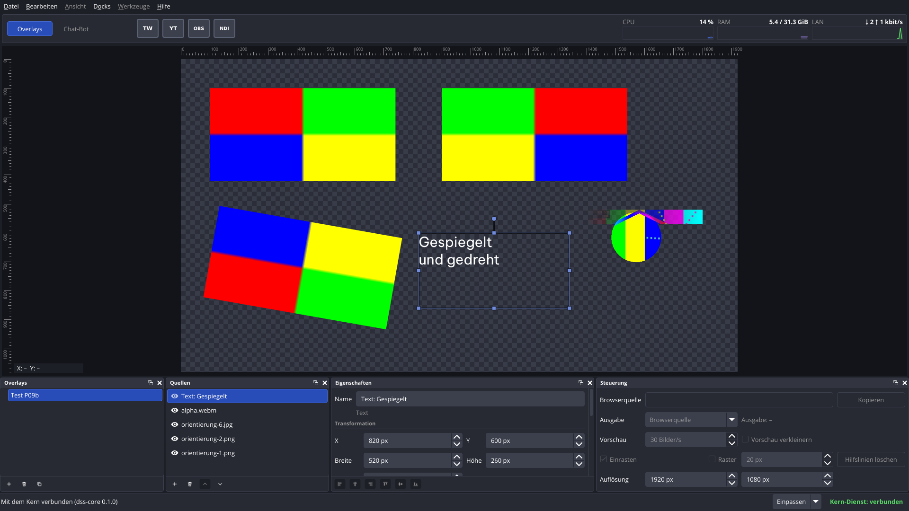
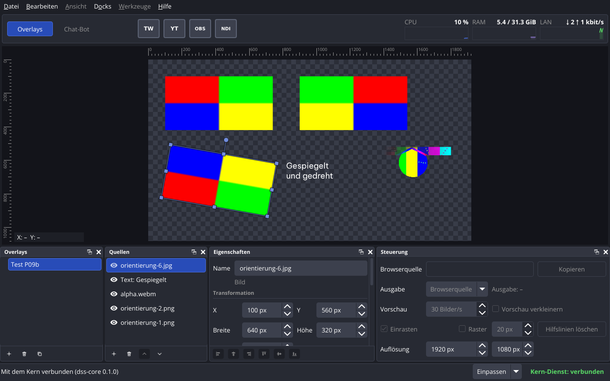
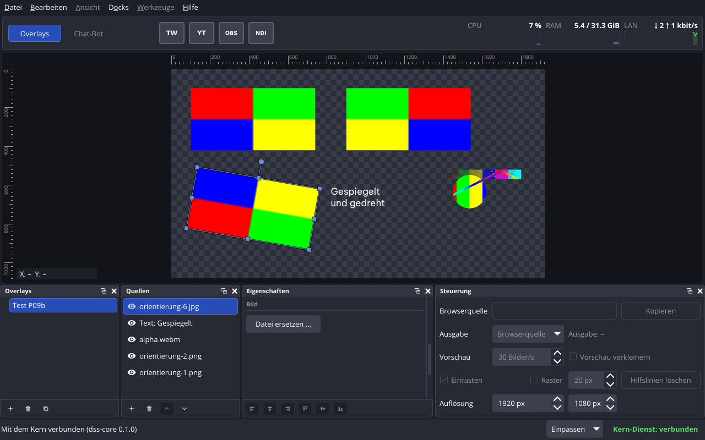

# P09b – Bericht Nacharbeiten Editor

Stand: 2026-11-03. Alle Messwerte stammen vom Studio-PC (Debian 13, Kernel 6.12.113+deb13-amd64, Xfce/xfwm4 unter X11, `DISPLAY=:0.0`, Qt 6.8.2+dfsg-9+deb13u2, FFmpeg 7.1.5-0+deb13u1, NVIDIA 550.163.01). Kein Xvfb und kein offscreen: Fenstertests liefen in der aktiven X11-Sitzung (vor jedem Lauf `loginctl show-session … -p LockedHint` → `LockedHint=no`).

Auftrag: `prompts/P09b-nacharbeiten-editor.md`. Entscheide des Nutzers (2026-11-03): 1 Einrasten beim Drehen mit Umschalttaste in 1°-Schritten, 2 Leistungsanzeige fest 600 Pixel, höchstens ein Drittel der Fensterbreite, 3 Seitenverhältnis an der Ecke nach der Originalgrösse der Datei (Text: Box beim Beginn), 4 Spiegeln durch Ziehen über die Gegenseite, neue Felder «waagrecht/senkrecht gespiegelt», 5 E-25 Transformieren wie OBS (ohne Zuschneiden), 6 E-26 Dock «Eigenschaften» in Bereiche geteilt, 7 EXIF-Ausrichtung im Zeichner des Editors und im Kern.

## Kurzfassung

| Abnahme | Ergebnis |
|---|---|
| Bau ohne Warnungen mit `-Wall -Wextra`, jeder Schalter einzeln abschaltbar | ja: 0 Warnungen im Arbeitsordner (Debug), im frischen Klon und mit jedem der acht Schalter einzeln aus sowie mit den dreien des P07-Stands zusammen aus (nur `dss-core`); neuer Schalter `DSS_APP_TRANSFORM` |
| `ctest --test-dir build`, auch im frischen Klon | 30 von 30 im Arbeitsordner und im frischen Klon (neu: `tst_transform`, `tst_imageorientation`); `tst_medien` und `tst_fensterbearbeiten` 10 von 10 bei `--repeat until-fail:10`. Beim Einzelbau der Commits je ein seltener Fehlschlag in `tst_medien` (Test aus P09, Punkt 66) und in `tst_fensterbearbeiten` (nicht nachgestellt), siehe «Commits» |
| Startprüfung `--runs 20` | 20/20 sauber in allen vier Fällen |
| Dokumente | nachgeführt: `docs/06-overlay-format.md` (Format 3 mit `flip_horizontal`, `flip_vertical`, EXIF), `docs/08-kern-schnittstelle.md` (Version 4 mit `media_sizes` und Spiegeln in `update_source`), `docs/01-festlegungen.md` (zweiter Zeichner muss spiegeln und EXIF beachten), `docs/04-offene-punkte.md` (55 und 58 erledigt, neu 60 bis 66), `docs/07-bauplan.md` (P09b unter «Erledigt») |
| Handtest | offen: 4 Prüfungen (unten) |

**Es wurde kein Paket installiert.** Die EXIF-Testbilder erzeugt ein Python-Skript ohne Zusatzmodule und `ffmpeg` (seit P02 vorhanden).

## Entscheid 1 – Einrasten beim Drehen

- Mit Umschalttaste rundet `rotateGeometry` auf ganze Grad (`kRotateSnapDegrees = 1.0`, `src/common/canvasedit.*`), ohne Umschalttaste Zehntelgrad wie bisher, kein Einrasten.
- OBS rastet mit Shift auf 15° ein und ohne Shift nahe 0°, 45° … und nahe dem Startwinkel (`RotateItem`, `frontend/widgets/OBSBasicPreview.cpp` Zeile 1668). Abweichung nach Entscheid des Nutzers.
- Tests: `tst_canvasedit::rotate` (mit Shift 5,71° → 6°, 90,29° → 90°, ohne Shift Zehntelgrad), `tst_fensterbearbeiten::canvasSelectAndEdit` (Drehgriff mit Shift im Fenster → 90,0°, ohne Shift nicht eingerastet).

## Entscheid 2 – Leistungsanzeige im Kopfbereich

- Rechnung in `dss_common` (`src/common/windowsize.*`): `headerGaugesWidth(Fensterbreite)` = 600, höchstens ein Drittel (abgerundet); `headerGaugeWidth(gesamt, i)` teilt in drei Teile, ein Rest geht an die vorderen, die Summe ist immer die Gesamtbreite.
- Oberfläche: ein eigenes Layout `HeaderRowLayout` (`src/app/headerbar.cpp`) setzt links Modul-Reiter und Verbindungsknöpfe in ihrer eigenen Breite und rechts die drei Anzeigen; dazwischen bleibt Platz leer. Die Breite wird bei jeder Änderung der Grösse im `setGeometry` des Layouts gesetzt, nicht in einem Ereignis-Behandler (Regel 9). Eigenes Layout nach https://doc.qt.io/qt-6.8/layout.html#how-to-write-a-custom-layout-manager.
- Tests: `tst_windowsize::headerGauges` (1920 → 600, 1800 → 600, 1799 → 599, 1280 → 426, 3840 → 600, 0 und negativ → 0, Teilung 142/142/142 bzw. 143/142/142); `tst_fensterbearbeiten::headerGaugesWidth` im echten Fenster bei 1920 und 1280: Summe 600 bzw. 426, lückenlos nebeneinander, rechts bündig, links davon endet der linke Teil.

## Entscheid 3 – Seitenverhältnis an der Ecke

- Der Kern kennt die Originalgrösse jeder Bild- und Videodatei (libavformat/libavcodec wie in P09, Bild mit EXIF-Ausrichtung, siehe Entscheid 7) und schickt sie mit `overlay` und `overlay_changed` im neuen Feld `media_sizes` (Schlüssel = Verweis `media/…`). Er liest jede Datei einmal; die Dateien in `media/` sind nach Inhalt benannt und ändern sich nicht (`OverlayStore::mediaSizes`, Zwischenspeicher je Verweis).
- `resizeGeometry(…, originalSize)` (`src/common/canvasedit.*`) nimmt an den Ecken das Verhältnis der Originalgrösse; ohne (Text, Datei unlesbar, Kern ohne `DSS_MEDIA_SIZE`) das des Kastens beim Beginn des Ziehens. Rechnung wie `ClampAspect` in OBS.
- OBS: `StretchItem` (`OBSBasicPreview.cpp` Zeilen 1582-1666) nimmt `baseSize` = `obs_source_get_width/height` der Quelle, `ClampAspect` (Zeilen 1362-1413) hält dieses Verhältnis.
- Tests: `tst_canvasedit::resizeOriginalAspect`, `originalSizeOfSource`; `tst_protocol` (Hin- und Rückweg von `media_sizes`, ungültige Einträge abgewiesen); `tst_medien::storeUsesFileSize` (4 Dateien, davon eine unlesbar: 4 Lesevorgänge, beim zweiten Abfragen keiner mehr; die unlesbare fehlt in `media_sizes`); `tst_fensterbearbeiten::canvasSelectAndEdit` (`bild1.png` 256x256 im Kasten 400x200, Ecke gezogen → 600x600; mit `DSS_MEDIA_SIZE=OFF` wie bisher 2:1, 800x400; Text 300x100 → 480x160, also 3:1; mit Shift frei).

## Entscheid 4 – Spiegeln

- Neue Felder `flipHorizontal` und `flipVertical` je Quelle (`src/common/overlay.h`), in der Datei `flip_horizontal` und `flip_vertical` (Format 3), in `update_source.changes` (Schnittstelle 4), in `dss-cli` als `quelle-geometrie … [--waagrecht-gespiegelt] [--senkrecht-gespiegelt]` und Spalte «Gespiegelt» (nein, waagrecht, senkrecht, beide). Breite und Höhe bleiben positiv.
- Bedeutung: Gespiegelt wird der Inhalt im Kasten um seine Mitte, danach gedreht (wie CSS `rotate(θ) scale(-1, 1)`); `flipContent` und `flipScale` in `src/common/sourcegeometry.*`. Der Zeichner des Editors setzt `QPainter::scale(-1, 1)` bzw. `(1, -1)` nach der Drehung um die Mitte (`src/app/sourcerenderer.cpp`).
- Ziehen über die Gegenseite (`resizeGeometry`): Der Zeiger wird in den Rahmen der Quelle beim Beginn umgerechnet; liegt er jenseits des Gegengriffs, liegt der Kasten auf der anderen Seite des Gegengriffs und die Richtung wird gegenüber dem Beginn umgeschaltet. Das Seitenverhältnis an der Ecke gilt für die Beträge. OBS: `StretchItem` (Zeilen 1582-1666) lässt die Grösse negativ werden und setzt einen negativen Massstab; `ClampAspect` behält das Vorzeichen jeder Seite. Abweichung: Mindestgrösse 1 Pixel (OBS erlaubt 0).
- Tests: `tst_overlaymodel::flipFields` (Datei hin und zurück, in Format 3 Pflicht und nur `true`/`false`), Format 1 und 2 laden mit «nicht gespiegelt»; `tst_aenderungen` (`flip_*` in `update_source`, falsche Typen abgewiesen); `tst_canvasedit::resizeMirror` (Ecke und Kante über die Gegenseite, auch gedreht und schon gespiegelt); `tst_sourcegeometry::flipContent`; `tst_leinwand::flipped` (Farben der vier Viertel eines gespiegelten Testbildes auf der Leinwand); `tst_medien::cliFlip`; `tst_fensterbearbeiten::canvasSelectAndEdit` (rechte Kante über die linke hinaus → waagrecht gespiegelt, die linke Kante bleibt), `propertySections` (Kästchen im Dock).
- Mit einer Kopie der echten Overlay-Datei geprüft (2026-11-03 13:09): Format 2, Quellen laden, `dss-cli quelle-liste` zeigt «nein»; nach `quelle-geometrie … --waagrecht-gespiegelt` steht in der Datei `format_version` 3, beim Bild `flip_horizontal: true`, beim Text `false`. Die Kopie ist danach gelöscht (sie lag im Scratch-Ordner und enthielt auch `tokens.json`, Regel 12).

### `format_version` 2 → 3

Die neuen Felder sind im neuen Format Pflicht (strenges Lesen wie bisher). Damit vorhandene Dateien weiter laden, liest der Kern die Versionen 1, 2 und 3; bei 1 und 2 gilt «nicht gespiegelt». Geschrieben wird immer 3. Ein älterer Kern (P09) lehnt Format 3 ab, statt die Spiegelung still zu verlieren. Auf dem Studio-PC gibt es eine echte Datei mit Format 2 (`grep -h '"format_version"' ~/.local/share/dons-streaming-studio/overlays/*.json` → `2`, 2026-11-03, nur gelesen).

### Schnittstelle 3 → 4

`overlay` und `overlay_changed` tragen Overlays im Format 3 und das Pflichtfeld `media_sizes`; ein Fenster der Version 3 würde sie als ungültig verwerfen. Dazu `flip_horizontal` und `flip_vertical` in `update_source.changes`. Kern und Fenster prüfen die Version im `hello` wie bisher; eine abweichende Version wird abgelehnt.

## Entscheid 5 – Transformieren (E-25)

- Menü «Bearbeiten» → «Transformieren» und dasselbe Untermenü per Rechtsklick auf eine Quelle der Leinwand oder des Docks «Quellen» (der Rechtsklick wählt die Quelle zuerst). Einträge in der Reihenfolge von OBS: «Transformation kopieren», «Transformation einfügen», «Transformation zurücksetzen» | «90° im Uhrzeigersinn drehen», «90° gegen den Uhrzeigersinn drehen», «180° drehen» | «Waagrecht spiegeln», «Senkrecht spiegeln» | «Auf Leinwand einpassen», «Auf Leinwand strecken», «Zentrieren», «Senkrecht zentrieren», «Waagrecht zentrieren».
- Rechnung in `src/common/transform.*` (`transformGeometry`, `boundingBox`), ohne Qt Gui. Das Fenster schickt das Ergebnis wie jede Änderung der Lage an den Kern (`update_source` mit allen Werten der Transformation).
- Kopierte Transformation (Lage, Grösse, Drehung, Spiegeln) ist Zustand des Fensters (`MainWindow::m_copiedTransform`), nicht des Kerns. Einfügen geht in jede gewählte Quelle, auch eines anderen Overlays. «Einfügen» ist ausgegraut, solange nichts kopiert ist; alle Befehle ausser «Kopieren» sind ausgegraut ohne gewählte Quelle oder ohne Bearbeiten (Schalter `DSS_APP_EDITING`).
- Schalter `DSS_APP_TRANSFORM` (aus: kein Untermenü, kein Rechtsklick-Menü auf der Leinwand, Menü «Bearbeiten» ausgegraut).

### Vergleich mit OBS (Entscheide 3, 4 und 5)

Geprüft im Quellcode von OBS Studio, Commit `65c320b46e1af5c7a555161aea6182cdf7a8c524` (https://github.com/obsproject/obs-studio/tree/65c320b46e1af5c7a555161aea6182cdf7a8c524):

| Befehl | OBS (Datei, Zeilen) | DoNs Streaming Studio |
|---|---|---|
| Menü, Reihenfolge, Trennlinien | `frontend/forms/OBSBasic.ui` Zeilen 774-795; deutsche Texte `frontend/data/locale/de-DE.ini` Zeilen 652-666 | gleiche Reihenfolge; Texte nach dem Auftrag («waagrecht/senkrecht», «Auf Leinwand einpassen», «Zentrieren»); ohne «Transformation bearbeiten …» und «Zuschneiden» |
| Kopieren / Einfügen | `frontend/widgets/OBSBasic_Clipboard.cpp` Zeilen 28-68: `obs_sceneitem_get_info2` / `set_info2` (Lage, Drehung, Massstab, Ausrichtung, Begrenzung), Zuschnitt getrennt | Lage, Grösse in Pixeln, Drehung, Spiegeln. **Abweichung:** Grösse statt Massstab (Punkt 61) |
| Zurücksetzen | `frontend/widgets/OBSBasic_Scenes.cpp` `reset_tr`, Zeilen 952-983: Lage 0/0, Massstab 1, Drehung 0, keine Begrenzung, kein Zuschnitt | Lage 0/0, Originalgrösse, Drehung 0, nicht gespiegelt; Text behält die Grösse (Auftrag) |
| 90° / −90° / 180° drehen | `OBSBasic_SceneItems.cpp` `GetItemBox` 1048-1068, `GetItemTL` 1070, `RotateSelectedSources` 1089-1118, Befehle 1120-1160: Drehung += Winkel, danach die linke obere Ecke des umschliessenden Kastens wieder auf den alten Wert | gleich; Lage auf ganze Pixel gerundet (Punkt 64) |
| Spiegeln | `MultiplySelectedItemScale` 1162-1188, Befehle 1190-1218: Massstab × −1, linke obere Ecke des umschliessenden Kastens bleibt | Feld umschalten; der Kasten bleibt gleich, also auch der umschliessende Kasten |
| Einpassen / Strecken | `CenterAlignSelectedItems` 1220-1251, Befehle 1253-1279: Lage 0/0, Massstab 1 (nicht mehr gespiegelt), Drehung 0, Begrenzung = Leinwand (`OBS_BOUNDS_SCALE_INNER` bzw. `OBS_BOUNDS_STRETCH`), mittig; `libobs/obs-scene.c` `calculate_bounds_data` 446-558 (Massstab und Ausrichtung 466-497), `add_alignment` 325-336 (ganzzahlig halbiert) | gleich, aber als feste Pixel (Punkt 61). Einpassen mit dem Verhältnis der Originalgrösse (Text: Kasten), Abstand ganzzahlig halbiert wie `add_alignment`. Drehung 0 und nicht gespiegelt wie OBS |
| Zentrieren / senkrecht / waagrecht | `CenterSelectedSceneItems` 1281-1366, Befehle 1368-1408: Mitte des umschliessenden Kastens auf die Mitte der Leinwand; «senkrecht» ändert nur y, «waagrecht» nur x | gleich. Die Mitte des umschliessenden Kastens ist die Mitte der Quelle (gedreht wird um die Mitte); die Drehung bleibt. **Abweichung:** OBS beginnt den Kasten der Auswahl rechts und unten bei 0 (eine Quelle ganz links oder oben ausserhalb rechnet dort anders), hier gilt immer der Kasten der Quelle |
| Tastenkürzel | `OBSBasic.ui` Zeilen 1726-1785 | keine (Punkt 60) |
| Mehrere Quellen | alle gewählten | die eine gewählte (Punkt 62) |

Verhalten bei gedrehten Quellen wie OBS: 90°-Drehungen halten die linke obere Ecke des umschliessenden Kastens (nicht die Mitte); Einpassen und Strecken setzen die Drehung auf 0 und heben das Spiegeln auf (Massstab 1); Zentrieren rechnet mit dem umschliessenden Kasten und lässt die Drehung.

- Tests ohne Qt Gui: `tst_transform` (umschliessender Kasten gedreht, 90°/−90°/180° halten die Ecke, auch über 360° hinaus, unter 0° und gespiegelt, viermal 90°, Spiegeln, Zurücksetzen mit und ohne Originalgrösse, Einpassen breit/hoch/gedreht/gespiegelt/Text, Strecken, Zentrieren in allen drei Arten bei gedrehten Quellen und ungeraden Resten, kopierte Transformation vollständig).
- Fenstertest `tst_fensterbearbeiten::transformCommands`: Reihenfolge und Trennlinien des Menüs, ausgegraut ohne Quelle bzw. ohne Kopie, jeder Befehl an einem Bild (Werte aus dem Kern zurückgelesen), Kopieren aus dem Bild und Einfügen in das Video, Einfügen in eine Quelle des zweiten Overlays «Chat Ecke» (800x600) und Zentrieren dort, Rechtsklick auf Leinwand und Liste öffnet das Menü und wählt die Quelle.

## Entscheid 6 – Dock «Eigenschaften» in Bereiche (E-26)

- Oben der Name, darunter der Bereich «Transformation» (X, Y, Breite, Höhe, Drehung, «Waagrecht gespiegelt», «Senkrecht gespiegelt») und der Bereich nach Art («Bild», «Video», «Text») mit den übrigen Eigenschaften (`src/app/docks.cpp`).
- Jeder Bereich: kleiner Titel (`propertySectionTitle`, kleine fette Schrift in der gedämpften Textfarbe) und darunter eine Linie von 1 Pixel in der Rahmenfarbe des Designs (`propertySectionLine`), wie die Trennlinien des Kopfbereichs (`src/app/theme.cpp`).
- Die Kästchen zum Spiegeln schicken eine Änderung wie die übrigen Felder.
- Test: `tst_fensterbearbeiten::propertySections` (Reihenfolge Name → Transformation → Bereich der Art, Titel je Art, Kästchen umschalten → Wert im Kern).

## Entscheid 7 – EXIF-Ausrichtung

- `src/common/imageorientation.*` (ohne Qt Gui): `imageFileOrientation(Pfad)` liest bei JPEG das Segment APP1 mit `Exif\0\0`, bei PNG den Chunk `eXIf` vor dem ersten `IDAT` (PNG Third Edition, Abschnitt 11.3.4.5 und Tabelle 7: `eXIf` danach gilt nicht), dann Tag 0x0112, Typ SHORT, Anzahl 1 (EXIF 2.32, Abschnitt 4.6.4). Grenzen: höchstens 64 Segmente bzw. Chunks, TIFF-Daten höchstens 1 MiB; jeder Lesefehler gibt 1. `orientedSize` (5 bis 8 tauschen Breite und Höhe), `orientedPoint` (Abbildung gespeichert → angezeigt), `orientationSteps` (waagrecht spiegeln, dann im Uhrzeigersinn drehen).
- Kern: Originalgrösse = Grösse nach der Ausrichtung (neue Quellen, `media_sizes`).
- Zeichner des Editors: `QImageReader` mit `setAutoTransform(false)`, dann die Schritte aus `orientationSteps` (`QImage::mirrored`, `QImage::transformed`). Grund: Qt liest die Ausrichtung nur bei JPEG und ignoriert `eXIf` in PNG, der Browser beachtet beides. Geprüft am 2026-11-03 mit einem kleinen Programm im Scratch-Ordner gegen die Testbilder: `QImage(Pfad)` gibt für Ausrichtung 6 32x64 (ohne Drehung); `QImageReader::autoTransform()` ist ohne Einstellung `false`; mit `setAutoTransform(true)` gibt JPEG 64x32, PNG weiter 32x64. Doku: https://doc.qt.io/qt-6.8/qimagereader.html#setAutoTransform.
- Browser: `image-orientation` hat den Anfangswert `from-image` (https://developer.mozilla.org/en-US/docs/Web/CSS/image-orientation). PNG `eXIf` beachtet Chromium seit dem Commit https://chromium.googlesource.com/chromium/src/+/694d9d3a5cc2bc5fa8b36a5dd11b55d437555ca6 (2024-02-05). Ob der CEF in OBS das schon kann, ist nicht geprüft (P10, `docs/01-festlegungen.md`).
- Testbilder `tests/daten/exif/` aus `tests/daten/exif/erzeugen.py` (eigene Testdaten): 64x32 in vier Vierteln (rot, grün, blau, gelb), gespeichert so, dass jede Ausrichtung 1 bis 8 wieder dasselbe Bild 64x32 ergibt; PNG in reinem Python mit `eXIf` (Byte-Reihenfolge MM), JPEG über `ffmpeg -pix_fmt yuvj444p` mit eingesetztem APP1 (II bei geraden, MM bei ungeraden Werten); dazu `ohne-exif.jpg`.
- Tests: `tst_imageorientation` (alle 16 Dateien, ohne EXIF, PNG aus `prototypes/media`, Video, fehlende Datei, `eXIf` nach `IDAT`, kaputte Dateien, TIFF-Sonderfälle, Grösse, Punkte, Schritte = Punkte); `tst_medien::storeUsesFileSize` (libav liest 32x64 bzw. 64x32, Grösse neuer Quellen und `media_sizes` 64x32 bei Ausrichtung 6 JPEG, 5 PNG, 3 JPEG); `tst_leinwand::exifOrientation` (alle 16 Bilder auf der Leinwand, Farbe jedes Viertels richtig, Abweichung JPEG höchstens 12, PNG höchstens 2).

## Ausgeführte Befehle und Ergebnisse

### Bau

```
$ cmake -S . -B <scratch>/schalter/build-<Schalter> -D<Schalter>=OFF && cmake --build <scratch>/schalter/build-<Schalter> -j8 ; grep -c 'warning:' ; ctest --test-dir …
```

| Variante | Zeit (Ende) | rc | Warnungen | gebaut / ctest |
|---|---|---|---|---|
| Arbeitsordner `build/` (Debug, voll, Stand `dbfbb12`) | 2026-11-03 13:29 | 0 | 0 | ctest 30/30 (44,8 s) |
| frischer Klon, Stand `dbfbb12` (`git clone`, `media_vorbereiten` erzeugt `prototypes/media/` neu) | 13:23 | 0 | 0 | ctest 30/30 (63,8 s) |
| `-DDSS_MEDIA_SIZE=OFF` | 13:09 | 0 | 0 | ctest 30/30 |
| `-DDSS_APP_RENDERER=OFF` | 13:11 | 0 | 0 | ctest 29/29 (ohne `tst_leinwand`) |
| `-DDSS_APP_CANVAS_EDIT=OFF` | 13:13 | 0 | 0 | ctest 30/30 |
| `-DDSS_APP_EDITING=OFF` | 13:15 | 0 | 0 | ctest 30/30 |
| `-DDSS_APP_TRANSFORM=OFF` (neu) | 13:17 | 0 | 0 | ctest 30/30 |
| `-DDSS_BUILD_CLI=OFF` | 13:19 | 0 | 0 | ctest 30/30 |
| `-DDSS_BUILD_APP=OFF` | 13:20 | 0 | 0 | ctest 25/25 |
| `-DDSS_BUILD_TESTS=OFF` | 13:22 | 0 | 0 | dss-app, dss-cli, dss-core |
| `-DDSS_BUILD_APP=OFF -DDSS_BUILD_CLI=OFF -DDSS_BUILD_TESTS=OFF` | 13:22 | 0 | 0 | dss-core |

Die Schaltervarianten liefen in frischen Build-Ordnern im Scratch-Ordner nacheinander (Skript `lauf.sh`, Stand `dbfbb12`). Das Skript schrieb seine Zusammenfassung (mit dem Exit-Code jedes Baus) an einen falschen Pfad, sie fehlt deshalb (Exit-Code 2 des Skripts). Die Zahlen oben stammen aus den Protokollen je Variante: `grep -c 'warning:'` und `grep -c 'error'` im Bau-Protokoll (je 0), Zeile «tests passed» im ctest-Protokoll, Zeit = Änderungszeit des Bau-Protokolls. «rc 0» bei den Schaltervarianten ist daraus geschlossen (keine Fehlermeldung, alle Programme der Variante gebaut, ctest lief), nicht als Exit-Code festgehalten.

### Tests

```
$ ctest --test-dir build                                                        (2026-11-03 13:28:23)
30/30 bestanden
$ cd build/tests && XDG_CONFIG_HOME=<scratch>/cfg-zaehl ./<test>               (2026-11-03 13:20 bis 13:30, einzeln für die Fallzahlen)
```

Fallzahlen nach der Zeile `Totals` von QtTest (mit `initTestCase`/`cleanupTestCase`, wo vorhanden):

| Test | Ergebnis | neu oder geändert in P09b |
|---|---|---|
| `tst_transform` (neu, ohne Qt Gui) | 25 bestanden | alle Befehle aus E-25, umschliessender Kasten |
| `tst_imageorientation` (neu, ohne Qt Gui) | 50 bestanden | EXIF in JPEG und PNG, TIFF, Grösse, Punkte, Schritte |
| `tst_canvasedit` (ohne Qt Gui) | 16 bestanden | Einrasten 1°, Seitenverhältnis der Originalgrösse, Spiegeln durch Ziehen |
| `tst_windowsize` (ohne Qt Gui) | 24 bestanden | Breite der Leistungsanzeige |
| `tst_sourcegeometry` (ohne Qt Gui) | 9 bestanden | `flipContent` |
| `tst_overlaymodel` | 70 bestanden | `flipFields`, Format 1 und 2 laden ohne Spiegeln |
| `tst_protocol` | 34 bestanden | Version 4, `media_sizes` hin und zurück, ungültige `media_sizes` |
| `tst_aenderungen` | 58 bestanden | `flip_*` in `update_source` |
| `tst_overlaystore`, `tst_kernverbindung` | 18 bzw. 15 bestanden | angepasst an Format 3 und Version 4 |
| `tst_medien` | 16 bestanden | Grösse mit EXIF, Zwischenspeicher, `dss-cli` mit Spiegeln |
| `tst_leinwand` (X11) | 9 bestanden, 1 übersprungen | gespiegelte Bilder, 16 EXIF-Bilder. Übersprungen wie in P09: Bild speichern ohne `DSS_LEINWAND_BILD` |
| `tst_fensterbearbeiten` (X11) | 15 bestanden, 1 übersprungen | Bereiche im Dock «Eigenschaften», Leistungsanzeige 1920/1280, Ecke mit Originalgrösse, Spiegeln durch Ziehen, Einrasten 1°, alle Befehle «Transformieren» mit Rechtsklick und über zwei Overlays. Übersprungen wie in P08: Fall für `DSS_APP_EDITING=OFF` |

Fehler, die erst die Tests gefunden haben, im jeweiligen Commit behoben: Erwartung 2:1 an der Ecke nach dem Wechsel auf die Originalgrösse (Test angepasst, mit Zweig für `DSS_MEDIA_SIZE=OFF`); die EXIF-Bilder in `tst_leinwand` lagen über dem Prüfpunkt eines anderen Falls (verschoben); ein Testfall «APP1 zu kurz» las über das Ende der Testdaten hinaus (Länge korrigiert); in `transformCommands` sah die Prüfverbindung neue Werte vor dem Fenster (der Test wartet jetzt auf das Overlay des Fensters).

### Startprüfung

```
$ python3 scripts/startpruefung.py --runs 20 --out docs/berichte/P09b-daten   (Beginn 2026-11-03 13:25:09 +0100)
```

| Fall | sauber | Start ms (min / Median / max) | Beenden ms (min / Median / max) |
|---|---|---|---|
| `core-sigterm` | 20/20 | 36.7 / 42.5 / 46.6 | 2.8 / 3.9 / 4.4 |
| `core-sigint` | 20/20 | 38.3 / 44.6 / 47.5 | 3.4 / 3.8 / 4.4 |
| `app-sigterm` | 20/20 | 201.4 / 220.8 / 235.9 | 12.0 / 14.7 / 17.3 |
| `app-kern-sigterm` | 20/20 | 201.1 / 216.6 / 227.0 | 14.1 / 15.8 / 19.1 |

Einzelwerte: `docs/berichte/P09b-daten/startpruefung-*.json` und `.md`. Gegenüber P09 (Median Kern 42.2 bzw. 43.7 ms, Fenster 211.2 bzw. 205.2 ms) etwa gleich; das Fenster startet im Median 10 ms langsamer, die Ursache ist nicht einzeln geprüft.

## Bildschirmfotos

Mit Befehlen erzeugt und angesehen (2026-11-03 13:23 bis 13:25), je eigener Kern, eigene Daten und eigenes `XDG_CONFIG_HOME` (das Skript meldet «keine Einstellungen geschrieben»):

```
sh docs/berichte/P09b-daten/bildschirmfoto.sh docs/berichte/P09b-bilder/kopf-1920.png text 1920x1080
sh docs/berichte/P09b-daten/bildschirmfoto.sh docs/berichte/P09b-bilder/kopf-1280.png bild 1280x800
sh docs/berichte/P09b-daten/bildschirmfoto.sh docs/berichte/P09b-bilder/eigenschaften-text.png text 1280x800 art
sh docs/berichte/P09b-daten/bildschirmfoto.sh docs/berichte/P09b-bilder/eigenschaften-video.png video 1280x800 art
sh docs/berichte/P09b-daten/bildschirmfoto.sh docs/berichte/P09b-bilder/eigenschaften-bild.png bild 1280x800 art
```

Inhalt der Leinwand in allen Bildern (Overlay «Test P09b»): oben links das Testbild ungespiegelt (rot, grün / blau, gelb), oben rechts waagrecht gespiegelt (grün, rot / gelb, blau), unten links das JPEG mit EXIF-Ausrichtung 6 (gespeichert hochkant, angezeigt wie das Testbild) senkrecht gespiegelt und 10° gedreht (blau, gelb / rot, grün), rechts `alpha.webm`, Text in zwei Zeilen.

- `kopf-1920.png`: Fenster 1920x1080, Leistungsanzeige 600 Pixel rechts, dazwischen leer; Text gewählt, Dock «Eigenschaften» oben mit Name und Beginn des Bereichs «Transformation».
- `kopf-1280.png`: Fenster 1280x800, Leistungsanzeige 426 Pixel (ein Drittel); Bild gewählt (gedreht und gespiegelt, Rahmen gedreht).
- `eigenschaften-text.png`, `eigenschaften-video.png`, `eigenschaften-bild.png`: Dock «Eigenschaften» zum Bereich der Art gerollt («Text», «Video», «Bild» mit Titel und Linie).

In der Standardanordnung ist das Dock «Eigenschaften» niedrig; Name, «Transformation» und der Bereich der Art sind deshalb nicht auf einem Bild. Die ganze Reihenfolge prüft `tst_fensterbearbeiten::propertySections`; das Aussehen ist Teil von Prüfung 1 im Handtest.








## Handtest

Grund (Regel 10): Aussehen (Leistungsanzeige, Bereiche im Dock, gespiegelte und gedrehte Bilder, eigene Symbole) und Bedienen mit der Maus (Drehen mit Umschalttaste, Spiegeln durch Ziehen, Rechtsklick-Menü) lassen sich hier nicht als Bedienung durch einen Menschen prüfen. Was oben automatisch geprüft ist (Rechnungen, Breiten in Pixeln, Werte im Kern nach jedem Befehl, Farben der EXIF-Bilder), muss der Nutzer nicht wiederholen.

Der Handtest nutzt **eigene Daten** unter `/tmp/dss-handtest-p09b` mit eigenem Kern, eigener Verbindung und eigenen Fenster-Einstellungen (`docs/berichte/P09b-daten/handtest.sh`). Die echten Daten, `fenster.ini` und `dss-core.service` bleiben unberührt. Die eigenen Symbole aus `~/.config/dons-streaming-studio/symbole/` werden nur gelesen und in die Einstellungen des Handtests kopiert. Jede Prüfung öffnet ein neues Handtest-Fenster in der Standardanordnung und beendet vorher das der vorigen Prüfung. Probelauf am 2026-11-03 13:27 (`start`, `liste`, `aufraeumen`): Daten angelegt, Fenster und Kern liefen, die vier Symbole lagen in der Kopie und erschienen im Kopfbereich (Bildschirmfoto eines zweiten Fensters am selben Kern), danach alles gelöscht.

Inhalt des Overlays «Handtest P09b» (1920x1080), von hinten nach vorne: 1 `viertel.png` (Testbild: links oben rot, rechts oben grün, links unten blau, rechts unten gelb), 2 `viertel-exif6.jpg` (dasselbe Bild, gespeichert hochkant mit EXIF-Ausrichtung 6), 3 `bild3.png` (blaue Scheibe) 15° gedreht, 4 `alpha.webm` mit «Wiederholen», 5 Text «Willkommen im Stream» / «Zweite Zeile» in 96 px. Zweites Overlay «Handtest Zweit» (1280x720) mit `viertel.png` 320x160 bei 50/50. Befehle im Terminal der Xfce-Sitzung.

Hinweis: Das normale Fenster des Nutzers lief von 11:08:59 bis 11:28:31 am `dss-core.service` (`journalctl --user -u dss-core.service`) und wurde dann geschlossen; es wurde nicht berührt. Zurzeit läuft kein Programm von DoNs Streaming Studio (`pgrep -a dss-`, 2026-11-03 13:28).

### Prüfung 1 – Leistungsanzeige, Bereiche im Dock «Eigenschaften», EXIF und Symbole

```
cd ~/DoNs_Streaming_Studio && cmake --build build -j8 && sh docs/berichte/P09b-daten/handtest.sh start
```

Im Dock «Overlays» «Handtest P09b» anklicken. Erwartet:
- Kopfbereich: die eigenen Symbole (Twitch, YouTube, OBS, NDI) auf den Verbindungsknöpfen; rechts CPU, RAM, LAN gleich breit nebeneinander, zusammen etwa ein Drittel der Fensterbreite oder weniger; zwischen den Knöpfen und der Anzeige leerer Platz. Das Fenster breiter und schmaler ziehen: Auf grossen Fenstern bleibt die Anzeige gleich breit (600 Pixel), auf schmalen wird sie schmaler, die Lücke wächst bzw. schrumpft.
- Leinwand: Die beiden Testbilder oben sehen gleich aus (links oben rot, rechts oben grün, links unten blau, rechts unten gelb), auch das rechte, das als JPEG hochkant gespeichert ist.
- Im Dock «Quellen» nacheinander «viertel.png», «alpha.webm» und «Text: Willkommen …» wählen und das Dock «Eigenschaften» grösser ziehen oder rollen. Erwartet: oben der Name; darunter der Bereich «Transformation» (X, Y, Breite, Höhe, Drehung, «Waagrecht gespiegelt», «Senkrecht gespiegelt»); darunter der Bereich «Bild», «Video» bzw. «Text». Jeder Bereich hat einen kleinen Titel und eine feine Linie wie die Trennlinien im Kopfbereich.

### Prüfung 2 – Drehen mit Umschalttaste und Spiegeln durch Ziehen

```
cd ~/DoNs_Streaming_Studio && sh docs/berichte/P09b-daten/handtest.sh start
```

«Handtest P09b» anklicken, auf der Leinwand «viertel.png» (oben links) anklicken. Dann:
1. Den runden Drehgriff mit gedrückter Umschalttaste ziehen. Erwartet: Die Drehung im Dock «Eigenschaften» springt in ganzen Grad (zum Beispiel 12.0, 13.0); ohne Umschalttaste Zehntelgrad. Danach im Dock «Eigenschaften» die Drehung wieder auf 0 setzen (Enter).
2. Ecke unten rechts ziehen, ohne Umschalttaste. Erwartet: Das Bild bleibt im Verhältnis 2:1 der Datei (64x32), auch wenn der Kasten vorher ein anderes Verhältnis hatte (vorher mit Umschalttaste verzerren und dann ohne ziehen). Dasselbe beim Text: Das Verhältnis ist das des Kastens beim Beginn des Ziehens.
3. Den Griff in der Mitte der rechten Kante über die linke Kante hinaus nach links ziehen. Erwartet: Das Bild erscheint links der bisherigen linken Kante waagrecht gespiegelt (grün links oben, rot rechts oben); «Waagrecht gespiegelt» im Dock «Eigenschaften» ist angehakt. Den Griff der unteren Kante über die obere hinaus ziehen → senkrecht gespiegelt. Zurückziehen hebt das Spiegeln wieder auf.
4. Die Kästchen «Waagrecht gespiegelt» und «Senkrecht gespiegelt» im Dock anklicken. Erwartet: Das Bild spiegelt sich sofort, Lage und Grösse bleiben.

Kontrolle:

```
cd ~/DoNs_Streaming_Studio && sh docs/berichte/P09b-daten/handtest.sh liste
```

Erwartet: Zeile 1 `image` «viertel.png» mit ganzen Zahlen und in der Spalte «Gespiegelt» dem Zustand aus dem Dock («nein», «waagrecht», «senkrecht» oder «beide»).

### Prüfung 3 – Transformieren an zwei Quellen und über zwei Overlays

```
cd ~/DoNs_Streaming_Studio && sh docs/berichte/P09b-daten/handtest.sh start
```

«Handtest P09b» anklicken.
1. Rechtsklick auf der Leinwand auf die blaue Scheibe (`bild3.png`, unten links, 15° gedreht). Erwartet: Die Scheibe wird gewählt, es öffnet sich ein Menü mit «Transformieren» und den Einträgen in dieser Reihenfolge: «Transformation kopieren», «Transformation einfügen» (ausgegraut), «Transformation zurücksetzen» | drei Drehungen | zweimal Spiegeln | «Auf Leinwand einpassen», «Auf Leinwand strecken», «Zentrieren», «Senkrecht zentrieren», «Waagrecht zentrieren». Dasselbe Menü per Rechtsklick auf «bild3.png» im Dock «Quellen» und unter «Bearbeiten» → «Transformieren».
2. Nacheinander ausprobieren: «90° im Uhrzeigersinn drehen» (die linke obere Ecke des umschliessenden Kastens bleibt stehen), «Waagrecht spiegeln», «Zentrieren» (mitten auf der Leinwand, Drehung bleibt), «Auf Leinwand einpassen» (so gross wie möglich, Verhältnis der Datei, mittig, Drehung 0, nicht mehr gespiegelt), «Auf Leinwand strecken» (genau die Leinwand), «Transformation zurücksetzen» (links oben, Grösse der Datei, nicht gedreht).
3. Die blaue Scheibe auf etwa die Mitte verschieben, mit dem Drehgriff schräg stellen, dann «Transformation kopieren». Rechtsklick auf `alpha.webm` → «Transformation einfügen». Erwartet: Das Video liegt genau dort, gleich gross und gleich gedreht wie die Scheibe.
4. Im Dock «Overlays» «Handtest Zweit» anklicken, Rechtsklick auf das Testbild → «Transformation einfügen». Erwartet: Das Bild hat Lage, Grösse und Drehung der Scheibe aus dem ersten Overlay (auf der kleineren Leinwand 1280x720 teilweise ausserhalb). Danach «Zentrieren» → mitten auf dieser Leinwand.

Kontrolle:

```
cd ~/DoNs_Streaming_Studio && sh docs/berichte/P09b-daten/handtest.sh liste
```

Erwartet: Zeile 4 `video` von «Handtest P09b» und die Zeile von «Handtest Zweit» mit denselben Werten für Breite, Höhe, Drehung und Gespiegelt wie Zeile 3 `image` (`bild3.png`) zum Zeitpunkt des Kopierens; in «Handtest Zweit» X und Y nach dem Zentrieren.

### Prüfung 4 – Aufräumen

```
cd ~/DoNs_Streaming_Studio && sh docs/berichte/P09b-daten/handtest.sh aufraeumen && ls /tmp/dss-handtest-p09b
```

Erwartet: «Voriges Handtest-Fenster beendet.» (das Fenster schliesst sich), «Handtest-Daten gelöscht.» und danach von `ls` «Datei oder Verzeichnis nicht gefunden». In `~/.config/dons-streaming-studio/symbole/` hat sich nichts geändert.

## Commits

| Commit | Entscheid | einzeln gebaut (0 Warnungen) / ctest |
|---|---|---|
| `58297c7` | 1: Einrasten 1° | 0 / 28 von 28 im zweiten und dritten Lauf; im ersten Lauf `tst_medien` fehlgeschlagen (siehe unten) |
| `d2e3d07` | 2: Leistungsanzeige | 0 / 28 von 28 |
| `4a37c2c` | 4: Spiegeln (Modell, Datei, Schnittstelle, `dss-cli`, Zeichner, Ziehen) | 0 / 28 von 28 im dritten Lauf; im ersten Lauf `tst_fensterbearbeiten`, im zweiten `tst_medien::oneFramePerTick` fehlgeschlagen (siehe unten) |
| `f3f9451` | 3: Seitenverhältnis aus der Originalgrösse | 0 / 28 von 28 |
| `8f4acfa` | 7: EXIF-Ausrichtung | 0 / 29 von 29 |
| `e1da704` | 6: Bereiche im Dock «Eigenschaften» | 0 / 29 von 29 |
| `4ba8c92` | 5: Transformieren | 0 / 30 von 30 |
| `dbfbb12` | 5: Menütexte nach dem Wortlaut des Auftrags | 0 / 30 von 30 (= frischer Klon oben) |
| `665e64c` | Zeilenangaben zu OBS im Kommentar berichtigt (nur Kommentar) | 0 Warnungen im Arbeitsordner |
| (dieser) | Bericht und Dokumente | nur Dokumente, Bilder und Skripte für Bildschirmfoto und Handtest |

Einzeln gebaut im frischen Klon von oben, je `git checkout <commit>`, `cmake --build build -j8`, `ctest --test-dir build` (2026-11-03 13:29 bis 13:39; derselbe Build-Ordner, nacheinander). Entscheid 4 kam vor Entscheid 3, weil das Ziehen über die Gegenseite die Rechnung an der Ecke ändert, die Entscheid 3 danach erweitert.

**Fehlschläge beim Einzelbau (nicht behoben, nicht Teil von P09b):**

- `tst_medien` schlug in 2 von 13 ctest-Läufen im Klon fehl: beim ersten Lauf auf `58297c7` (ohne `--output-on-failure`, welcher Fall, ist nicht bekannt) und beim Wiederholen auf `4a37c2c` (13:50, mit Ausgabe): `TestMedien::oneFramePerTick`, «150 Takte: 50 ohne neues Bild, 50 mit mehr als einem». Player (`src/media/`) und Test sind seit P09 unverändert (`git diff --stat a8733b6..HEAD -- src/media` leer). `alpha.webm` hat Zeitstempel in ganzen Millisekunden (`ffprobe -v error -select_streams v:0 -show_entries packet=pts_time -of csv=p=0 prototypes/media/alpha.webm` → 0.000, 0.033, 0.067, 0.100 …; Zeitbasis 1/1000). Das Muster (jeder dritte Takt ohne, der nächste mit zwei Bildern) passt dazu, dass der Takt knapp vor den gerundeten Zeitpunkten liegt; das ist eine Vermutung, nicht geprüft. Neuer Punkt 66 in `docs/04-offene-punkte.md`.
- `tst_fensterbearbeiten` schlug einmal fehl (erster Lauf auf `4a37c2c`, ohne Ausgabe, Ursache nicht bekannt). Nicht nachgestellt: auf `4a37c2c` danach 6 von 6 Einzelläufen und 2 von 2 ctest-Läufen ohne Fehler in diesem Test, auf dem Endstand 10 von 10 (`ctest -R "tst_medien|tst_fensterbearbeiten" --repeat until-fail:10`, 2026-11-03 13:44 bis 13:48, beide Tests 10 von 10).

## Geänderte und neue Dateien

Neu:
- `src/common/transform.*`, `imageorientation.*`
- `tests/tst_transform.cpp`, `tests/tst_imageorientation.cpp`, `tests/daten/exif/` (`erzeugen.py`, `orientierung-1.jpg` bis `orientierung-8.jpg`, `orientierung-1.png` bis `orientierung-8.png`, `ohne-exif.jpg`)
- `docs/berichte/P09b-bericht.md`, `P09b-bilder/`, `P09b-daten/` (`bildschirmfoto.sh`, `handtest.sh`, Startprüfung)

Geändert:
- `src/common/canvasedit.*`, `overlay.*`, `overlayjson.*`, `overlaystore.*`, `protocol.*`, `sourcegeometry.*`, `windowsize.*`, `coreclient.*`, `CMakeLists.txt`
- `src/core/coreservice.cpp`; `src/cli/main.cpp`
- `src/app/canvaswidget.*`, `docks.*`, `headerbar.cpp`, `mainwindow.*`, `mainwindowedit.cpp`, `sourcerenderer.cpp`, `theme.cpp`, `CMakeLists.txt`
- `tests/CMakeLists.txt`, `tst_aenderungen.cpp`, `tst_canvasedit.cpp`, `tst_fensterbearbeiten.cpp`, `tst_kernverbindung.cpp`, `tst_leinwand.cpp`, `tst_medien.cpp`, `tst_overlaymodel.cpp`, `tst_overlaystore.cpp`, `tst_protocol.cpp`, `tst_sourcegeometry.cpp`, `tst_windowsize.cpp`
- `README.md` (Stand, Schalter `DSS_APP_TRANSFORM`), `docs/00-uebergabe.md`, `docs/01-festlegungen.md`, `docs/04-offene-punkte.md`, `docs/05-quellen.md`, `docs/06-overlay-format.md`, `docs/07-bauplan.md`, `docs/08-kern-schnittstelle.md`

Ausserhalb des Repos: nichts geändert. Alle Prüfläufe mit eigenem Datenordner, eigener Verbindung und eigenem `XDG_CONFIG_HOME`; `~/.config/dons-streaming-studio/fenster.ini`, die Symbole des Nutzers, die echten Daten in `~/.local/share/dons-streaming-studio` (nur gelesen und für die Prüfung von Format 2 kopiert) und `dss-core.service` blieben unberührt.

## Nicht erledigt

- Handtest durch den Nutzer (oben).
- Zweiter Zeichner (Browserquelle) mit Spiegeln und EXIF-Ausrichtung: P10 (`docs/01-festlegungen.md`, «Zeichnen im Editor»).
- Zurückgestellt, bis das Netzwerk besteht: Browserquelle in OBS, NDI, obs-websocket.
- Laut Auftrag nicht Teil: Zuschneiden, Rückgängig (E-22), Einrasten an Kanten und Raster (E-10), alles aus P10.
- Neu in `docs/04-offene-punkte.md`: 60 Tastenkürzel, 61 Einpassen/Strecken als feste Pixel und Einfügen der Pixelgrösse, 62 nur eine Quelle, 63 kein Dialog «Transformation bearbeiten …», 64 Rundung beim 90°-Drehen, 65 Drehung aus Metadaten von Videos, 66 seltener Fehlschlag von `oneFramePerTick` (Zeitstempel in Millisekunden).
- Nicht geprüft: ob der CEF in OBS `eXIf` in PNG beachtet; Drehung aus Metadaten von Videos (Punkt 65).
- Seltener Fehlschlag von `tst_medien::oneFramePerTick` (aus P09, Punkt 66) und einmaliger, nicht nachgestellter Fehlschlag von `tst_fensterbearbeiten` beim Einzelbau (Abschnitt «Commits»).

## Annahmen

- Gespiegelt wird vor dem Drehen um die Mitte (wie der negative Massstab in OBS und `rotate(θ) scale(-1, 1)` in CSS). Spiegeln ändert Lage und Grösse nicht.
- Einpassen und Strecken setzen feste Pixel; Einfügen übernimmt die Grösse in Pixeln (Punkt 61).
- 90°-Drehungen runden die Lage auf ganze Pixel (Regel 11, Punkt 64).
- Zentrieren mit dem umschliessenden Kasten der einen Quelle, auch ausserhalb der Leinwand.
- Zurücksetzen einer Quelle ohne lesbare Datei (oder ohne `DSS_MEDIA_SIZE`): Grösse bleibt wie bei Text.
- Der Kern liest die Originalgrösse einer Datei einmal; die Dateien in `media/` sind nach Inhalt benannt.
- EXIF in JPEG: nur das erste APP1 mit `Exif\0\0`; in PNG nur `eXIf` vor `IDAT`. Andere Formate (WebP, AVIF, HEIC) gibt es im Editor nicht.

## `[OFFEN]`

- Ob der CEF in OBS (Browserquelle) EXIF in PNG beachtet; zu prüfen in P10 mit den Testbildern aus `tests/daten/exif/`.

## Quellen

- Auftrag: `prompts/P09b-nacharbeiten-editor.md`
- OBS Studio, Commit `65c320b46e1af5c7a555161aea6182cdf7a8c524`:
  - https://github.com/obsproject/obs-studio/blob/65c320b46e1af5c7a555161aea6182cdf7a8c524/frontend/widgets/OBSBasic_SceneItems.cpp
  - https://github.com/obsproject/obs-studio/blob/65c320b46e1af5c7a555161aea6182cdf7a8c524/frontend/widgets/OBSBasic_Scenes.cpp
  - https://github.com/obsproject/obs-studio/blob/65c320b46e1af5c7a555161aea6182cdf7a8c524/frontend/widgets/OBSBasic_Clipboard.cpp
  - https://github.com/obsproject/obs-studio/blob/65c320b46e1af5c7a555161aea6182cdf7a8c524/frontend/widgets/OBSBasicPreview.cpp
  - https://github.com/obsproject/obs-studio/blob/65c320b46e1af5c7a555161aea6182cdf7a8c524/frontend/forms/OBSBasic.ui
  - https://github.com/obsproject/obs-studio/blob/65c320b46e1af5c7a555161aea6182cdf7a8c524/frontend/data/locale/de-DE.ini
  - https://github.com/obsproject/obs-studio/blob/65c320b46e1af5c7a555161aea6182cdf7a8c524/libobs/obs-scene.c
- EXIF 2.32 (CIPA DC-008-2019, Abschnitt 4.6.4, Tag Orientation): https://www.cipa.jp/std/documents/e/DC-X008-Translation-2019-E.pdf
- PNG Third Edition, `eXIf` (Abschnitt 11.3.4.5, Tabelle 7): https://www.w3.org/TR/png-3/
- CSS `image-orientation`: https://developer.mozilla.org/en-US/docs/Web/CSS/image-orientation
- Chromium, PNG `eXIf`: https://chromium.googlesource.com/chromium/src/+/694d9d3a5cc2bc5fa8b36a5dd11b55d437555ca6
- Qt 6.8: https://doc.qt.io/qt-6.8/qimagereader.html#setAutoTransform, https://doc.qt.io/qt-6.8/qimage.html#mirrored, https://doc.qt.io/qt-6.8/qimage.html#transformed, https://doc.qt.io/qt-6.8/qpainter.html#scale, https://doc.qt.io/qt-6.8/layout.html#how-to-write-a-custom-layout-manager, https://doc.qt.io/qt-6.8/qwidget.html#contextMenuEvent, https://doc.qt.io/qt-6.8/qmenu.html
- Bericht P09: `docs/berichte/P09-bericht.md`
